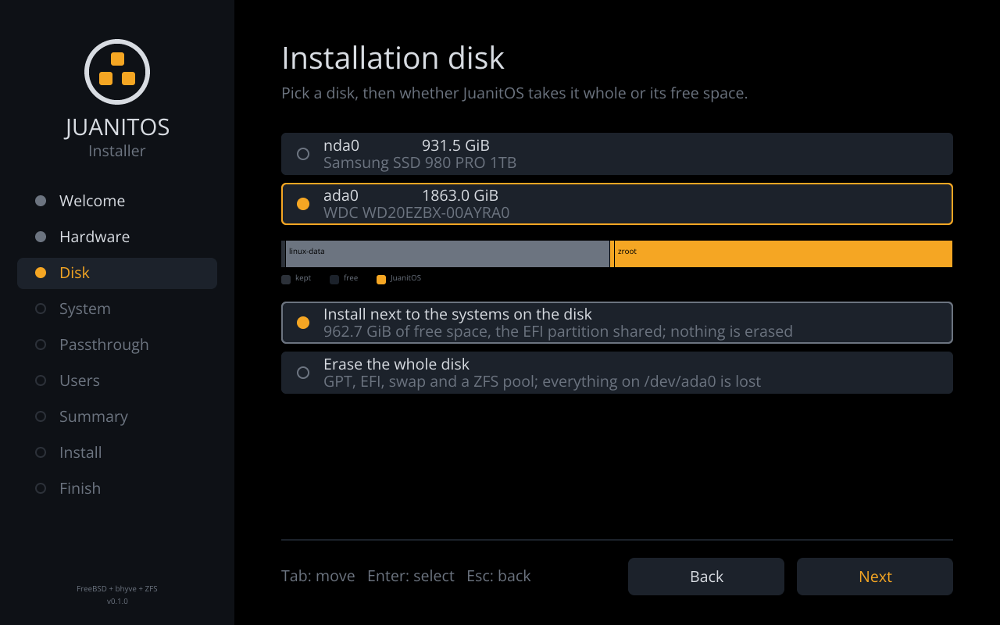

<!-- SPDX-License-Identifier: BSD-3-Clause -->
# JuanitOS

[](https://github.com/juanmaneo/JuanitOS/actions/workflows/ci.yml)
[](#license)

A FreeBSD distribution with bhyve aiming at beeing like QubesOS for FreeBSD

Inspired by TrueNAS Core, Hellfire and HardenedBSD

Uses ZFS and has GPU passthrough to Linux host (mainly for CUDA)

This project is also inspired by Redox and uses Cosmic desktop (https://github.com/pop-os/cosmic-epoch).
The libc is Relibc (https://github.com/redox-os/relibc) instead of traditionnal libc like glibc or musl.

The project also was inspired by ClipOS (https://clip-os.org)

It boots like HaikuOS/BeOS: a logo and a row of icons lighting up, no
scrolling text (see `docs/boot-splash.md`).

## What it is

A FreeBSD host that runs every workload in an isolated bhyve VM ("qube")
backed by a ZFS zvol, with networking funnelled through `sys-net` and a
Rust-unikernel `sys-firewall` (the QubesOS mirage-firewall idea, in Rust),
and a Linux `gpu` qube that owns an NVIDIA card for CUDA. Qubes are
cloned from templates built from the distributions' official images:
ready-made development templates with Docker (Debian 13) and Podman
(FreeBSD 15), and Redox OS as the Relibc-based guest. All management
tooling is written in Rust.

See `docs/` for details:

- `docs/architecture.md` — domains, storage layout, networking, lifecycle
- `docs/bootstrap.md` — LFS-style stages: build on FreeBSD, then on JuanitOS
- `docs/installer.md` — the live/install ISO and the graphical installer
- `docs/templates.md` — guest templates: Debian 13 + Docker, FreeBSD 15 + Podman, Redox
- `docs/inter-qube.md` — the per-qube share, the guest agent, `jos copy`, and
  `jos-copy` requests from a qube under `jos policy` (the qrexec idea)
- `docs/gpu-passthrough.md` — NVIDIA + CUDA inside a Linux qube
- `docs/unikernel-firewall.md` — single-purpose Rust unikernel qubes
- `docs/boot-splash.md` — the graphical boot: pre-loader, kernel splash, daemon
- `docs/relibc-cosmic.md` — where Relibc and COSMIC fit (host vs. guest)
- `docs/security.md` — what is borrowed from QubesOS, CLIP OS and HardenedBSD
- `docs/secure-boot.md` — UEFI Secure Boot with your own keys (`jos secureboot`)
- `docs/hardware-testing.md` — first boot on a new machine and `jos doctor --report`

## Repository layout

```text
crates/juanitos-core   library: config, bhyve, zfs, pci, net, doctor, dom0, release, firewall, share, requests, agent
crates/jos             management CLI
crates/jos-install     installer on the live ISO: graphical wizard (Calamares/Anaconda-style) + text mode
crates/jos-release     builds the binaries, the dom0 tarball and the ISO; QEMU harness
crates/jos-fwnet       no_std firewall engine (ARP, DHCP, NAT, rules), host-tested
crates/jos-fwcfg       config-disk format shared by host and unikernel
crates/jos-firewall    the sys-firewall unikernel (UEFI application)
crates/jos-gfx         no_std boot artwork: icons, font, rasteriser, PNG export
crates/jos-boot        graphical UEFI pre-loader that chain-loads loader.efi
crates/jos-splash      boot splash daemon on the vt(4) framebuffer + rc.d clients
crates/jos-fb          vt(4) framebuffer display, keyboard and mouse decoders (splash, installer, greeter)
crates/jos-greet       login screen: PAM, then the COSMIC session on the same VT
crates/jos-firstboot   first-boot wizard: picks sys-net's card and the app qubes, runs `jos setup`
crates/jos-ventoy-chain no_std reader of Ventoy's chain blob, linked into geom_ventoy.ko
xtask/                 `cargo xtask`: CI pipeline, coverage gate, screenshots
coverage.toml          per-file uncovered-line/function/region allowances (ratcheted down to 0)
deny.toml              cargo-deny policy: advisories, licenses, sources
REUSE.toml             licenses of the files that cannot carry an SPDX tag (binary, generated, vendored)
templates/             cloud-init user-data of the guest template recipes; agent/ the guest agents (share, jos-agentd) and jos-copy
release/juanitos.toml  release profile (FreeBSD version, packages, label)
release/oci            Containerfile: the dom0 tarball as an OCI image (podman on FreeBSD)
freebsd/               loader.conf / sysctl.conf samples, rc.d scripts, pam.d/jos-greet, the C modules
freebsd/grub           jos_efi.mod: GRUB module that boots the kernel on UEFI (Ventoy's direct kernel boot)
freebsd/jos_kmsfb      KMS code the frame buffer drivers share (dumb buffers, one plane, damage, fbdev console)
freebsd/jos_vmsvga     KMS driver for the VMware SVGA II device (VirtualBox VMSVGA, QEMU -vga vmware)
freebsd/jos_efifb      KMS driver on the UEFI frame buffer: the software-rendered fallback for a GPU without a driver
docs/                  design notes (docs/images: rendered previews)
```

## Getting an installable image

The dom0 is a stock FreeBSD release plus packages plus the Rust tools; no
FreeBSD source is compiled. On a FreeBSD host (or the builder VM described
in `docs/bootstrap.md`), as root:

```sh
rustup target add x86_64-unknown-uefi  # for jos-boot.efi and the firewall unikernel
rustup target add x86_64-unknown-none  # for geom_ventoy's chain reader (Ventoy direct kernel boot)
cargo build --release
./target/release/jos-release all      # fetch → bins → rootfs → pack → iso
./target/release/jos-release qemu     # boot release/out/JuanitOS-0.1.0-amd64.iso
```

`bins` also builds the two UEFI applications and wraps the firewall into
`release/out/jos-firewall.img`; both are optional (without them the ESP
boots `loader.efi` directly and `sys-firewall` has to be a FreeBSD qube).
It builds `crates/jos-ventoy-chain` for `x86_64-unknown-none` too, as the
one object `geom_ventoy.ko` links in to find the ISO on a Ventoy stick
when Ventoy's GRUB boots the kernel directly; optional as well.
`iso` builds the two C modules of `freebsd/` as well, `geom_ventoy.ko`
against the release's kernel sources and `jos_efi.mod` against the GRUB
headers named in `release/juanitos.toml` (`[grub]`, fetched and
sha256-checked); both are best effort too (without them the ISO needs a
dd-written stick, or Ventoy's normal mode on firmware where it works).

The ISO boots the same dom0 it installs. `jos-install` runs the `jos doctor`
host checks (bhyve, IOMMU, kernel modules) on the live medium first, so you
learn whether the hardware can run JuanitOS before any disk is touched.
The installed dom0 is also a development machine: it carries this
repository with its crates vendored (`/usr/local/src/juanitos`) and the
toolchain to build it offline (rust, git, gcc, gmake, pkgconf, cmake,
ninja next to the base system's clang and make), plus zellij.

## Installing

Boot the ISO (`dd` it to a USB stick, or drop the file on a Ventoy
stick, with the `.iso.vcfg` built next to it for firmware where only
Ventoy's GRUB2 mode boots, such as Intel Macs: see
`docs/installer.md`): after the splash, a graphical installer takes the screen,
the way QubesOS greets you with Anaconda. It is our own Rust program
drawing straight on the FreeBSD console framebuffer (no X11, no Qt), laid
out like Calamares: steps on the left, the current page on the right.



Welcome → **Keyboard** (the console layout, loaded as you pick it, with
a field to try it in, so the passwords typed later are what their keys
say) → **Hardware** (the `jos doctor` checks: VT-x/AMD-V, IOMMU, bhyve
modules, passthrough devices) → **Disk** (install next to the systems
already there, erase the disk, or partition it by hand) → **Partitions**
(only for the last: delete and keep partitions, add EFI, swap and the
ZFS pool in free space, as in Anaconda) → **System** (hostname, swap,
COSMIC at boot) → **Passthrough** (GPUs and NICs reserved for qubes via
`pptdevs`; the NVIDIA card is proposed for CUDA) → **Users** → **Summary** (nothing is written before you
tick the confirmation here) → **Install** (progress) → **Finish**
(reboot). Erasing makes the disk GPT + EFI + swap + a ZFS pool laid out
like `bsdinstall zfsboot`; on a UEFI disk with an existing Linux, the
installer instead proposes the free space (shrink a partition first),
shares the EFI system partition and adds a firmware boot entry after the
existing ones, erasing nothing. Serial consoles get the same steps as text
prompts, and `jos-install --non-interactive --disk nda0 ...` installs
unattended (`--alongside` for the free-space install). Details and all
screens: `docs/installer.md`. Trying it on a
new machine: `docs/hardware-testing.md` (what each boot icon means, and
`jos doctor --report FILE` to bring back what the hardware looks like).

On the first boot, a graphical wizard (`jos-firstboot`, like QubesOS's
initial setup; `docs/architecture.md`) asks which network card
`sys-net` gets and which app qubes to create, then runs `jos setup`,
which can also be run by hand. `jos setup` does what the QubesOS firstboot does,
and the network only ever goes through the qubes: the dom0 gets no
address and downloads nothing. It builds the `fbsd15-net` template from
the FreeBSD image shipped on the install media (its provisioning boot is
bridged to the network card), creates `sys-net` with that card passed
through (bridged to it on a machine without IOMMU, and for a USB
adapter) and `sys-firewall` (the Rust unikernel), starts them, waits
until `sys-net` reaches the network and builds the other templates
through it. Then it creates the app qubes (`--app work`, `--app
vault:offline`) and, when an NVIDIA card was reserved, the CUDA `gpu`
qube from `debian-13-dev`. The network card is reserved last
(`pptdevs`), so the dom0 keeps it until the reboot that hands it to
`sys-net`. `jos setup` skips what exists, so it can be run again after
a failure; `--nic`, `--uplink`, `--no-passthrough`, `--no-gpu` and
`--dry-run` adjust or preview it.

Once installed, `jos-release all` works on JuanitOS itself (sources and
vendored crates are in `/usr/local/src/juanitos`), which is how the
bootstrap closes: stage 1 on FreeBSD, stage 2 on JuanitOS.

## Quick start (on the FreeBSD host)

```sh
pkg install edk2-bhyve
cargo install --path crates/jos          # or cargo build --release

# load vmm/nmdm/if_bridge and enable IOMMU: see freebsd/loader.conf.sample
jos doctor
jos setup                                # fbsd15-net, sys-net, sys-firewall, gpu (below, by hand)

# The same by hand: templates from the distributions' cloud images (see "Guest templates")
jos init
jos template install fbsd15-net           # FreeBSD 15.1 as sys-net (dnsmasq + pf NAT)
jos template install fbsd15-dev           # FreeBSD 15.1 + Podman
jos template install debian-13-dev        # Debian 13 + Docker

jos create sys-net     --kind net      --os freebsd --template fbsd15-net --pci 5/0/0 --autostart
jos create sys-firewall --kind firewall --os unikernel --netvm sys-net --autostart \
    --kernel /usr/local/share/juanitos/jos-firewall.img   # or --os freebsd --template fbsd15-dev
jos create work        --kind app      --os linux   --template debian-13-dev
jos create gpu         --kind gpu      --os linux   --template debian-13-dev \
    --cpus 8 --memory-mb 16384 --pci 1/0/0 --pci 1/0/1
jos create vault       --kind app      --os freebsd --template fbsd15-dev --netvm none

jos start work
jos console work                         # serial console (nmdm), autologin shell
jos run work docker ps                   # run a command via the agent channel, get its exit status
jos run work --user root -- apt-get update
jos copy work:/home/user/report.pdf jail # qube to qube, lands in jail:/mnt/jos/in/work/
jos copy /root/notes.txt work            # dom0 to qube, lands in work:/mnt/jos/in/dom0/
jos policy add work jail allow           # let work push files to jail by itself...
jos run work jos-copy /tmp/build.log jail   # ...with jos-copy inside the qube
jos requests                             # what the policy left for you to decide
jos ls
```

`jos serve` (started by `rc.d/jos`) answers the qubes' requests according
to the policy, re-reading it as it changes; anything the policy does not
settle waits for `jos requests approve|deny`. `jos run` talks to
`jos-agentd` in the qube over a virtio-console port (no login, no
console), falling back to the serial console for qubes without it
(Redox).

Every command accepts `--dry-run` to print the host commands it would run,
which also makes the CLI usable on a non-FreeBSD development machine.
A dry run never changes the qube definitions: it prints the files it
would write or remove. Set `JOS_CONFIG_DIR` to a scratch directory to
keep dry-run definitions there, so that a series of dry runs
builds on each other without touching `/usr/local/etc`.
On a machine without IOMMU (no NIC passthrough for `sys-net`), or before
`sys-net` exists, `--uplink IFACE` bridges a host interface straight into
a qube. Qube definitions are plain TOML files under
`/usr/local/etc/juanitos/qubes/`, edited while the qube is stopped (that
is how `sys-net` moves from `uplink` to `pci_passthrough` once the NIC is
bound to `ppt(4)`).

## Guest templates

As in QubesOS, software is installed once in a template and app qubes run
copies of it: here a template is a ZFS zvol snapshotted as `@base`, and
every app qube is a `zfs clone` of that snapshot. `jos template install`
builds templates from the distributions' **official cloud images**,
verified against their published SHA-512/SHA-256 lists, and provisions
them on a first boot with cloud-init (Debian) or nuageinit (FreeBSD)
from a NoCloud seed; the recipes are plain `#cloud-config` files in
`templates/`.

Four templates ship today:

| template        | base                       | what for                                        |
|-----------------|----------------------------|-------------------------------------------------|
| `debian-13-dev` | Debian 13 "trixie"         | development with **Docker** Engine, Compose v2, Buildx (Debian packages) |
| `fbsd15-dev`    | FreeBSD 15.1 (ZFS)         | development with **Podman** + Buildah on jails (`ocijail`), ZFS storage, pf NAT, Linux images via Linux emulation |
| `fbsd15-net`    | FreeBSD 15.1 (ZFS)         | **`sys-net`**: DHCP on the physical NIC, dnsmasq DHCP/DNS and pf NAT for `sys-firewall` |
| `redox`         | Redox OS `server` nightly  | the **Relibc** guest: a whole userland on Redox's Rust libc (console-only, see `docs/templates.md`) |

The two development templates come with git, a compiler toolchain and
the usual tools, an unprivileged `user` with password-less `sudo`/`doas`,
autologin on the serial console (`jos console`, reachable from dom0
only), and the guest agents: the share mount that names each clone, and
`jos-agentd`, which runs what `jos run <qube> <command>` sends over the
qube's virtio-console channel (`docs/inter-qube.md`). Redox qubes have
neither: `jos run` types into their console after logging in as Redox's
`user`, and they get NVMe + e1000 devices instead of virtio (Redox's
virtio drivers need the modern transport bhyve lacks).

```sh
jos template recipes
jos template install debian-13-dev
jos create web --kind app --os linux --template debian-13-dev
jos start web && jos console web       # user@web:~$ docker run --rm hello-world

jos template run debian-13-dev         # maintenance boot for updates, then:
jos template snapshot debian-13-dev 2026-10
```

The development recipes were verified on the real images (provisioning,
then Docker and Podman running containers on the next boot); `fbsd15-dev`,
`fbsd15-net` and `redox` also on bhyve itself; details in
`docs/templates.md`.

## Development

Project automation is a Rust program too ([cargo xtask](https://github.com/matklad/cargo-xtask)):

```sh
cargo xtask ci            # security audit, fmt, clippy + clang-tidy, tests + coverage gate, UEFI builds
cargo xtask security-audit  # cargo-audit + cargo-deny (deny.toml) on all three lockfiles
cargo xtask test          # just the tests (workspace + jos-boot's library on the host)
cargo xtask lint          # SPDX tags, clippy -D warnings on every target, clang-tidy on the C sources
cargo xtask fmt --fix     # rustfmt, and clang-format on the C sources
cargo xtask coverage      # lines, functions, regions per file, checked against coverage.toml
cargo xtask coverage --html --ratchet
cargo xtask screenshots   # regenerate docs/images (installer pages, boot card)
cargo xtask ci -- --offline   # arguments after -- go to cargo
```

Coverage uses `cargo-llvm-cov` (`cargo install cargo-llvm-cov`). The
target is 100 % of lines, functions and regions in every file.
`coverage.toml` lists, per file, how many of each may still be uncovered;
a file it does not list (a new one, for instance) must be fully covered.
The counts are exact, with no slack: coverage has to be deterministic, so
tests never depend on timing or on which tools the host has (host
programs are fake ones on `PATH`; the few tests that exercise a real
tool (`tar`, `mkfifo` and mtools, in `jos-release`) fail rather than skip when it
is missing). `--ratchet` lowers the allowances to
what was just measured and drops files that reach zero. The toolchain is
pinned in `rust-toolchain.toml`, because another compiler version counts
regions differently. The same `cargo xtask ci` runs in GitHub Actions
(`.github/workflows/ci.yml`).

The security audit runs first and needs `cargo install --locked
cargo-audit cargo-deny` and network access (both fetch the RustSec
advisory database). It fails on any advisory (vulnerable, unmaintained,
unsound or yanked crate), on a license that is not compatible with
BSD-3-Clause, and on a dependency from anywhere but crates.io; the
policy is `deny.toml`, where an advisory that does not apply is ignored
with its reason.

The C sources (the `jos_bootwatch`, `jos_vmsvga` and `jos_efifb` kernel
modules, the KMS code in `jos_kmsfb`, and the `jos_efi` GRUB module; `freebsd/geom_ventoy` is vendored and left as
upstream has it)
are C23 (`-std=gnu23`) in LLVM style, with braces around every
`if`/`else`/`for`/`while` body (a statement added to an unbraced body is
a classic bug; `--fix` inserts them), `f()` rather than `f(void)`
(the same prototype since C23), the `*` with the type
(`struct jos_vmsvga* sc`; `--fix` moves it) and the constant on the left
of `==` and `!=` (`0 != ret`, `NULL == p`: a mistyped `=` then does not
compile; a custom clang-tidy check, written by hand when it fires):
`.clang-format` is checked by `cargo xtask fmt` and
`.clang-tidy` by `cargo xtask lint`, every finding being an error.
clang-tidy compiles the kernel modules the way `bsd.kmod.mk` does (the
DRM driver with drm-kmod's flags on top) and the GRUB module with its
`compile_flags.txt`, so `lint` fetches the kernel headers of the FreeBSD
release in `release/juanitos.toml` (`src.txz`, verified against its
MANIFEST), drm-kmod's (`[drm_kmod]`) and GRUB's (`[grub]`), both
sha256-checked, once, into `~/.cache/juanitos`. Both tools must be the LLVM major
version in `.clang-version` (what CI installs): another version formats
differently and has other checks.

How the code stays testable on a Linux or macOS laptop:

- all host interaction goes through a `Runner` trait, so the libraries are
  unit-tested with mock command output, and every CLI has `--dry-run`;
- the binaries have end-to-end tests (`crates/*/tests/cli.rs`) that run
  them in dry-run mode, e.g. the README quick start against a temporary
  `JOS_CONFIG_DIR`;
- the installer, the splash and the login screen are pure state machines
  rendered into images; only the thin `vt(4)` layer in `jos-fb` (and the
  greeter's PAM backend) needs FreeBSD;
- the UEFI applications keep their logic in host-testable libraries
  (`jos-gfx`, `jos-fwnet`, `jos-fwcfg`, `jos-boot`'s lib) and boot under
  QEMU + OVMF with `tools/uefi-test.sh`.

Clippy is configured (root `Cargo.toml`) to warn on
`unwrap`/`expect`/`panic`/indexing outside tests: an OS cannot afford a
panic in critical code, so errors are handled and returned instead.

```sh
# Preview the boot card or the installer on any host
cargo run -p jos-splash -- render preview.png --stage network --status "Starting qubes"
cargo run -p jos-install -- --screenshots /tmp/installer
```

Work that needs a FreeBSD userland (building the COSMIC packages, bhyve
experiments with guests) runs in a stock FreeBSD VM under QEMU/KVM:

```sh
tools/fetch-freebsd.sh vm                       # the official 15.1 VM image
tools/dev/freebsd-vm.sh create freebsd 80       # raw disk, serial console on a socket
VM_NESTED=1 tools/dev/freebsd-vm.sh start freebsd
tools/dev/freebsd-vm.sh firstboot freebsd       # installs the ssh key over the serial console
tools/dev/freebsd-vm.sh ssh freebsd uname -a
tools/dev/freebsd-vm.sh ssh freebsd ./cosmic-build.sh all   # tools/dev/cosmic-build.sh, copied over
```

Everything it makes lives under `target/work` (reclaimed by `cargo
clean`). `tools/dev/cosmic-build.sh` builds COSMIC from `pop-os/cosmic-epoch`
and packages it (`docs/relibc-cosmic.md`); `tools/dev/redox-fbuf/`
reproduces the Redox display problem (`docs/templates.md`).

## Status

v0.1, targeting FreeBSD 15.1-RELEASE. Every component has unit tests
with 100 % coverage (lines, functions and regions, enforced in CI by
`coverage.toml`) and a `--dry-run` mode.

### What works, and where it was tried

| Area | Verified on | Details |
|------|-------------|---------|
| Build the ISO from Linux (stage 1) | FreeBSD 15.1 VM under QEMU/KVM, ~10 min | `docs/bootstrap.md` |
| JuanitOS rebuilds itself (stage 2) | installed dom0, ~5 min, same file list | `docs/bootstrap.md` |
| Boot chain: `jos-boot.efi`, kernel splash, `jos-splash` | QEMU + OVMF, real hardware | `docs/boot-splash.md` |
| Graphical installer (keyboard, disks, manual partitions, users) | QEMU, real hardware | `docs/installer.md` |
| COSMIC desktop with the `jos-greet` login screen | QEMU, VirtualBox, real hardware (Intel GPU) | `docs/relibc-cosmic.md` |
| bhyve qubes: FreeBSD 15 + Podman, Debian 13 + Docker, Redox | nested in a QEMU dom0 | `docs/templates.md` |
| Network chain `work` → `sys-firewall` (Rust unikernel) → `sys-net` | nested dom0, `jos firewall` rules enforced | `docs/unikernel-firewall.md` |
| `jos run`, `jos copy`, `jos-copy` with policy and approval | nested dom0, FreeBSD and Debian qubes | `docs/inter-qube.md` |
| NIC passthrough to `sys-net` | nested dom0 with an emulated AMD IOMMU | `docs/gpu-passthrough.md` |
| `jos setup` (first-boot qubes) | nested dom0, no GPU | `docs/architecture.md` |
| dom0 userland as an OCI image (`jos-release oci`) | podman on FreeBSD, nested in QEMU | `docs/installer.md` |
| Secure Boot: signed chain, unsigned images refused | QEMU + Secure Boot OVMF (`jos-release secureboot-test`) | `docs/secure-boot.md` |

### On real hardware

The ISO was installed from Ventoy onto an external disk of a laptop with
an Intel GPU (`i915kms`). It boots from the firmware's boot picker and
from rEFInd, logins work, and COSMIC runs well enough to develop
JuanitOS from JuanitOS (the dom0 ships rust, git, gcc, cmake and
zellij), including COSMIC's tiling mode. The bugs that run found are
fixed: keyboard layout at install, the login screen after a VT switch,
COSMIC's power menu, the shutdown splash, and reusing a partition label
in manual partitioning.

### Not yet done

`docs/hardware-testing.md` is the checklist for hardware runs.

* **Wi-Fi**: untested; a USB Ethernet adapter comes first.
* **Passthrough on real hardware**: the nested run proves the plumbing,
  not IOMMU groups, device resets or GPU option ROMs.
* **`jos setup` on real hardware**.
* **Secure Boot on real hardware**: `jos secureboot enroll` has only run
  against a fake `efivar`.
* **A display for Redox qubes**: blocked by a Redox `pci_types` bug,
  reported upstream (`tools/dev/redox-fbuf/`, `docs/templates.md`).

## License

Licensed under the BSD 3-Clause license ([LICENSE](LICENSE) or
<https://opensource.org/licenses/BSD-3-Clause>), like much of FreeBSD's
ecosystem. The copyright holders are Juanito (Juan Manuel CABA
GONZALEZ-NICOLAS) and the contributors listed in [AUTHORS](AUTHORS).

A few files in the repository are not covered by that license and keep
their own:

* `freebsd/geom_ventoy/`: vendored from Ventoy, BSD-2-Clause (the
  original file headers are kept).
* `crates/jos-gfx/fonts/OpenSans-Regular.ttf`: the Open Sans font, SIL
  Open Font License 1.1, see
  [OFL.txt](crates/jos-gfx/fonts/OFL.txt).
* `freebsd/grub/`: a GRUB module, so GPL-3.0-or-later. Nothing else in
  JuanitOS links against it.
* `tools/dev/cosmic-patches/*.patch`: patches to other projects, under
  the license of the project they patch (GPL-3.0-only for COSMIC, MIT for
  pipewire-rs), named on each patch's first line.

[THIRD_PARTY.md](THIRD_PARTY.md) has the details, the licenses of the
Rust dependencies, and the projects that inspired the design (ideas
only, no code taken).

### Built images

The ISO and the dom0 tarball also ship third-party binaries under their
own licenses: the FreeBSD base system (BSD-2-Clause), FreeBSD packages
(several of them GPL, such as git and gcc) and the COSMIC desktop
(GPL-3.0). Publishing a built ISO therefore means publishing the sources
of the GPL parts it ships; [THIRD_PARTY.md](THIRD_PARTY.md#built-images-iso-dom0-tarball)
says what that takes.

### License headers

Every file names its license with an `SPDX-License-Identifier:` comment
in its first lines (line 2 after a `#!` or `#cloud-config` line). The
files that cannot carry a comment (images, the font, lockfiles, vendored
files kept as upstream has them) are listed in `REUSE.toml`, in the
[REUSE](https://reuse.software) format. `cargo xtask lint` checks
both, and only accepts the licenses `THIRD_PARTY.md` accounts for.
There is no `LICENSES/` directory, so `reuse lint` itself would still
ask for one.

### Contribution

Unless you explicitly state otherwise, any contribution intentionally
submitted for inclusion in JuanitOS by you shall be licensed under the
BSD 3-Clause license as above, without any additional terms or
conditions. Add yourself to [AUTHORS](AUTHORS) in the change that brings
your first contribution.
