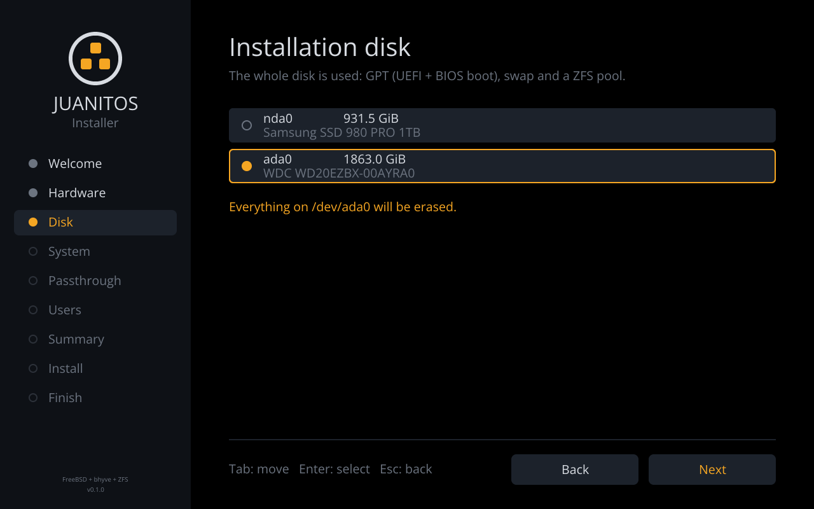

# JuanitOS

A FreeBSD distribution with bhyve aiming at beeing like QubesOS for FreeBSD

Inspired by TrueNAS Core, Hellfire and HardenedBSD

Uses ZFS and has GPU passthrough to Linux host (mainly for CUDA)

This project is also inspired by Redox and uses Cosmic desktop (https://github.com/pop-os/cosmic-epoch).
The libc is Relibc (https://github.com/redox-os/relibc) instead of traditionnal libc like glibc or musl.

The project also was inspired by ClipOS (https://clip-os.org)

It boots like HaikuOS/BeOS: a logo and a row of icons lighting up, no
scrolling text (see `docs/boot-splash.md`).

## What it is

A FreeBSD host that runs every workload in an isolated bhyve VM ("qube")
backed by a ZFS zvol, with networking funnelled through `sys-net` and a
Rust-unikernel `sys-firewall` (the QubesOS mirage-firewall idea, in Rust),
and a Linux `gpu` qube that owns an NVIDIA card for CUDA. Qubes are
cloned from templates built from the distributions' official images:
ready-made development templates with Docker (Debian 13) and Podman
(FreeBSD 15), and Redox OS as the Relibc-based guest. All management
tooling is written in Rust.

See `docs/` for details:

- `docs/architecture.md` — domains, storage layout, networking, lifecycle
- `docs/bootstrap.md` — LFS-style stages: build on FreeBSD, then on JuanitOS
- `docs/installer.md` — the live/install ISO and the graphical installer
- `docs/templates.md` — guest templates: Debian 13 + Docker, FreeBSD 15 + Podman, Redox
- `docs/inter-qube.md` — the per-qube share, the guest agent, `jos copy`, and
  `jos-copy` requests from a qube under `jos policy` (the qrexec idea)
- `docs/gpu-passthrough.md` — NVIDIA + CUDA inside a Linux qube
- `docs/unikernel-firewall.md` — single-purpose Rust unikernel qubes
- `docs/boot-splash.md` — the graphical boot: pre-loader, kernel splash, daemon
- `docs/relibc-cosmic.md` — where Relibc and COSMIC fit (host vs. guest)
- `docs/security.md` — what is borrowed from QubesOS, CLIP OS and HardenedBSD
- `docs/hardware-testing.md` — first boot on a new machine and `jos doctor --report`

## Repository layout

```text
crates/juanitos-core   library: config, bhyve, zfs, pci, net, doctor, dom0, release, firewall, share, requests, agent
crates/jos             management CLI
crates/jos-install     installer on the live ISO: graphical wizard (Calamares/Anaconda-style) + text mode
crates/jos-release     builds the binaries, the dom0 tarball and the ISO; QEMU harness
crates/jos-fwnet       no_std firewall engine (ARP, DHCP, NAT, rules), host-tested
crates/jos-fwcfg       config-disk format shared by host and unikernel
crates/jos-firewall    the sys-firewall unikernel (UEFI application)
crates/jos-gfx         no_std boot artwork: icons, font, rasteriser, PNG export
crates/jos-boot        graphical UEFI pre-loader that chain-loads loader.efi
crates/jos-splash      boot splash daemon on the vt(4) framebuffer + rc.d clients
crates/jos-fb          vt(4) framebuffer display and keyboard decoder (splash, installer, greeter)
crates/jos-greet       login screen: PAM, then the COSMIC session on the same VT
xtask/                 `cargo xtask`: CI pipeline, coverage gate, screenshots
coverage.toml          per-file uncovered-line/function/region allowances (ratcheted down to 0)
deny.toml              cargo-deny policy: advisories, licenses, sources
templates/             cloud-init user-data of the guest template recipes; agent/ the guest agents (share, jos-agentd) and jos-copy
release/juanitos.toml  release profile (FreeBSD version, packages, label)
freebsd/               loader.conf / sysctl.conf samples, rc.d scripts, pam.d/jos-greet
docs/                  design notes (docs/images: rendered previews)
```

## Getting an installable image

The dom0 is a stock FreeBSD release plus packages plus the Rust tools; no
FreeBSD source is compiled. On a FreeBSD host (or the builder VM described
in `docs/bootstrap.md`), as root:

```sh
rustup target add x86_64-unknown-uefi  # for jos-boot.efi and the firewall unikernel
cargo build --release
./target/release/jos-release all      # fetch → bins → rootfs → pack → iso
./target/release/jos-release qemu     # boot release/out/JuanitOS-0.1.0-amd64.iso
```

`bins` also builds the two UEFI applications and wraps the firewall into
`release/out/jos-firewall.img`; both are optional (without them the ESP
boots `loader.efi` directly and `sys-firewall` has to be a FreeBSD qube).

The ISO boots the same dom0 it installs. `jos-install` runs the `jos doctor`
host checks (bhyve, IOMMU, kernel modules) on the live medium first, so you
learn whether the hardware can run JuanitOS before any disk is touched.

## Installing

Boot the ISO (`dd` it to a USB stick, or drop the file on a Ventoy
stick): after the splash, a graphical installer takes the screen,
the way QubesOS greets you with Anaconda. It is our own Rust program
drawing straight on the FreeBSD console framebuffer (no X11, no Qt), laid
out like Calamares: steps on the left, the current page on the right.



Welcome → **Hardware** (the `jos doctor` checks: VT-x/AMD-V, IOMMU, bhyve
modules, passthrough devices) → **Disk** → **System** (hostname, swap,
COSMIC at boot) → **Passthrough** (GPUs and NICs reserved for qubes via
`pptdevs`; the NVIDIA card is proposed for CUDA) → **Users** → **Summary** (nothing is written before you
tick "erase the disk" here) → **Install** (progress) → **Finish**
(reboot). The whole disk becomes GPT + EFI + swap + a ZFS pool laid out
like `bsdinstall zfsboot`. Serial consoles get the same steps as text
prompts, and `jos-install --non-interactive --disk nda0 ...` installs
unattended. Details and all screens: `docs/installer.md`. Trying it on a
new machine: `docs/hardware-testing.md` (what each boot icon means, and
`jos doctor --report FILE` to bring back what the hardware looks like).

After the first boot, `jos setup` does what the QubesOS firstboot does:
it builds the `fbsd15-net` template (downloading through the dom0's own
network card), creates `sys-net` with that card passed through (bridged
to it on a machine without IOMMU), `sys-firewall` (the Rust unikernel)
and, when an NVIDIA card was reserved, the CUDA `gpu` qube from
`debian-13-dev`. The network card is reserved last (`pptdevs`), so the
dom0 keeps it until the reboot that hands it to `sys-net`. `jos setup`
skips what exists, so it can be run again after a failure; `--nic`,
`--uplink`, `--no-gpu` and `--dry-run` adjust or preview it.

Once installed, `jos-release all` works on JuanitOS itself (sources and
vendored crates are in `/usr/local/src/juanitos`), which is how the
bootstrap closes: stage 1 on FreeBSD, stage 2 on JuanitOS.

## Quick start (on the FreeBSD host)

```sh
pkg install edk2-bhyve
cargo install --path crates/jos          # or cargo build --release

# load vmm/nmdm/if_bridge and enable IOMMU: see freebsd/loader.conf.sample
jos doctor
jos setup                                # fbsd15-net, sys-net, sys-firewall, gpu (below, by hand)

# The same by hand: templates from the distributions' cloud images (see "Guest templates")
jos init
jos template install fbsd15-net           # FreeBSD 15.1 as sys-net (dnsmasq + pf NAT)
jos template install fbsd15-dev           # FreeBSD 15.1 + Podman
jos template install debian-13-dev        # Debian 13 + Docker

jos create sys-net     --kind net      --os freebsd --template fbsd15-net --pci 5/0/0 --autostart
jos create sys-firewall --kind firewall --os unikernel --netvm sys-net --autostart \
    --kernel /usr/local/share/juanitos/jos-firewall.img   # or --os freebsd --template fbsd15-dev
jos create work        --kind app      --os linux   --template debian-13-dev
jos create gpu         --kind gpu      --os linux   --template debian-13-dev \
    --cpus 8 --memory-mb 16384 --pci 1/0/0 --pci 1/0/1
jos create vault       --kind app      --os freebsd --template fbsd15-dev --netvm none

jos start work
jos console work                         # serial console (nmdm), autologin shell
jos run work docker ps                   # run a command via the agent channel, get its exit status
jos run work --user root -- apt-get update
jos copy work:/home/user/report.pdf jail # qube to qube, lands in jail:/mnt/jos/in/work/
jos copy /root/notes.txt work            # dom0 to qube, lands in work:/mnt/jos/in/dom0/
jos policy add work jail allow           # let work push files to jail by itself...
jos run work jos-copy /tmp/build.log jail   # ...with jos-copy inside the qube
jos requests                             # what the policy left for you to decide
jos ls
```

`jos serve` (started by `rc.d/jos`) answers the qubes' requests according
to the policy, re-reading it as it changes; anything the policy does not
settle waits for `jos requests approve|deny`. `jos run` talks to
`jos-agentd` in the qube over a virtio-console port (no login, no
console), falling back to the serial console for qubes without it
(Redox).

Every command accepts `--dry-run` to print the host commands it would run,
which also makes the CLI usable on a non-FreeBSD development machine.
A dry run never changes the qube definitions: it prints the files it
would write or remove. Set `JOS_CONFIG_DIR` to a scratch directory to
keep dry-run definitions there, so that a series of dry runs
builds on each other without touching `/usr/local/etc`.
On a machine without IOMMU (no NIC passthrough for `sys-net`), or before
`sys-net` exists, `--uplink IFACE` bridges a host interface straight into
a qube. Qube definitions are plain TOML files under
`/usr/local/etc/juanitos/qubes/`, edited while the qube is stopped (that
is how `sys-net` moves from `uplink` to `pci_passthrough` once the NIC is
bound to `ppt(4)`).

## Guest templates

As in QubesOS, software is installed once in a template and app qubes run
copies of it: here a template is a ZFS zvol snapshotted as `@base`, and
every app qube is a `zfs clone` of that snapshot. `jos template install`
builds templates from the distributions' **official cloud images**,
verified against their published SHA-512/SHA-256 lists, and provisions
them on a first boot with cloud-init (Debian) or nuageinit (FreeBSD)
from a NoCloud seed; the recipes are plain `#cloud-config` files in
`templates/`.

Four templates ship today:

| template        | base                       | what for                                        |
|-----------------|----------------------------|-------------------------------------------------|
| `debian-13-dev` | Debian 13 "trixie"         | development with **Docker** Engine, Compose v2, Buildx (Debian packages) |
| `fbsd15-dev`    | FreeBSD 15.1 (ZFS)         | development with **Podman** + Buildah on jails (`ocijail`), ZFS storage, pf NAT, Linux images via Linux emulation |
| `fbsd15-net`    | FreeBSD 15.1 (ZFS)         | **`sys-net`**: DHCP on the physical NIC, dnsmasq DHCP/DNS and pf NAT for `sys-firewall` |
| `redox`         | Redox OS `server` nightly  | the **Relibc** guest: a whole userland on Redox's Rust libc (console-only, see `docs/templates.md`) |

The two development templates come with git, a compiler toolchain and
the usual tools, an unprivileged `user` with password-less `sudo`/`doas`,
autologin on the serial console (`jos console`, reachable from dom0
only), and the guest agents: the share mount that names each clone, and
`jos-agentd`, which runs what `jos run <qube> <command>` sends over the
qube's virtio-console channel (`docs/inter-qube.md`). Redox qubes have
neither: `jos run` types into their console after logging in as Redox's
`user`, and they get NVMe + e1000 devices instead of virtio (Redox's
virtio drivers need the modern transport bhyve lacks).

```sh
jos template recipes
jos template install debian-13-dev
jos create web --kind app --os linux --template debian-13-dev
jos start web && jos console web       # user@web:~$ docker run --rm hello-world

jos template run debian-13-dev         # maintenance boot for updates, then:
jos template snapshot debian-13-dev 2026-10
```

The development recipes were verified on the real images (provisioning,
then Docker and Podman running containers on the next boot); `fbsd15-dev`,
`fbsd15-net` and `redox` also on bhyve itself; details in
`docs/templates.md`.

## Development

Project automation is a Rust program too ([cargo xtask](https://github.com/matklad/cargo-xtask)):

```sh
cargo xtask ci            # security audit, fmt, clippy (host, FreeBSD, UEFI), tests + coverage gate, UEFI builds
cargo xtask security-audit  # cargo-audit + cargo-deny (deny.toml) on all three lockfiles
cargo xtask test          # just the tests (workspace + jos-boot's library on the host)
cargo xtask lint          # clippy -D warnings on every target
cargo xtask fmt --fix
cargo xtask coverage      # lines, functions, regions per file, checked against coverage.toml
cargo xtask coverage --html --ratchet
cargo xtask screenshots   # regenerate docs/images (installer pages, boot card)
cargo xtask ci -- --offline   # arguments after -- go to cargo
```

Coverage uses `cargo-llvm-cov` (`cargo install cargo-llvm-cov`). The
target is 100 % of lines, functions and regions in every file.
`coverage.toml` lists, per file, how many of each may still be uncovered;
a file it does not list (a new one, for instance) must be fully covered.
The counts are exact, with no slack: coverage has to be deterministic, so
tests never depend on timing or on which tools the host has (host
programs are fake ones on `PATH`). `--ratchet` lowers the allowances to
what was just measured and drops files that reach zero. The toolchain is
pinned in `rust-toolchain.toml`, because another compiler version counts
regions differently. The same `cargo xtask ci` runs in GitHub Actions
(`.github/workflows/ci.yml`).

The security audit runs first and needs `cargo install --locked
cargo-audit cargo-deny` and network access (both fetch the RustSec
advisory database). It fails on any advisory (vulnerable, unmaintained,
unsound or yanked crate), on a license that is not compatible with
BSD-3-Clause, and on a dependency from anywhere but crates.io; the
policy is `deny.toml`, where an advisory that does not apply is ignored
with its reason.

How the code stays testable on a Linux or macOS laptop:

- all host interaction goes through a `Runner` trait, so the libraries are
  unit-tested with mock command output, and every CLI has `--dry-run`;
- the binaries have end-to-end tests (`crates/*/tests/cli.rs`) that run
  them in dry-run mode, e.g. the README quick start against a temporary
  `JOS_CONFIG_DIR`;
- the installer, the splash and the login screen are pure state machines
  rendered into images; only the thin `vt(4)` layer in `jos-fb` (and the
  greeter's PAM backend) needs FreeBSD;
- the UEFI applications keep their logic in host-testable libraries
  (`jos-gfx`, `jos-fwnet`, `jos-fwcfg`, `jos-boot`'s lib) and boot under
  QEMU + OVMF with `tools/uefi-test.sh`.

Clippy is configured (root `Cargo.toml`) to warn on
`unwrap`/`expect`/`panic`/indexing outside tests: an OS cannot afford a
panic in critical code, so errors are handled and returned instead.

```sh
# Preview the boot card or the installer on any host
cargo run -p jos-splash -- render preview.png --stage network --status "Starting qubes"
cargo run -p jos-install -- --screenshots /tmp/installer
```

Work that needs a FreeBSD userland (building the COSMIC packages, bhyve
experiments with guests) runs in a stock FreeBSD VM under QEMU/KVM:

```sh
tools/fetch-freebsd.sh vm                       # the official 15.1 VM image
tools/dev/freebsd-vm.sh create freebsd 80       # raw disk, serial console on a socket
VM_NESTED=1 tools/dev/freebsd-vm.sh start freebsd
tools/dev/freebsd-vm.sh firstboot freebsd       # installs the ssh key over the serial console
tools/dev/freebsd-vm.sh ssh freebsd uname -a
tools/dev/freebsd-vm.sh ssh freebsd ./cosmic-build.sh all   # tools/dev/cosmic-build.sh, copied over
```

Everything it makes lives under `target/work` (reclaimed by `cargo
clean`). `tools/dev/cosmic-build.sh` builds COSMIC from `pop-os/cosmic-epoch`
and packages it (`docs/relibc-cosmic.md`); `tools/dev/redox-fbuf/`
reproduces the Redox display problem (`docs/templates.md`).

## Status

v0.1 scaffold targeting FreeBSD 15.1-RELEASE: configuration, storage
provisioning, bhyve command generation, networking plumbing, per-qube
supervisor (restart on reboot, pidfiles and logs under
`/var/run/juanitos`), host checks, release builder, the graphical
installer (with its passthrough page), the first-boot `jos setup`, guest templates from the distributions' images (Debian 13 +
Docker, FreeBSD 15 + Podman, Redox), the COSMIC desktop built from
source for the dom0 (packaged, with a login screen), `jos run` through a virtio-console
agent channel (serial console as the fallback), the per-qube virtio-9p
share with its guest agent (own hostname per clone), `jos copy` on top
of it and the request broker (`jos-copy` in a qube, `jos policy`, `jos
serve`), the `sys-firewall` unikernel, and the graphical boot chain
(`jos-boot.efi`, kernel splash, `jos-splash`). Everything is verified
with `--dry-run` and unit tests on the development host; on Linux,
`tools/uefi-test.sh` boots the UEFI pieces under QEMU + OVMF:
`jos-boot.efi` draws the card and chain-loads the genuine FreeBSD
`loader.efi`, and `jos-firewall.efi` serves DHCP, answers ARP and NATs a
ping end to end.

Stage 1 is done from a Linux host: `jos-release builder --auto` builds
the ISO inside FreeBSD's official 15.1 VM image under QEMU/KVM (about 10
minutes). That ISO boots on OVMF to the graphical installer, whose
hardware check passes in the VM and which installs onto a virtual disk;
the installed system then boots through the splash to a login. Inside
that installed dom0 (nested virtualisation), real bhyve runs the qubes:
`fbsd15-dev`, `fbsd15-net` and `redox` were installed there from a USB
stick, and the whole network chain works — `work` (clone of
`fbsd15-dev`) gets its address from the Rust `sys-firewall` unikernel,
which takes its lease from `sys-net` (clone of `fbsd15-net`, bridged to
the dom0's NIC), and `fetch https://www.freebsd.org/` succeeds from
`work` while `jos firewall` rules are enforced on the way. `jos run`
answers from FreeBSD's `sh` and Redox's `ion` alike, with exit statuses.
On the same dom0, a clone created after the guest agent was added to
`fbsd15-dev` boots as itself (`hostname` = `test`) with the dom0 share
on `/mnt/jos`, and `jos copy` moved a file and a directory from `work`
into `test`'s inbox and the agent script from dom0 into the qubes. The
`debian-13-dev` template was installed there from Debian's `generic`
image and a clone `web` boots as `web`, takes its address from
`sys-firewall`, reaches the Internet, runs Docker, and mounts the share.
With `jos serve` running, `jos-copy` inside `work`, `test` and `web`
moved files to each other as the policy allowed, was refused where it
said `deny`, and waited for `jos requests approve` where it said
nothing. NIC passthrough was exercised in the same nest: `jos-release
qemu --iommu` gives the dom0 an emulated AMD-Vi (the laptop is a Ryzen)
and a second NIC; bound to `ppt(4)` and handed to `sys-net` with `--pci`,
it shows up as `em0` in the qube, takes a DHCP lease, and `work` reaches
the Internet through `sys-firewall` → `sys-net` → that NIC
(`docs/gpu-passthrough.md`; it also found that AMD hosts need
`hw.vmm.amdvi.enable=1`, which the installer and `jos doctor` now cover).
The agent channel was brought up there as well: `work` and `web` answer
`jos run` through `jos-agentd` a second after they boot, in a tenth of a
second per command, 2 MB of output included, and `jos copy` and
`jos-copy` ride on it. The channel's second port is the qube's doorbell:
`jos-copy` rings it and `jos serve` answers at once instead of on its
next poll (0.4 s end to end with the poll set to 60 s; both templates
updated). The test suite reaches 97.0% of lines, 96.9% of functions and
95.5% of regions, gated per file in CI on the way to 100 % (see
`coverage.toml` for what each file may still leave uncovered).

`jos setup` was then run for real on that dom0 (`--nic` on the
emulated-IOMMU NIC, no GPU): it built `fbsd15-net`, `sys-net` and
`sys-firewall` and started them. The bugs it exposed are fixed:
two supervisors racing to create the same bridge, qubes asking for more
vCPUs than `vmm` allows (now capped at `hw.vmm.maxcpu` with a note),
FreeBSD's `nuageinit` dropping the agent files (its `write_files` stops
at the first missing directory), dry runs writing qube files outside
`JOS_CONFIG_DIR`, and the firmware watchdog resetting `sys-firewall`
every five minutes. On top of it `fbsd15-dev` and a clone `work` were
installed; `work` reaches the Internet through `sys-firewall` →
`sys-net`, runs Podman, takes `jos copy` from dom0, and `jos stop
--all` powers the agents' qubes off through them, tier by tier.

Stage 2 is done too: the stage-1 ISO was installed headless (`qemu -vga
none`, text installer on the serial port) and the installed JuanitOS
rebuilt itself with `jos-release all` in 5.5 minutes, producing an ISO
stamped `built_on = "juanitos"`, `stage = 2` that boots to the installer.
The stage-1 and stage-2 dom0 tarballs have the same 128,568 entries and
differ only in the JuanitOS binaries, `release.toml` and `pkg`'s
bookkeeping (`docs/bootstrap.md` has the comparison and what it
uncovered). It was repeated on the nested dom0 with the events-port
sources, qubes running alongside: 4 min 49 s, `stage = 2`, the stage-1
file list plus the 13 new source files, after fixing a source copy that
had shipped that dom0's UEFI build output and a dangling `vendor` link.

COSMIC is built from source for the dom0, since FreeBSD has no packages
for it: `tools/dev/cosmic-build.sh` compiles `pop-os/cosmic-epoch`
(`epoch-1.10.0`) in the FreeBSD build VM with the systemd/logind
features off and a handful of portability patches
(`tools/dev/cosmic-patches/`: Linux-only abstract sockets, pidfd, bluez,
the stale BSD paths in libcosmic's iced fork, FreeBSD's renamed
`pw_init`), and packages every component for `pkg`. The compositor,
session, panel, applets, launcher, settings, terminal, files, editor and
the rest install into the dom0 root from that repository, which the
installed system keeps; `jos-greet`, a Rust login screen on the same
framebuffer stack as the splash and the installer, authenticates with
PAM on `ttyv8` and starts the session there, and the installer picks the `drm-kmod` driver for the GPU it finds
(`docs/relibc-cosmic.md`). The compositor starts on FreeBSD up to the
point where it needs a seat and a KMS device; neither QEMU nor bhyve
gives a FreeBSD guest one, so the first COSMIC session has to be on real
hardware.

The Redox display problem was traced with an instrumented bhyve: Redox's
`pcid` sizes PCI BARs through `pci_types` without disabling memory
decoding first (every other OS, and the PCI specification, do), so the
32 MiB framebuffer BAR of bhyve's `fbuf` transiently decodes over the
HPET and bhyve asserts. It is a Redox/`pci_types` bug; the reproducer,
the trace and the upstream report are in `tools/dev/redox-fbuf/`
(`docs/templates.md`).

Not yet done (`docs/hardware-testing.md` is the checklist for the
hardware runs): passthrough on real hardware (the nested run above proves
the plumbing, not IOMMU groups, device resets or GPU option ROMs; the
Intel vIOMMU recipe of `jos-release qemu --iommu` follows the vmm source
but has not been booted), a display for Redox qubes (until `pci_types`
is fixed upstream), a COSMIC session on real hardware (the packages
install; the desktop has not been seen running yet), and `jos setup` on
real hardware (the nested run above covers it without a GPU).

## License

JuanitOS is under the BSD 3-Clause license (`LICENSE`), like much of
FreeBSD's ecosystem and compatible with every project it draws on.
`THIRD_PARTY.md` lists the vendored code (`freebsd/geom_ventoy`,
BSD-2-Clause), the Rust dependencies' licenses, the projects that
inspired the design (ideas only, no code taken), and what publishing a
built ISO requires (sources for the GPL-3.0 COSMIC packages it ships).
`AUTHORS` names the copyright holders: Juanito (Juan Manuel CABA
GONZALEZ-NICOLAS) and the contributors.
