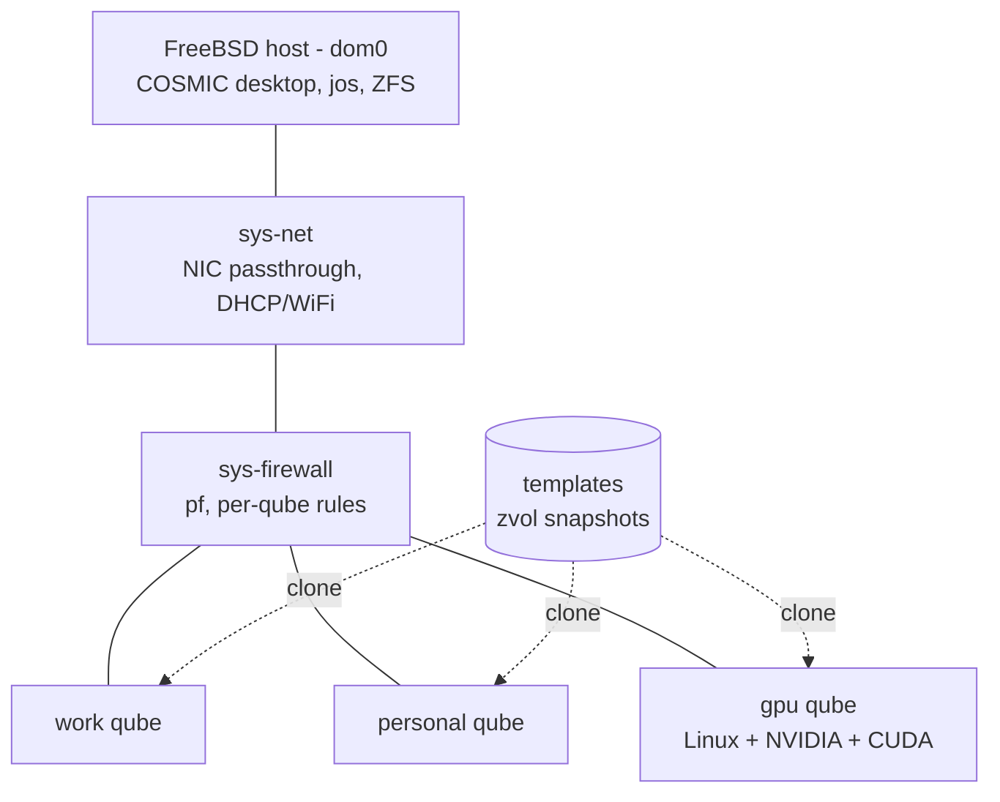
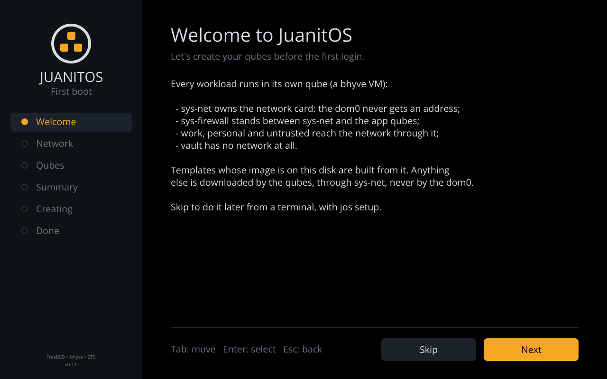
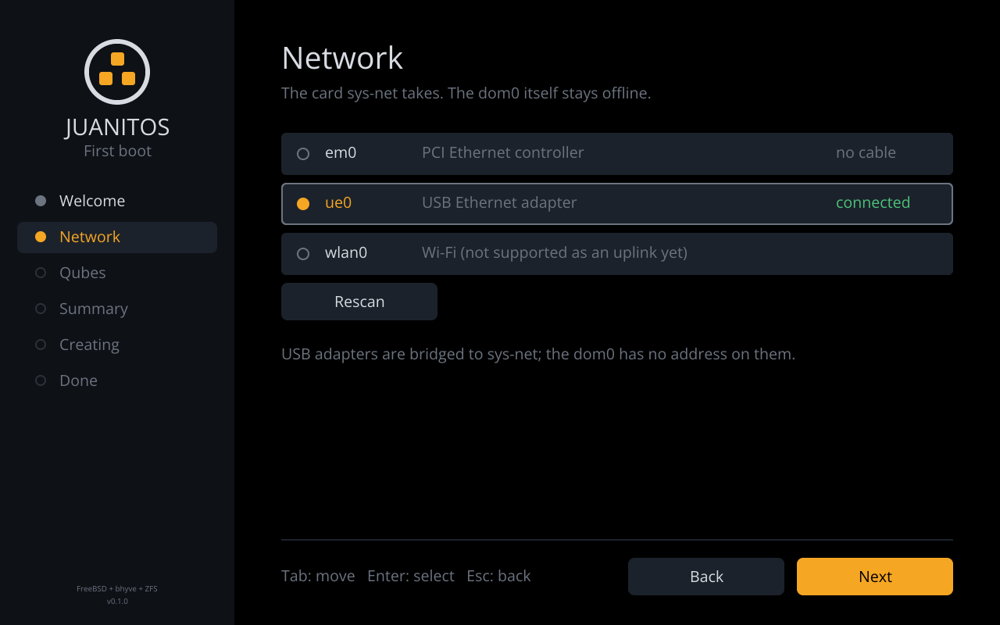
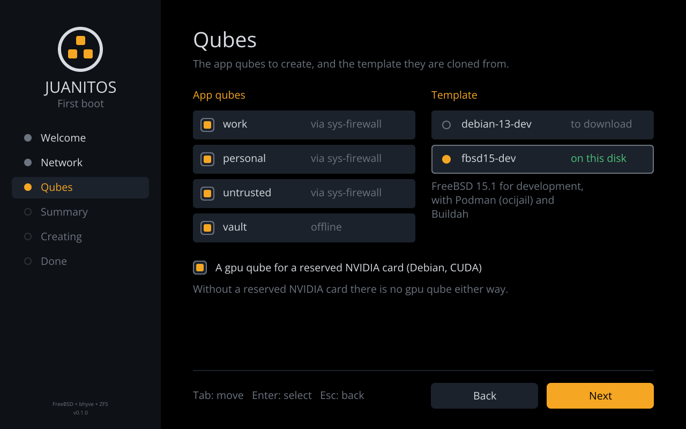
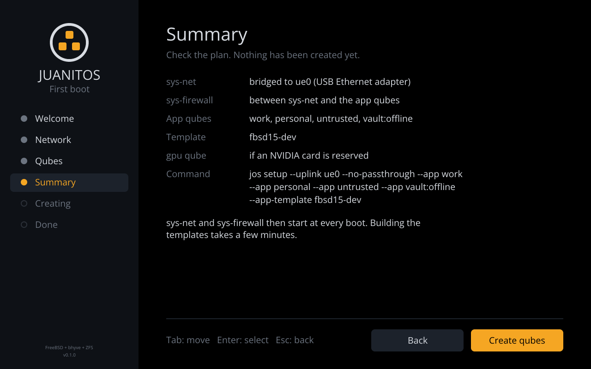
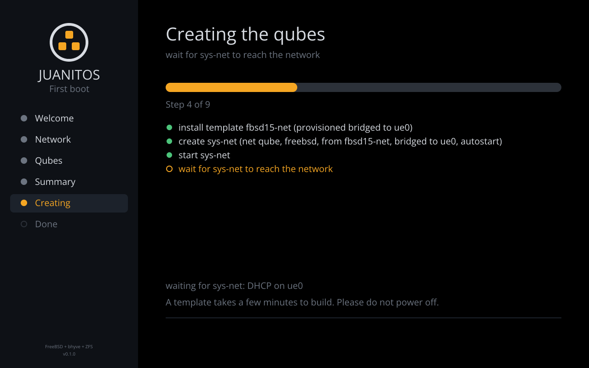
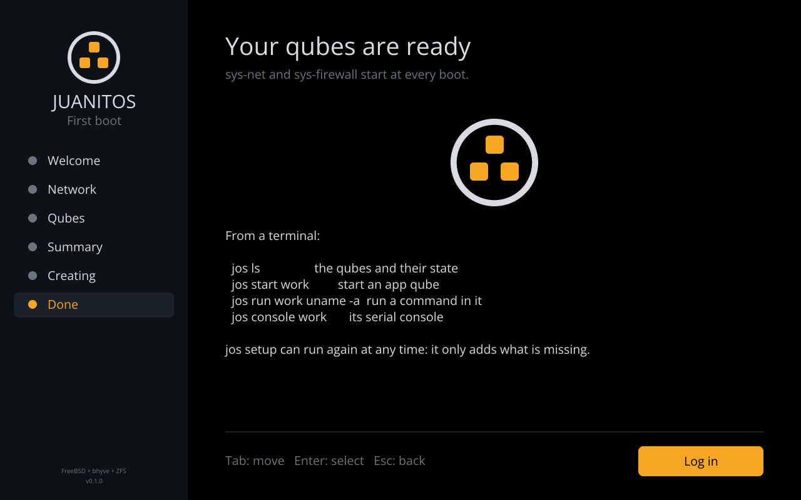

<!-- SPDX-License-Identifier: BSD-3-Clause -->
# JuanitOS architecture

JuanitOS is a FreeBSD host that runs every workload inside a bhyve virtual
machine, following the QubesOS security model. The host plays the role of
Qubes' *dom0*: it owns the hardware, ZFS storage and the COSMIC desktop, and
it should never touch untrusted data directly.



## Domains

| Domain         | Kind       | OS            | Role                                                                 |
|----------------|------------|---------------|----------------------------------------------------------------------|
| host (dom0)    | —          | FreeBSD       | bhyve, ZFS, `jos`, COSMIC. No network of its own beyond management.  |
| `sys-net`      | `net`      | FreeBSD       | Owns the physical NIC(s) via `ppt`. Does DHCP/WiFi. Untrusted.       |
| `sys-firewall` | `firewall` | unikernel     | Rust unikernel (or FreeBSD + `pf`) between app qubes and `sys-net`. See `unikernel-firewall.md`. |
| app qubes      | `app`      | FreeBSD/Linux | Cloned from templates. Only talk to their NetVM.                     |
| `gpu`          | `gpu`      | Linux         | NVIDIA GPU passed through for CUDA. Linux because of driver support. |
| templates      | `template` | FreeBSD/Linux | Golden images. Never started directly; cloned via ZFS snapshots.     |

## Storage

Every qube's disk is a sparse ZFS zvol (unikernel qubes are the exception:
they boot from a read-only image and own no dataset):

```text
zroot/juanitos
zroot/juanitos/templates/<name>      template zvol, snapshots @base, @...
zroot/juanitos/qubes/<name>          clone of a template snapshot, or empty zvol
```

`jos create --template X` clones the newest snapshot of `templates/X`
(creating `@base` if the template has never been snapshotted). Updating a
template and running `jos template snapshot X` makes future clones pick up
the change; existing clones keep their origin.

Zvols are created with `volmode=dev` so GEOM never tastes guest partition
tables on the host.

Besides its zvol, every FreeBSD or Linux qube has a *share*: a dom0
directory `/var/db/juanitos/share/<name>` (`share_dir` in `jos.toml`)
exported into the guest over virtio-9p (guest slot 28, mount tag `jos`).
It carries the qube's name, which the guest agent in the templates turns
into the hostname, the inbox/outbox of `jos copy`, and the request
directory `jos-copy` uses to ask dom0 for a transfer, answered by
`jos serve` under `jos policy`. See `docs/inter-qube.md`.

## Networking

- One bridge per network-providing qube: `br-<netvm>`.
- One *upstream* tap per qube: `tap-<qube>`, added to its NetVM's bridge
  (guest slot 3).
- Net-providing qubes (`net`, `firewall`) additionally get a *downstream*
  tap `tapd-<qube>` on their own bridge `br-<qube>` (guest slot 4); that is
  where their clients plug in.
- `sys-net` has no upstream tap; it gets the physical NIC via passthrough
  (`--pci B/S/F`, the device bound to `ppt(4)` through `pptdevs`) and
  offers `br-sys-net` to `sys-firewall`. Inside, the `fbsd15-net`
  template runs DHCP on the NIC and dnsmasq + pf NAT on `10.138.0.0/24`
  towards the bridge (`docs/templates.md`). Verified end to end in a
  nested dom0 with an emulated IOMMU (`docs/gpu-passthrough.md`).
- `sys-firewall` plugs into `br-sys-net` and offers `br-sys-firewall` to
  app qubes.
- A qube with `uplink = "<iface>"` (`jos create --uplink em0`) gets its
  upstream tap on a bridge `bru-<qube>` shared with that host interface
  instead of a NetVM's bridge. That is how `sys-net` reaches the world on
  a machine without IOMMU (no NIC passthrough), and how a template is
  provisioned before any NetVM exists (`jos template install --uplink`).
  Less isolating than passthrough: the NIC driver runs in dom0.
- The host never enables IP forwarding; all routing happens inside VMs.

Interface names are truncated to FreeBSD's 15-character limit.

## First boot: `jos setup`

The installer leaves a dom0 with no qubes. `jos setup`
(`crates/juanitos-core/src/setup.rs`) creates the system qubes, the
way the QubesOS firstboot does after Anaconda:

1. The templates the system qubes clone from (`fbsd15-net`, plus
   `debian-13-dev` for `gpu`) are built over the dom0's own uplink (the
   interface of its default route, or `--uplink`), since no NetVM exists
   yet.
2. `sys-net` gets the network card behind that uplink (or `--nic B/S/F`,
   or one already bound to `ppt`) passed through. Without IOMMU it is
   bridged to the uplink instead.
3. `sys-firewall` is the Rust unikernel when
   `/usr/local/share/juanitos/jos-firewall.img` is installed, else a
   FreeBSD qube cloned from `fbsd15-net`. Both start at boot.
4. `gpu` gets the NVIDIA card the installer reserved, with every
   function of its slot. Without such a card there is no `gpu` qube.
5. Last, the system qubes' devices the dom0 still drives are added to
   `pptdevs` in `/boot/loader.conf`. The dom0 keeps its network card
   until the reboot that hands it to `sys-net`.

The plan is a pure function of the host (PCI devices, uplink, IOMMU,
`pptdevs`) and of the qubes already defined: whatever exists is skipped,
so `jos setup` resumes after a failure and is harmless once done.
No qube gets more vCPUs than the host's `vmm` allows (`hw.vmm.maxcpu`):
defaults are lowered with a note, an explicit `--gpu-cpus` that is too
large fails the plan. `--dry-run` prints the plan, the host commands
and the qube files it would write, and writes none of them. A dom0 whose only
network card was reserved at install time has nothing to download
through, so the templates have to come from local images
(`jos template install --image --checksums`) before `jos setup`.

### The first-boot wizard: `jos-firstboot`

On the first boot of an installed system `rc.d/jos-firstboot` runs
`jos-firstboot` (`crates/jos-firstboot`) before the login screen, on the
same terminal (`ttyv8`, VT 9), the way QubesOS's initial setup follows
Anaconda. It is a front end to `jos setup`, drawn like the installer:

1. **Network**: the cards `ifconfig -a` lists (USB adapters' drivers are
   loaded first; Rescan after plugging one in), with their link state.
   The one picked becomes `--uplink`. A PCI card on a machine with IOMMU
   is passed through to `sys-net` unless the box is unticked
   (`--no-passthrough`); everything else is bridged. Wi-Fi is listed but
   cannot be the uplink yet. The dom0 never gets an address and never
   runs `dhclient`: only `sys-net` talks to the network.
2. **Qubes**: the app qubes to create (`work`, `personal`, `untrusted`,
   and `vault` offline; `--app NAME[:offline]`), the template they clone
   (`--app-template`, `fbsd15-dev` by default, whose image is on the
   media) and whether a reserved NVIDIA card gets a `gpu` qube.
3. **Summary**: the plan in words, and the exact `jos setup` command.
4. **Creating**: `jos setup` runs as a child process; its `==> [i/n]`
   steps drive the progress bar, the whole output goes to
   `/var/log/jos-firstboot.log`.
5. **Done**: Log in (or Reboot, when `jos setup` reserved devices for
   passthrough). A failure shows the last lines of `jos setup`'s errors,
   with Retry, or Later (the wizard comes back at the next boot).

Finishing or skipping it writes `/var/db/juanitos/firstboot.done`;
after that the boot goes straight to the login screen. `jos-firstboot run
--force` (as root, from a text console) shows it again, `--dry-run`
passes `--dry-run` to `jos setup` and writes no marker, and
`jos-firstboot screenshots DIR` renders the pages on any host.

| | |
|---|---|
|  |  |
|  |  |
|  |  |

## VM lifecycle

`jos start <name>` spawns a detached `jos supervise <name>` (own process
group, stdout/stderr appended to `<run_dir>/<name>.log`). The supervisor
(`crates/juanitos-core/src/supervisor.rs`) writes `<run_dir>/<name>.pid`
and loops:

1. Resolve the NetVM (explicit `netvm`, else `default_netvm`, none for `net`).
2. `ifconfig` the bridge(s) and tap(s) into existence.
3. Run `bhyve` with the guest PCI layout documented in
   `crates/juanitos-core/src/bhyve.rs` (virtio disk and NICs; NVMe and
   e1000 for Redox guests). UEFI boot uses the `edk2-bhyve` bootrom; the
   serial console is an `nmdm` pair reachable via `jos console <name>`.
   `jos run <name> <command>` runs a command in the qube and returns its
   output and exit status: through the agent channel, a virtio-console
   port served by `jos-agentd` in FreeBSD and Linux guests
   (`crates/juanitos-core/src/agent.rs`), or typed into the serial
   console when there is no agent (`console.rs`: Redox, or `--console`).
   The same device carries the qube's `events` port, the one direction a
   guest may initiate: a line on it wakes `jos serve` (`events.rs`).
   The qube's share is created (or refreshed) and the stale agent
   sockets removed just before `bhyve` starts.
4. On exit, `bhyvectl --destroy` releases the VM slot. bhyve's exit code
   says why the guest left: `0` reset → boot again, `1` poweroff / `2` halt
   → finish, `3` triple fault → finish (reported), anything else → error.
5. When the loop ends, taps and the pidfile are removed.

`jos stop` asks a FreeBSD or Linux guest to shut down through its agent
(`shutdown -p now` or `poweroff`, as root), waits up to `--timeout`
seconds (60) for the VM to go, then falls back to
`bhyvectl --force-poweroff`; guests without an agent (unikernel, Redox),
or whose agent does not answer, and `jos stop --force`, are forced off at
once (bhyve has no `bhyvectl` verb for an ACPI power button). Either way
the supervisor observes a poweroff and exits on its own. `jos stop --all`
stops every running qube in tiers, each before the NetVM it depends on:
app qubes, then firewalls, then `sys-net`, the qubes of a tier together.
`jos kill` additionally destroys the VM,
sends `SIGTERM` to a still-living supervisor and tears down the taps.
`jos ls` reports `running` (vmm device present), `booting` (supervisor pid
but no VM yet) or `stopped`. `jos start --foreground` / `jos supervise`
run the loop in the current terminal, which is also what `--dry-run` does.

The rc script (`freebsd/rc.d/jos`) calls `jos autostart`, which starts one
supervisor per `autostart = true` qube and returns immediately; on
shutdown it runs `jos stop --all --timeout 20` (`jos_stop_timeout`; three
tiers of 20 seconds leave room within rc's default `rcshutdown_timeout`
of 90, unless agents hang without answering), then kills every
qube with a pidfile and anything left in `/dev/vmm`.

## Trust boundaries

- Host ↔ guest: bhyve + IOMMU. Passthrough devices must be isolated in their
  own IOMMU group and bound to `ppt(4)` at boot (`pptdevs`).
- Guest ↔ guest: only via the NetVM/FirewallVM chain. Shares are strictly
  per qube; files move between qubes only when dom0 moves them (`jos
  copy`, or a `jos-copy` request the policy allows; `docs/inter-qube.md`),
  never through a filesystem two qubes see.
- Host hardening: see `freebsd/sysctl.conf.sample` for HardenedBSD-style
  knobs. Running the host on HardenedBSD itself is supported but untested.
- The reasoning behind all of this, and what is borrowed from QubesOS,
  CLIP OS and HardenedBSD respectively, is in `docs/security.md`.

## Tooling

All management tooling is Rust:

- `juanitos-core`: platform-agnostic library (builds on Windows/macOS/Linux
  for development; only *runs* usefully on FreeBSD).
- `jos`: clap CLI. `--dry-run` prints every host command instead of
  executing it, which is how the project is exercised off-host.
