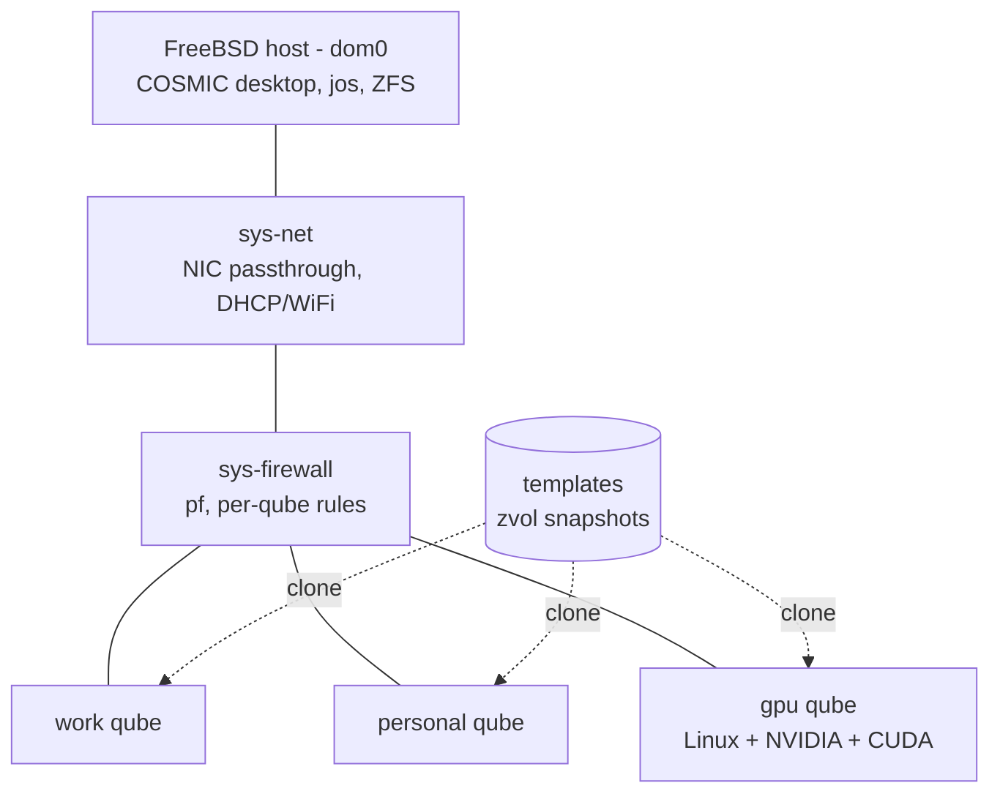

# JuanitOS architecture

JuanitOS is a FreeBSD host that runs every workload inside a bhyve virtual
machine, following the QubesOS security model. The host plays the role of
Qubes' *dom0*: it owns the hardware, ZFS storage and the COSMIC desktop, and
it should never touch untrusted data directly.



## Domains

| Domain         | Kind       | OS            | Role                                                                 |
|----------------|------------|---------------|----------------------------------------------------------------------|
| host (dom0)    | —          | FreeBSD       | bhyve, ZFS, `jos`, COSMIC. No network of its own beyond management.  |
| `sys-net`      | `net`      | FreeBSD       | Owns the physical NIC(s) via `ppt`. Does DHCP/WiFi. Untrusted.       |
| `sys-firewall` | `firewall` | unikernel     | Rust unikernel (or FreeBSD + `pf`) between app qubes and `sys-net`. See `unikernel-firewall.md`. |
| app qubes      | `app`      | FreeBSD/Linux | Cloned from templates. Only talk to their NetVM.                     |
| `gpu`          | `gpu`      | Linux         | NVIDIA GPU passed through for CUDA. Linux because of driver support. |
| templates      | `template` | FreeBSD/Linux | Golden images. Never started directly; cloned via ZFS snapshots.     |

## Storage

Every qube's disk is a sparse ZFS zvol (unikernel qubes are the exception:
they boot from a read-only image and own no dataset):

```text
zroot/juanitos
zroot/juanitos/templates/<name>      template zvol, snapshots @base, @...
zroot/juanitos/qubes/<name>          clone of a template snapshot, or empty zvol
```

`jos create --template X` clones the newest snapshot of `templates/X`
(creating `@base` if the template has never been snapshotted). Updating a
template and running `jos template snapshot X` makes future clones pick up
the change; existing clones keep their origin.

Zvols are created with `volmode=dev` so GEOM never tastes guest partition
tables on the host.

Besides its zvol, every FreeBSD or Linux qube has a *share*: a dom0
directory `/var/db/juanitos/share/<name>` (`share_dir` in `jos.toml`)
exported into the guest over virtio-9p (guest slot 28, mount tag `jos`).
It carries the qube's name, which the guest agent in the templates turns
into the hostname, the inbox/outbox of `jos copy`, and the request
directory `jos-copy` uses to ask dom0 for a transfer, answered by
`jos serve` under `jos policy`. See `docs/inter-qube.md`.

## Networking

- One bridge per network-providing qube: `br-<netvm>`.
- One *upstream* tap per qube: `tap-<qube>`, added to its NetVM's bridge
  (guest slot 3).
- Net-providing qubes (`net`, `firewall`) additionally get a *downstream*
  tap `tapd-<qube>` on their own bridge `br-<qube>` (guest slot 4); that is
  where their clients plug in.
- `sys-net` has no upstream tap; it gets the physical NIC via passthrough
  (`--pci B/S/F`, the device bound to `ppt(4)` through `pptdevs`) and
  offers `br-sys-net` to `sys-firewall`. Inside, the `fbsd15-net`
  template runs DHCP on the NIC and dnsmasq + pf NAT on `10.138.0.0/24`
  towards the bridge (`docs/templates.md`). Verified end to end in a
  nested dom0 with an emulated IOMMU (`docs/gpu-passthrough.md`).
- `sys-firewall` plugs into `br-sys-net` and offers `br-sys-firewall` to
  app qubes.
- A qube with `uplink = "<iface>"` (`jos create --uplink em0`) gets its
  upstream tap on a bridge `bru-<qube>` shared with that host interface
  instead of a NetVM's bridge. That is how `sys-net` reaches the world on
  a machine without IOMMU (no NIC passthrough), and how a template is
  provisioned before any NetVM exists (`jos template install --uplink`).
  Less isolating than passthrough: the NIC driver runs in dom0.
- The host never enables IP forwarding; all routing happens inside VMs.

Interface names are truncated to FreeBSD's 15-character limit.

## VM lifecycle

`jos start <name>` spawns a detached `jos supervise <name>` (own process
group, stdout/stderr appended to `<run_dir>/<name>.log`). The supervisor
(`crates/juanitos-core/src/supervisor.rs`) writes `<run_dir>/<name>.pid`
and loops:

1. Resolve the NetVM (explicit `netvm`, else `default_netvm`, none for `net`).
2. `ifconfig` the bridge(s) and tap(s) into existence.
3. Run `bhyve` with the guest PCI layout documented in
   `crates/juanitos-core/src/bhyve.rs` (virtio disk and NICs; NVMe and
   e1000 for Redox guests). UEFI boot uses the `edk2-bhyve` bootrom; the
   serial console is an `nmdm` pair reachable via `jos console <name>`.
   `jos run <name> <command>` runs a command in the qube and returns its
   output and exit status: through the agent channel, a virtio-console
   port served by `jos-agentd` in FreeBSD and Linux guests
   (`crates/juanitos-core/src/agent.rs`), or typed into the serial
   console when there is no agent (`console.rs`: Redox, or `--console`).
   The same device carries the qube's `events` port, the one direction a
   guest may initiate: a line on it wakes `jos serve` (`events.rs`).
   The qube's share is created (or refreshed) and the stale agent
   sockets removed just before `bhyve` starts.
4. On exit, `bhyvectl --destroy` releases the VM slot. bhyve's exit code
   says why the guest left: `0` reset → boot again, `1` poweroff / `2` halt
   → finish, `3` triple fault → finish (reported), anything else → error.
5. When the loop ends, taps and the pidfile are removed.

`jos stop` sends `bhyvectl --force-poweroff`, which the supervisor observes
as a poweroff and exits on its own. `jos kill` additionally destroys the VM,
sends `SIGTERM` to a still-living supervisor and tears down the taps.
`jos ls` reports `running` (vmm device present), `booting` (supervisor pid
but no VM yet) or `stopped`. `jos start --foreground` / `jos supervise`
run the loop in the current terminal, which is also what `--dry-run` does.

The rc script (`freebsd/rc.d/jos`) calls `jos autostart`, which starts one
supervisor per `autostart = true` qube and returns immediately; on
shutdown it kills every qube with a pidfile, then anything left in
`/dev/vmm`.

Not yet done: a graceful ACPI power button (bhyve has no `bhyvectl` verb for
it; guests should be shut down from inside or via a future agent).

## Trust boundaries

- Host ↔ guest: bhyve + IOMMU. Passthrough devices must be isolated in their
  own IOMMU group and bound to `ppt(4)` at boot (`pptdevs`).
- Guest ↔ guest: only via the NetVM/FirewallVM chain. Shares are strictly
  per qube; files move between qubes only when dom0 moves them (`jos
  copy`, or a `jos-copy` request the policy allows; `docs/inter-qube.md`),
  never through a filesystem two qubes see.
- Host hardening: see `freebsd/sysctl.conf.sample` for HardenedBSD-style
  knobs. Running the host on HardenedBSD itself is supported but untested.
- The reasoning behind all of this, and what is borrowed from QubesOS,
  CLIP OS and HardenedBSD respectively, is in `docs/security.md`.

## Tooling

All management tooling is Rust:

- `juanitos-core`: platform-agnostic library (builds on Windows/macOS/Linux
  for development; only *runs* usefully on FreeBSD).
- `jos`: clap CLI. `--dry-run` prints every host command instead of
  executing it, which is how the project is exercised off-host.
