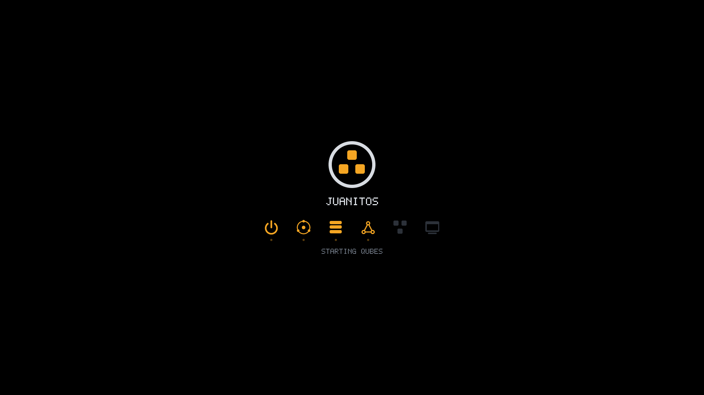
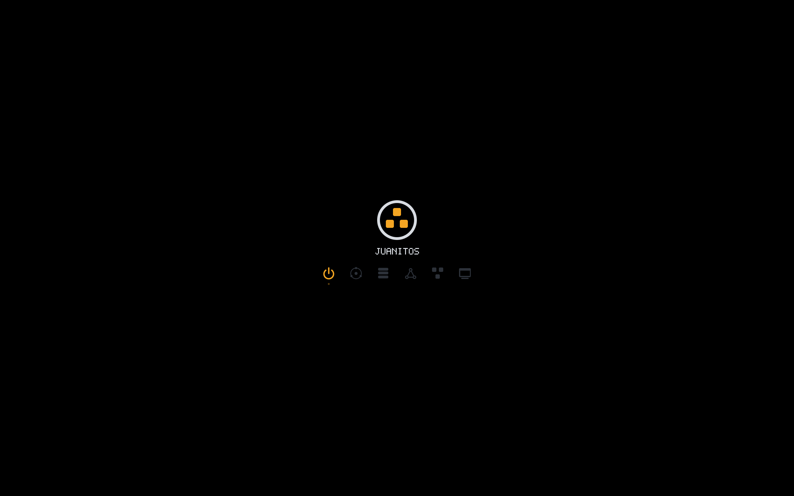

# Graphical boot: Haiku-style, in Rust, on stock FreeBSD

JuanitOS boots like BeOS/Haiku: a dark screen, the logo, and a row of
icons that light up one after the other as the system comes up. No GRUB,
no Plymouth, no text scrolling by, and no Lua beyond what FreeBSD's own
loader already runs. Three small Rust programs share one drawing library
and hand the picture to each other.



| Phase            | Who draws                       | Lit icons          |
|------------------|---------------------------------|--------------------|
| firmware → loader| `jos-boot.efi` (UEFI app)       | boot               |
| kernel           | `vt(4)` with `splash=` PNG      | boot, kernel       |
| `rc(8)`          | `jos-splash` daemon             | + storage, network, qubes, desktop |
| login            | COSMIC greeter (Wayland)        | —                  |

The card is 720×420 pixels and is always placed with the kernel's own
centring formula `((screen - card) / 2)`, so it does not move between
phases. Background is pure black, which is what `vt(4)` blanks to.

## Components

### `crates/jos-gfx` — the artwork

`no_std` + `alloc`, `#![forbid(unsafe_code)]`. Colours, anti-aliased text
in Open Sans (COSMIC's interface font, embedded; parsed by `skrifa`,
rasterised by `ab_glyph_rasterizer`),
procedurally drawn icons (power, kernel, storage, network, qubes, desktop)
and logo, an anti-aliased rasteriser (4×4 supersampling), and `Scene`:
which stages are lit, an optional status line, an optional menu. With the
`png` feature it also writes PNGs (`jos-release` uses that for the kernel
splash; `jos-splash render` for previews). Fully unit-tested on any host.

### `crates/jos-boot` — the pre-loader (`EFI/BOOT/BOOTX64.EFI`)

A UEFI application (`x86_64-unknown-uefi`, `uefi` crate, 67 KB). It:

1. opens the Graphics Output Protocol, switches to the largest mode (the
   same choice `loader.efi`'s `efi-autoresizecons` makes, so there is no
   second mode switch), fills the screen black and `Blt`s the card;
2. polls the keyboard for 3 s. Enter boots at once; any other key opens
   a menu: *Boot JuanitOS*, *Boot verbose*, *Single user*, *FreeBSD loader
   menu*, *Reboot*;
3. chain-loads `EFI/FREEBSD/LOADER.EFI` from the partition it was loaded
   from. The full device path (partition + file) is handed to
   `LoadImage`, so the loader sees a normal "booted from this ESP" setup
   and finds the ZFS pool / live CD exactly as if the firmware had started
   it. The chosen entry's arguments become the child's `LoadOptions`.

The pure parts (entries, menu state, UCS-2 encoding) live in
`src/lib.rs` and are tested on the host (`cargo test --lib --target
x86_64-unknown-linux-gnu` from the crate directory). On any error the
program prints the reason on the firmware text console and resets after
8 s; an ESP with only `loader.efi` boots as plain FreeBSD.

Without a Graphics Output Protocol at all (a serial-only server, `qemu
-vga none`) there is nothing to draw on, so the card and the menu are
skipped: `loader.efi` is chain-loaded immediately with `autoboot_delay=-1
beastie_disable=YES` and *without* `-m`/`console=nullconsole`, so the
loader and the kernel talk on the firmware's text console, i.e. the
serial port. The live installer then runs in its text mode there.

On Intel Macs (and other EFI 1.x firmware with
`EFI_CONSOLE_CONTROL_PROTOCOL`) the console must be in graphics mode for
drawing. It must be in text mode for anything that prints. `jos-boot`
selects graphics before it draws the card. Before chain-loading, it
selects the mode the entry needs (`console_mode_for` in `src/lib.rs`):
graphics for the quiet boot, text for the verbose, single-user, loader-menu
and headless boots. Error paths use text whenever no card can be drawn.
Where the protocol does not exist (all current firmware, OVMF), these
calls do nothing. See `docs/installer.md`, "Intel Macs".

#### Failed-boot fallback

`-m` (`RB_MUTE`) mutes kernel console *input* as well as output
(`cn_mute` in `sys/kern/kern_cons.c`: `cngetc()` returns -1). A muted
boot whose root mount fails therefore sits at an invisible `mountroot>`
prompt that ignores the keyboard. To avoid that dead end:

1. before chain-loading a muted entry, `jos-boot` sets the non-volatile
   UEFI variable `JuanitOSBootPending` (vendor GUID
   `62c99c6c-b34c-4e15-9e6c-fe06ff08543b`, runtime access);
2. `rc.d/jos-bootok` (`REQUIRE: FILESYSTEMS`, always on) deletes it with
   `efivar -D`, so a boot that reaches `rc(8)` leaves nothing behind. It
   only writes NVRAM when the variable exists;
3. if the variable is still there when `jos-boot` starts, the previous
   quiet boot died before userland: the card says *The last boot did not
   finish - booting verbose*, and Enter, Esc and the timeout pick *Boot
   verbose*. `jos-boot` never clears the mark itself, so the machine keeps
   booting verbose until a boot gets to `rc(8)`.

Firmware that refuses `SetVariable` simply never gets the fallback; the
menu's *Boot verbose* entry is always available. To force a quiet boot
again by hand: `efivar -D -n 62c99c6c-b34c-4e15-9e6c-fe06ff08543b-JuanitOSBootPending`.

#### Root mount failures on screen: `jos_bootwatch.ko`

The fallback needs a reboot. The most common way for a quiet boot to die
is a root that cannot be mounted (error 19 from an old Ventoy, a missing
storage driver). That case is reported in place by a small kernel module,
`freebsd/jos_bootwatch`. `jos-release` builds it against the release's
`src.txz` and installs it in `/boot/modules` with
`/boot/loader.conf.d/jos_bootwatch.conf`, on the live ISO and the
installed dom0.

On a muted boot, the module checks the end of the kernel message buffer
once a second until root is mounted. When the kernel sits at
`mountroot>`, it does three things:

- unmutes the console;
- replays the last 3 KiB of kernel messages, including the failed mount
  and its error number;
- adds a JuanitOS note (for Ventoy: update to 1.1.08+ or write the ISO
  with `dd`).

The first console read drops the splash. The `mountroot>` prompt then
works: `?` lists the disks, and an empty line panics and restarts after
15 s. The restart then goes through the verbose fallback above.

Verified on FreeBSD 15.1 under QEMU/OVMF with `boot_mute=YES` and a
bogus `vfs.root.mountfrom`:

1. the card splash showed while the mount waited;
2. the screen then switched to the messages ending in *Mounting from
   cd9660:/dev/iso9660/NOPE failed with error 19*, the note and a live
   prompt;
3. typing a valid root booted normally.

### `crates/jos-splash` — the daemon

`rc.d/jos-splash` starts it right after `FILESYSTEMS`. It opens
`/dev/ttyv9` (VT 10 — `/etc/ttys` runs gettys on `ttyv0-7` and the Wayland
seat picks `ttyv8`), switches to it, sets `KD_GRAPHICS` so console output
never touches the picture, `mmap`s the framebuffer and draws the card with
*storage* lit. Then it listens on the Unix datagram socket
`/var/run/jos-splash.sock`:

```text
stage <boot|kernel|storage|network|qubes|desktop>   light that icon (and earlier ones)
status <text>                                      one line under the icons
finish [keep|console]                              end: leave the frame / restore the console
```

Clients are the same binary: `jos-splash stage network`. A missing socket
is not an error for them, so the rc scripts work on a text boot too. Esc
on the keyboard ends the splash on the text console.

Hooks:

| rc.d script           | Runs after      | Sends                                   |
|-----------------------|-----------------|-----------------------------------------|
| `jos-splash`          | `FILESYSTEMS`   | starts the daemon (`--reached storage`) |
| `jos-splash-network`  | `NETWORKING`    | `stage network`                         |
| `jos`                 | `LOGIN`         | `status Starting qubes`, `stage qubes`  |
| `jos-splash-finish`   | `LOGIN jos`     | `stage desktop`, then `finish` if the login screen is enabled and installed, else `finish --console` |
| `jos-login`           | `LOGIN seatd dbus jos-splash-finish` | nothing; starts `jos-greet` under daemon(8) |

`finish` (keep) lights every icon and leaves the frame on screen; the
login screen (`jos-greet` on `ttyv8`, `docs/relibc-cosmic.md`) then
switches to its terminal and draws over it in the same palette and font,
and the compositor takes that terminal after login. The installed system enables all of
this with `jos_splash_enable="YES"` and `rc_startmsgs="NO"` in `rc.conf`.
The live medium does the same but always ends on the console, where the
installer runs.

All FreeBSD-specific calls (`ioctl`, `mmap`, termios) are in
`crates/jos-fb/src/vt.rs` behind `cfg(target_os = "freebsd")`, shared with
the graphical installer; the state machine, protocol, pixel packing and
keyboard decoding are tested on any host. `jos-splash run --dry-run` serves
the socket with a fake display for testing the rc.d plumbing.

After switching to its virtual terminal the daemon waits a few `vt(4)`
timer ticks before drawing: the kernel repaints a freshly activated
terminal (blank cells and border) from its 25 Hz timer *after*
`VT_WAITACTIVE` returns, which otherwise wipes the first frame (seen on a
real FreeBSD 15.1 boot under QEMU: a black screen until the next stage
redrew).

The mouse pointer is the other thing `vt(4)` draws over a graphics-mode
terminal. devd starts `moused` as soon as a mouse or touchpad attaches
(between the storage and network stages), and `rc.d/moused` runs
`vidcontrol -m on` on every `ttyv`: vt then draws its pointer once at the
centre of the screen, with the blank text cells under it, which is where
the card's title is (it erased the "I" of JUANITOS on an Acer Nitro 5).
Pointer motion is ignored on a graphics-mode terminal, so that drawing
never moves or goes away by itself. The daemon keeps its last frame and,
when nothing changed, re-presents the 192 rows around the centre every
50 ms tick (`pointer_rows` in `crates/jos-splash/src/server.rs`). The
installer and the login screen start after `moused` and draw a full frame
once they have switched terminals, which covers the pointer drawn at boot.

## What the loader and kernel do (verified against FreeBSD 15.1 sources)

- `stand/efi/loader/efi_main.c` splits `LoadOptions` on spaces into
  `argv`; `main.c` runs `boot_parse_arg` on each: `-m` → `RB_MUTE`, `-v`,
  `-s`, and `name=value` → `setenv`. This happens *after* `cons_probe()`
  (which always initialises the EFI console, clearing the screen) and
  *before* any `printf`.
- `console=nullconsole` is a valid loader console on amd64. Set from the
  arguments, it switches output away from the screen before the banner is
  printed, and `bi_getboothowto` turns it into `RB_MUTE` for the kernel.
  Because the EFI console was initialised first, `gfx_state` still holds
  the GOP framebuffer and `bi_load_efi_data` passes `MODINFOMD_EFI_FB` to
  the kernel — `vt(4)` keeps working.
- `autoboot_delay=-1` and `beastie_disable=YES` make `loader.lua` skip the
  menu and boot immediately. `/boot/defaults/loader.conf` leaves
  `autoboot_delay`, `beastie_disable`, `console` and `boot_mute` commented
  out, so values given as arguments survive `config.load()`. Our generated
  `loader.conf` therefore never sets `console=`; the serial console is
  requested kernel-side with `boot_multicons` + `hw.uart.console`.
- `splash=<png>` / `shutdown_splash=<png>` in `loader.conf`: the loader
  decodes the PNG to 32-bit RGBA (`build_splash_module`) and
  `vt_core.c` draws it centred — only when `RB_MUTE` is set and the console
  is not in text mode. While `VDF_SPLASH` is set, `vt_flush` draws no
  text; the flag is cleared by a key press or when a `ttyv` is opened, which
  is why the daemon starts as early as `rc(8)` allows.
- `vt(4)` on `/dev/ttyv*`: `FBIOGTYPE` (geometry/depth), `FBIO_GETLINEWIDTH`
  (stride), `FBIO_GETRGBOFFS` (channel offsets; BGRX assumed if `ENOTTY`),
  `mmap` of the framebuffer, `KDSETMODE` (`KD_GRAPHICS` / `KD_TEXT`),
  `VT_ACTIVATE` / `VT_WAITACTIVE` / `VT_GETACTIVE`. The ioctl numbers are
  computed from `ioccom.h` and checked against the C values in tests.

## Verified under QEMU + OVMF (`tools/uefi-test.sh`)

- `boot`: `jos-boot.efi` as `BOOTX64.EFI` on a FAT image. OVMF starts it,
  the card is drawn at the largest display-like mode (2560×1600 on QEMU
  `-vga std`; the 2048×2048 mode is skipped), the countdown runs, and with
  no `LOADER.EFI` present the error path shows and resets.
- `boot-loader`: same plus FreeBSD 15.1's real `loader.efi` at
  `EFI/FREEBSD/LOADER.EFI`. The chain-load succeeds, the arguments arrive:
  the serial log shows only `Consoles: EFI console` (printed by
  `cons_probe()` before arguments are parsed) and then nothing — no
  banner, no `BootOrder`, no "Failed to find bootable partition" — until
  the loader returns `NOT_FOUND` (the test image has no kernel) and
  `jos-boot` reports it. `loader-only` is the control: the same loader
  booted directly prints its full banner and countdown.



## Known limits

- **One black gap (accepted).** The loader's console initialisation
  erases the screen before it parses its arguments, so the pre-loader's
  picture goes black until the kernel draws the splash (the time the
  loader needs to read the kernel and modules, 1–3 s). There is no knob in
  the stock loader to avoid it; patching `loader.efi` is out of scope while
  the project reuses FreeBSD binaries unchanged, and the gap is considered
  acceptable.
- **Silent loader failures.** With `console=nullconsole` a loader that
  cannot find a kernel waits at an invisible prompt (unlike the kernel's
  root mount, the loader has no module hook to reveal it). Use the *FreeBSD
  loader menu* entry (no arguments) to see it. The next start of
  `jos-boot` falls back to *Boot verbose* (see *Failed-boot fallback*).
- **BIOS boot** (`cdboot`/`isoboot`/`gptzfsboot`, legacy machines) is the
  classic text boot. FreeBSD builds its BIOS loader `LOADER_BIOS_TEXTONLY`
  (no `vbe` command, `screen.textmode` is ignored), so the kernel only
  gets `vt_vga` text and no framebuffer. The splash daemon, the installer
  and the greeter therefore fall back to the text console: the installer
  runs its text mode, and on an installed system `rc.d/jos-login` sees
  `VT(vga): text` in the boot messages and does not start the greeter
  (`getty` keeps `ttyv0`). 32-bit EFI (`BOOTIA32.EFI` is FreeBSD's
  `loader_ia32.efi`) has no `jos-boot` card, but it still gets efifb when
  the firmware provides GOP.
- A daemon crash would leave the console in graphics mode; the panic
  path restores text mode, and `jos-splash finish --console` (what
  `service jos-splash stop` runs) can be typed blind.
- `vt_fb_bitblt_argb` pixel order and the exact moment the greeter takes
  over have not yet been exercised on hardware; the QEMU/OVMF path is the
  first test target (`jos-release qemu`).
