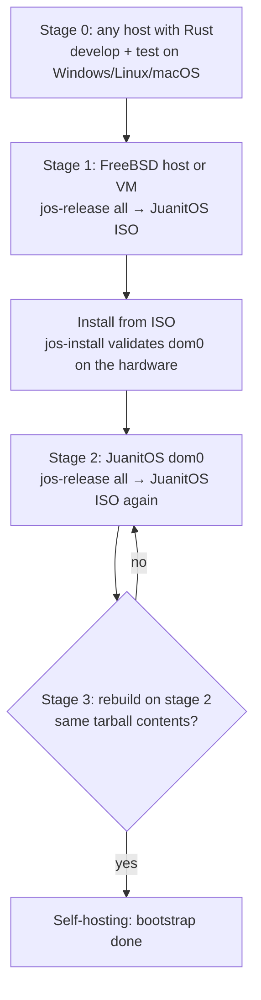

# Bootstrapping JuanitOS

The approach is borrowed from *Linux From Scratch*: build a temporary
toolchain on a host you already have, use it to build the real system, then
rebuild the system with itself to prove it is self-hosting. JuanitOS does
not compile a C userland — FreeBSD already exists and ships binary releases
— so the "toolchain" is Rust and the "system" is the dom0 assembled from
FreeBSD release artifacts plus packages plus the JuanitOS tools.



## Stage 0 — develop anywhere

`juanitos-core`, `jos`, `jos-install` and `jos-release` are pure Rust on
`std`. They build and test on Windows, Linux and macOS; everything that
touches the host goes through the `Runner` trait, so `--dry-run` prints the
exact FreeBSD commands a step would execute. This is the LFS "host system
requirements" chapter: all you need is `cargo`.

```sh
cargo test
jos-release --dry-run all
jos-install --dry-run --non-interactive --ignore-doctor --disk vtbd0 \
    --root-password x
```

`rust-toolchain.toml` pins the channel and adds the `x86_64-unknown-uefi`
(for `jos-boot`, `jos-firewall`) and `x86_64-unknown-freebsd` (for
cross-checking with clippy) targets, so `rustup` installs them on first
use.

### Stage 0 in a container

The `Dockerfile` gives a reproducible Linux toolchain that builds every
Rust artifact — host binaries, both `.efi` applications, the firewall boot
image, the kernel splash PNG — into `target/docker/`:

```sh
docker build -t juanitos-build .
docker run --rm -v "$PWD:/src" -v juanitos-rustup:/usr/local/rustup juanitos-build        # build
docker run --rm -v "$PWD:/src" -v juanitos-rustup:/usr/local/rustup juanitos-build check  # fmt/clippy/tests
```

It does **not** build the ISO: `makefs`, `pkg -c` and FreeBSD's `tar`
need a FreeBSD kernel, and so do the `freebsd/*` images on Docker Hub —
they only run on Docker/podman *on FreeBSD*. On a Linux or Windows Docker
engine they pull but cannot start; they are usable as file sources only
(`docker create` + `docker export`), and the `freebsd-runtime` image has
no `/boot` contents.

### Testing the UEFI pieces without FreeBSD

`tools/uefi-test.sh` boots `jos-boot.efi` and `jos-firewall.efi` under
QEMU + OVMF on any Linux (WSL2 included; `/dev/kvm` makes it fast), with
serial logs and screenshots in `target/work/uefi-test/`. `tools/fetch-freebsd.sh
loader` gets the real `loader.efi` from the release `base.txz` (SHA-256
verified) so the chain-load and `console=nullconsole` path are tested with
the genuine loader. `target/work/` (or `$JOS_WORK`) holds downloads, VM
disks and test output, so `cargo clean` reclaims it with the build; set
`JOS_WORK` elsewhere to keep large downloads across a clean.

The script needs `qemu-system-x86_64`, the OVMF firmware (`ovmf` on
Debian, `edk2-ovmf` on Arch/Manjaro and Fedora), `mtools` and `socat` or
`nc`. The QEMU monitor is a loopback TCP port, so it also runs where Unix
sockets are unavailable (sandboxes, WSL's DrvFs). Without `/dev/kvm` the
runs fall back to TCG, which is fine for these small UEFI applications.

```sh
tools/uefi-test.sh boot          # card + error path (no loader on the image)
tools/fetch-freebsd.sh loader    # base.txz → target/work/freebsd/boot/loader.efi
tools/uefi-test.sh boot-loader   # chain-load: loader.efi runs, finds no kernel, returns
tools/uefi-test.sh firewall      # DHCP, ARP, gateway ping, NAT via tools/fw-client.py
```

## Stage 1 — build the ISO on FreeBSD

This is LFS chapter 5 (temporary tools) and 6 (the system) in one, run as
root on a FreeBSD host of the same major version as `freebsd_version` in
`release/juanitos.toml`. A VM is fine; on a Linux box:

```sh
tools/fetch-freebsd.sh vm            # official qcow2 VM image, checksum verified
jos-release builder --image target/work/freebsd/FreeBSD-15.1-RELEASE-amd64-zfs.qcow2 --auto
```

`--auto` is the unattended path: `jos-release` converts the image to a
raw working disk (the pristine image is never modified), grows it to
60 GB, writes `/efi/freebsd/loader.env` into its EFI system partition so
the loader and kernel use the serial port (the stock images only talk to
VGA), boots it under OVMF, logs in as root over the serial console and
runs the steps below (`crates/jos-release/src/qemu.rs`, `AUTO_STEPS`):

1. grow the ZFS pool to the resized disk;
2. mount this repository (9p, read-only) and the results directory;
3. `pkg install rust git`;
4. copy the tree into the guest (building over 9p is slow);
5. `cargo build --release --workspace`;
6. `jos-release all`;
7. copy the ISO, its checksum, the dom0 tarball and `release.toml` to
   `<work>/builder/` on the host.

The whole console session is in `<work>/builder/console.log`. Without
`--auto` the same VM is started interactively (VGA + serial) for manual
use.

(VirtualBox can run the same image for a windowed view, but under Hyper-V
— which WSL2 requires — it cannot pass VT-x to the guest, so bhyve inside
that VM will not work; QEMU/KVM with nested virtualization does.)

Inside that guest when driving it by hand (root, no password):

```sh
pkg install -y rust git
kldload virtio_p9fs
mount -t p9fs -o trans=virtio juanitos /mnt     # this repository
cd /mnt && jos-release all
```

If `p9fs` is unavailable, `git clone` the repository instead (port 2222 on
the host forwards to the guest's sshd).

What `jos-release all` does, step by step (each is also a subcommand):

| step     | what                                                                                      | FreeBSD tooling reused                          |
|----------|-------------------------------------------------------------------------------------------|-------------------------------------------------|
| `fetch`  | download `base.txz`, `kernel.txz`, verify against the release `MANIFEST`                  | `fetch(1)`, release manifests                   |
| `bins`   | `cargo build --release --workspace`                                                       | —                                               |
| `rootfs` | extract the sets, `pkg -c rootfs install` the dom0 package set, add JuanitOS files        | `tar(1)`, `pkg(8)` as in `release/tools/vmimage.subr` |
| `pack`   | `juanitos-dom0.txz` + `MANIFEST` (sha256, size)                                           | `tar(1)`                                        |
| `iso`    | live overlay (`rc.conf`, `loader.conf`, `rc.local`), ESP image, `makefs -t cd9660`        | `makefs(8)` as in `release/amd64/mkisoimages.sh` |

Output lands in `release/out/`: the ISO, its `.sha256`, the dom0 tarball
and the extracted `rootfs/` for inspection.

The package set lives in `crates/juanitos-core/src/dom0.rs`: required
(`edk2-bhyve`, `seatd`, `dbus`, …), self-hosting (`rust`, `git`) and
best-effort desktop packages (COSMIC, `drm-kmod`). FreeBSD has no
COSMIC packages: they come from the repository `tools/dev/cosmic-build.sh`
builds in the FreeBSD VM (`docs/relibc-cosmic.md`), which `[packages]
local_repo` points at and the root carries at `/usr/local/share/juanitos/pkg`.
The root also gets a copy of this repository at `/usr/local/src/juanitos`
with vendored crates, so stage 2 needs no network.

### What the first native run taught (FreeBSD 15.1, 2026-10)

The unattended builder found three things the dry runs could not:

- `pkg -c <root> install` in a fresh chroot fails with "No packages
  available" until `pkg -c <root> update` has fetched the catalogue;
  `jos-release` now runs `bootstrap`, `update -f`, then `install`, the
  way `release/tools/vmimage.subr` does.
- The bhyve firmware package is `edk2-bhyve` (`sysutils/edk2@bhyve`);
  the `uefi-edk2-bhyve` port no longer exists. The file it installs is
  still `/usr/local/share/uefi-firmware/BHYVE_UEFI.fd` (compatibility
  copy), so `jos` is unchanged.
- Removing a previous `rootfs/` needs `chflags -R noschg` first: an
  extracted base has immutable files (`FsOps::remove_tree`).
- The COSMIC packages are not in any FreeBSD repository; they are
  best-effort and the build goes on without them, or with the ones
  `tools/dev/cosmic-build.sh` produced. The unattended builder copies the
  tree without `target/`, so it carries the profile's `local_repo` over
  separately (otherwise an ISO built with `builder --auto` silently
  lacked COSMIC).
- Command lines typed into the serial console in one burst lose bytes
  past a few hundred characters (the emulated 16550 overruns) and the step
  hangs waiting for a shell that never got the end of the line; the
  console driver now sends in 32-byte chunks 10 ms apart.
- FreeBSD's `rust` package has no `x86_64-unknown-uefi` standard library,
  so `jos-boot.efi` and `jos-firewall.efi` are built on the Linux side
  (`tools/docker-build.sh` or plain cargo with the target installed) and
  handed to the guest through the results share; `jos-release all` picks
  them up with `--boot-efi` / `--firewall-image`.

## Install — validation on real hardware

Boot the ISO. The live system is the dom0: same kernel, same modules, same
`loader.conf` knobs (`vmm`, `hw.vmm.iommu.enable=1`), same packages, same
`jos`. The installer runs `jos doctor`'s host checks first and refuses to
continue if bhyve or the IOMMU are unavailable (override with
`--ignore-doctor`). Passing here means the installed system will run qubes.

The installer then produces a stock FreeBSD-on-ZFS layout (GPT, ESP, swap,
`zroot/ROOT/default` + the `zfsboot` datasets, plus `zroot/juanitos/
{templates,qubes}`) and extracts the very tarball the ISO was built from.
See `docs/installer.md`.

## Stage 2 — build JuanitOS on JuanitOS

On the installed system:

```sh
dhclient vtnet0                 # see below
cd /usr/local/src/juanitos      # or a fresh git clone
jos-release all
```

`jos-release` notices `/usr/local/share/juanitos/release.toml` and stamps
the new image `built_on = "juanitos"`, `stage = 2`. The resulting ISO is a
stage-2 image: a JuanitOS built by JuanitOS.

What the first stage-2 run showed (JuanitOS 0.1.0 under QEMU, 2026-10):

- The Rust side is offline — `/usr/local/src/juanitos/vendor` and
  `.cargo/config.toml` make `cargo` use the vendored crates — but `fetch`
  still downloads `base.txz`/`kernel.txz` and `rootfs` runs `pkg` against
  the FreeBSD repository. A dom0 has no network of its own by design
  (`docs/security.md`), so for the rebuild either give it one temporarily
  (`dhclient vtnet0`, as above) or populate `release/out/dist` and a local
  `pkg` repository beforehand. Everything else ran unchanged: 5.5 minutes
  on 8 vCPUs, the same package set, `stage = 2` in `release.toml`.
- FreeBSD's `rust` cannot build the two UEFI applications, so a dom0
  rebuilding itself ships the `jos-boot.efi` and `jos-firewall.img` it was
  installed with (`/boot/jos-boot.efi`, `/usr/local/share/juanitos/
  jos-firewall.img`) when it has no newer ones; `--boot-efi` and
  `--firewall-image` still override. Before this fallback a stage-2 image
  silently lost the graphical boot and the unikernel.
- The live medium works headless: without a Graphics Output Protocol
  `jos-boot` chain-loads the loader straight onto the serial console and
  the installer runs in text mode there (`docs/boot-splash.md`), which is
  how the stage-2 VM was installed (`qemu -vga none`).

Stage 2 was run again on 2026-10-14 on the nested dom0 that hosts the
test qubes (`docs/gpu-passthrough.md`), with the sources of the events
port and the request broker, while `sys-net`, `sys-firewall`, `work` and
`web` kept running. The uplink bridge got a temporary address
(`dhclient bru-vtnet0`: `vtnet0` is a bridge member there) that was
removed afterwards. The first run exposed a bug in the source copy: that
dom0's tree had `vendor` as a symbolic link and the UEFI crates' own
`target/` directories, and `install_source` copied both, so the image
shipped a 160 MB source tree whose `vendor` was a dangling link (cargo
vendor had followed the link and refilled the old directory). The copy
now leaves out everything `.gitignore` lists plus `vendor/` when it is
about to be regenerated (`source_excludes`, with a test reproducing that
tree). The second run: 4 min 49 s on 8 vCPUs, `built_on = "juanitos"`,
`stage = 2`, a 3,700,162,560-byte ISO and a 533 MB dom0 tarball whose
128,581 entries are the stage-1 list plus exactly the 13 source files
added since (agent, events, requests, share, the template agent scripts
and `docs/inter-qube.md`); `/usr/local/bin/jos` in it is byte-identical
to the one the dom0 runs.

## Stage 3 — prove it

Install the stage-2 ISO (QEMU is enough: `jos-release qemu`), build again,
and compare the two dom0 tarballs. They are built from the same FreeBSD
sets and the same package repository, so apart from timestamps and
`release.toml` they should match; when they do, the system is self-hosting
and the bootstrap is finished.

Comparing the stage-1 and stage-2 tarballs of 2026-10-14 (same file list,
128,568 entries; per-file SHA-256 streamed with `tar --to-command`, which
also makes hard-link order irrelevant) left exactly these differences:

- the four JuanitOS binaries (built from a different path, and in that run
  from a patched source tree) and the patched sources themselves;
- `release.toml` (`stage`, `built_at`), `/var/db/pkg/local.sqlite`,
  `/var/log/userlog`, `/usr/local/share/info/dir` — `pkg` bookkeeping;
- `/usr/local/src/juanitos/.cargo/config.toml`: stage 2 had appended a
  second pair of `[source]` tables to the already vendored copy, which
  cargo would have rejected on stage 3. `vendored_cargo_config` is now
  idempotent, so this one disappears.

So the system is self-hosting in substance. To make the binaries
comparable, `bins` builds with `--remap-path-prefix` (passed as
`cargo --config build.rustflags=[...]`): the checkout becomes
`/usr/local/src/juanitos` and every crates.io registry directory
`/usr/local/src/juanitos/vendor`, which `cargo vendor --versioned-dirs`
fills with the same `<crate>-<version>` names. A stage-1 build in
`/root/juanitos` against the registry and a stage-2 build in
`/usr/local/src/juanitos` against `vendor/` then embed the same paths
(checked with a `toml`-using crate: byte-identical binaries).
`release.toml` records `rustc` (`rustc -V`), since only the same compiler
can give the same bytes, and `built_at` follows `SOURCE_DATE_EPOCH` when
it is set.

## Why not build FreeBSD from source?

It would be a faithful LFS, but it buys nothing yet: the dom0 is not
patched. When it is (HardenedBSD-style knobs beyond `sysctl`, a Relibc
port), `rootfs` grows a `buildworld`/`buildkernel` path and the release
sets become the build's output instead of a download. The step boundaries
are already in place for that.
