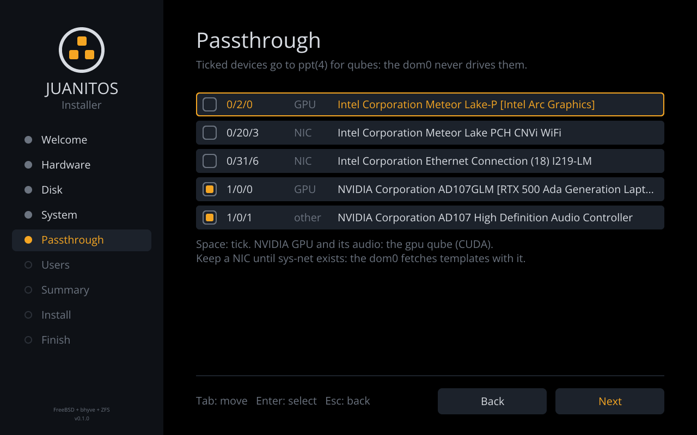
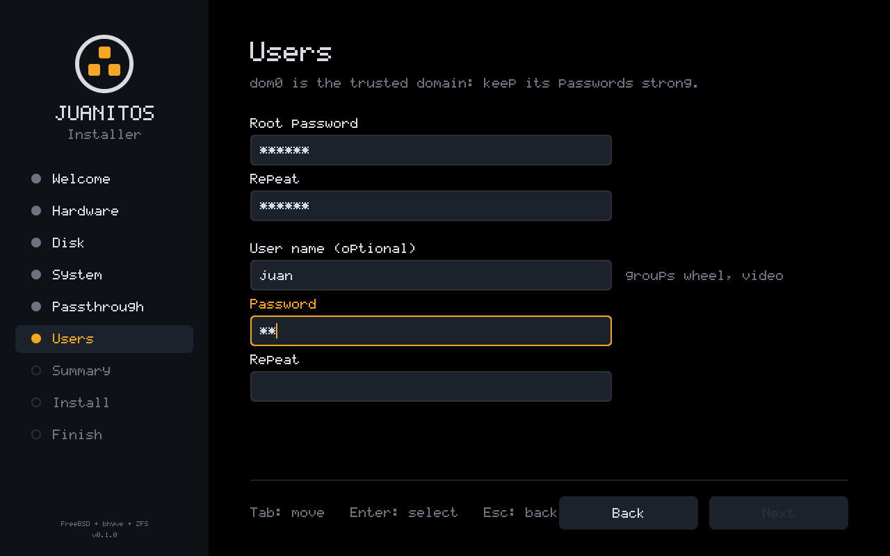
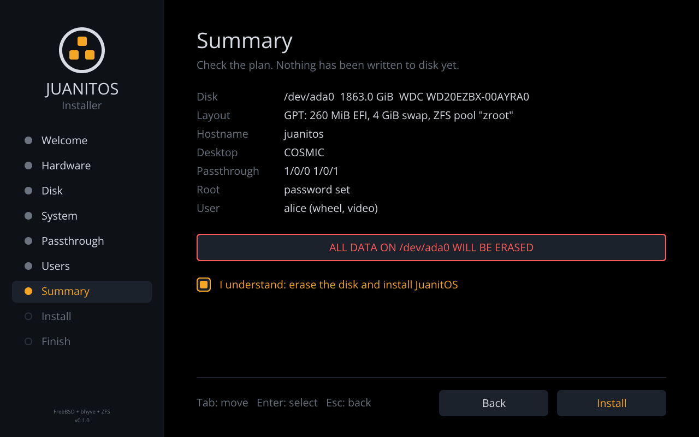
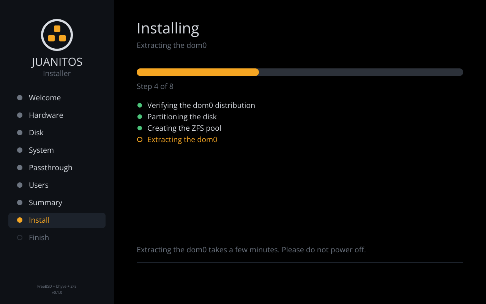
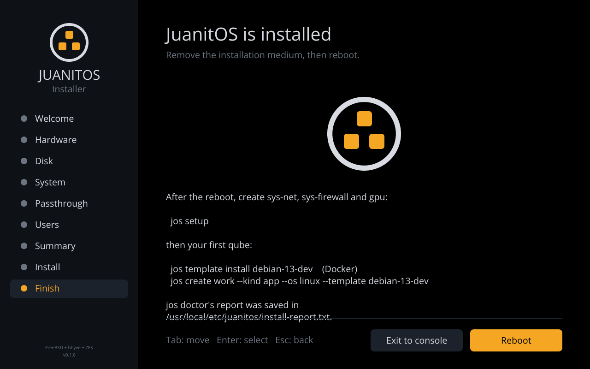

# Install medium and installer

## One dom0, two ways to boot it

`jos-release` builds a single artifact, `juanitos-dom0.txz`: FreeBSD base
and kernel, the dom0 packages and the JuanitOS binaries. The ISO's live
root is that tree extracted, with a small overlay (read-only `fstab`,
`varmfs`/`tmpmfs` in `rc.conf`, an `rc.local` that starts the installer,
a serial+video console). The tarball itself rides along in
`/usr/local/share/juanitos/dist/` with a sha256 `MANIFEST`, and the
installer extracts it onto the new pool.

Because the live system and the installed system come from the same
tarball, what you observe on the live medium — `kldstat` shows `vmm`,
`hw.vmm.iommu.enable=1`, `pciconf` lists `ppt*` devices, COSMIC starts —
is what you get after installing. `jos-install` runs exactly those checks
(`juanitos_core::doctor::run_host_checks`) before touching a disk and
writes the report to `/usr/local/etc/juanitos/install-report.txt` on the
target.

The first check reads the `VT-x:` / `SVM:` line that the kernel prints to
`/var/run/dmesg.boot`. bhyve needs EPT plus unrestricted guest on Intel
(Nehalem, 2008, or later) and nested paging on AMD. A Core 2 therefore
fails this check even though it has VT-x: the medium still boots and
installs, but no qube will start.

## ISO layout

```text
/                         FreeBSD 15.x base + kernel (live root, cd9660)
/boot/loader.conf         vmm/nmdm/if_bridge, hw.vmm.iommu.enable=1, serial console
/etc/rc.conf              root_rw_mount=NO, varmfs, tmpmfs, seatd/dbus
/etc/rc.local             → jos-install --live
/usr/local/bin/           jos, jos-install, jos-release, jos-splash
/usr/local/etc/rc.d/jos   autostart script (disabled on the live medium)
/usr/local/share/juanitos/
    release.toml          version, FreeBSD release, build stage, package list
    loader.conf.sample, sysctl.conf.sample
    dist/juanitos-dom0.txz, dist/MANIFEST
/usr/local/src/juanitos   this repository + vendored crates (stage 2)
El Torito: EFI (efiboot.img: jos-boot.efi as BOOTX64.EFI + EFI/FREEBSD/LOADER.EFI
           + loader_ia32.efi as BOOTIA32.EFI) and, when present, BIOS cdboot
System area: protective MBR + GPT (isoboot, ESP → efiboot.img) for USB sticks
```

The image is hybrid, like FreeBSD's own `mkisoimages.sh` output: after
`makefs`, `jos-release` reads the EFI El Torito entry with `etdump` and
writes a `mkimg` GPT into the first 32 KiB. With that, the same file
boots as a CD or written raw to a USB stick, under UEFI
(`BOOTX64.EFI`, or `BOOTIA32.EFI` on 32-bit EFI such as the first Intel
Macs) and under legacy BIOS (`isoboot`, or `cdboot` from a CD). FreeBSD's
BIOS loader is text-only, so a BIOS boot runs the text installer (same
steps, same checks).

```sh
# on Linux, as root; /dev/sdX is the whole stick, not a partition
dd if=JuanitOS-0.1.0-amd64.iso of=/dev/sdX bs=4M conv=fsync status=progress
```

### Ventoy

The ISO can also just be copied onto a [Ventoy](https://www.ventoy.net)
stick (the data partition must be exFAT, NTFS or ext4: the file is larger
than FAT32 allows). Ventoy recognises it as a FreeBSD image and boots the
ISO's own El Torito entries, so both
firmware paths work: UEFI (`jos-boot.efi`, graphical installer) and BIOS
(`isoboot`, text installer). Verified with Ventoy 1.1.18 in QEMU: the live
system mounts `/dev/iso9660/JUANITOS` on top of `ventoy/IMAGE`, and an
install from it boots to the login screen. On the Ventoy stick the ISO
must be a plain, fully allocated copy: a sparse file (holes punched where
the image is zero, as `mkfs.ext4 -d` or `debugfs write` do) cannot be
mapped and Ventoy stops with `No bootfile found for UEFI!`. Any normal
`cp` or file-manager copy is fine.

Ventoy normally injects a prebuilt `geom_ventoy.ko` matching the ISO's
FreeBSD version, and only Ventoy 1.1.08 (December 2025) and later have one
for FreeBSD 15. With an older Ventoy, stock FreeBSD 15 images stop at
`mountroot` with error 19. The live ISO therefore ships its own module,
built by `jos-release` from `freebsd/geom_ventoy` against the release's
`src.txz`. When an ISO contains `/boot/kernel/geom_ventoy.ko`, every Ventoy
since 1.0.62 skips the injection and writes the disk map into that file
(see `crates/jos-release/src/ventoy.rs` for the layout constraints). On
any other medium the module finds no Ventoy disk and does nothing. The
installed system does not ship it. Verified with `tools/dev/ventoy-rig.sh`
and `VENTOY_VERSION=1.1.05`, a Ventoy without FreeBSD 15 support: the
live ISO reaches the installer under both UEFI and BIOS, with root on
`ventoy/IMAGE`.

`tools/dev/ventoy-rig.sh` rebuilds that test on a Linux host: `make ISO`
writes a Ventoy stick image (the layout `Ventoy2Disk.sh` produces, the ISO
copied in through `fuse2fs`), `start uefi|bios` boots it under QEMU/KVM
with a blank virtio target disk, `key`/`type`/`shot` drive the installer
through the QEMU monitor. The Disk page must list the target disk only,
never the stick.

### Intel Macs

Macs before the T2 chip (2006–2017) boot EFI 1.x firmware with Apple
extensions and no Secure Boot. What works and what does not:

- **Write the ISO with `dd`, then hold Option (Alt) at the chime.** The
  Apple boot picker shows the stick's ESP as "EFI Boot". rEFInd also
  lists a `dd`-written stick, since it is a plain GPT disk with a FAT ESP.
  Macs from late 2007 on (MacBookPro3,1 and later, everything that runs
  Yosemite) have 64-bit EFI and start `BOOTX64.EFI` (`jos-boot`). The
  earliest models have 32-bit EFI and start `BOOTIA32.EFI` (FreeBSD's
  `loader_ia32.efi`, text boot).
- **Prefer `dd` over Ventoy on a Mac.** Ventoy's `BOOTX64.EFI` is a
  Secure Boot shim. On a machine without Secure Boot it prints a line such
  as `Not a Secure Boot Platform 14` and continues; we see the same line
  on OVMF, where the boot goes on normally. That line is harmless on a
  Mac too. What breaks is the next step: Ventoy's GRUB and its disk
  emulation on Apple's old firmware. This is why other ISOs, Debian's
  included, fail through Ventoy on the same Mac while they boot when
  written directly. rEFInd may also not list a Ventoy stick in its
  default MBR layout. Reinstalling Ventoy with a GPT layout
  (`Ventoy2Disk.sh -i -g`) may help; we have not verified this.
- **Console mode.** Apple firmware starts applications with its console
  in graphics mode, which hides all text output. `jos-boot` switches the
  `EFI_CONSOLE_CONTROL_PROTOCOL` to graphics mode before drawing the card.
  It switches to text mode before chain-loading the verbose, single-user
  and loader-menu entries, so their output shows (the same quirk rEFInd,
  GRUB and OpenCore handle). FreeBSD's own `loader.efi` does not do this.
  Booted directly on a Mac, it can show a black screen while it works.
- **Qubes need EPT.** bhyve on Intel requires EPT and unrestricted guest
  (Nehalem, 2008, and later). A Core 2 Duo has VT-x without either, and
  its chipset has no VT-d. On such a Mac, the live ISO tests the boot
  chain, the installer and the dom0 desktop, but no qube can start.
  The installer's Hardware page (`jos doctor`) reports it as a failed
  check ("VT-x lacks EPT and unrestricted guest, which bhyve requires"),
  and installing anyway is still allowed.

Apple's own `boot.efi` is closed source, and the open parts of Darwin
(XNU, the old `BootX`) carry nothing that a third-party EFI loader
needs. The public knowledge of Apple EFI quirks lives in rEFInd, GRUB and
OpenCore. Of those quirks, only console control matters for JuanitOS.
The others are Apple's "set OS" protocol, which keeps the integrated GPU
visible on 2011+ dual-GPU MacBook Pros, and HFS+ boot volumes, which a
FAT ESP does not need. Neither applies to Core 2–era machines.

## The graphical installer

`rc.local` starts `jos-install --live` once the boot splash has finished.
On a machine with a framebuffer console it opens a full-screen wizard on
`vt(4)` (virtual terminal 10, `--vt` to change it), drawn with the same
font, palette and logo as the boot splash, so the hand-over from boot to
installer is seamless.

The flow borrows from the two installers QubesOS users know:

- **Calamares**: a sidebar of steps walked in order (Welcome, Hardware,
  Disk, System, Passthrough, Users, Summary, Install, Finish), with
  Back/Next at the bottom and Next disabled until the page is valid;
- **Anaconda**: nothing is written to disk before the Summary page, where
  the erase has to be confirmed explicitly; the hardware check comes first,
  so you learn whether the machine can run qubes before choosing a disk.

| | |
|---|---|
|  |  |
|  |  |
|  |  |
|  |  |
|  | |

The **Passthrough** page lists the GPUs, the NICs (Wi-Fi included) and
the other functions of each GPU's slot (its HDMI audio), as `pciconf`
reports them. Ticked devices end up in `pptdevs` in the new system's
`/boot/loader.conf`, so `ppt(4)` claims them at boot and the dom0 never
drives them. The default selection is the devices already bound to `ppt`
plus, when another GPU is left for the dom0's display, the NVIDIA GPU
and its slot siblings (for the `gpu` qube, see `docs/gpu-passthrough.md`).
Reserving every GPU is allowed but flagged: the dom0 then has no display
of its own. NICs are never ticked by default: until `sys-net` exists the
dom0 needs one to download templates.

Keyboard: `Tab`/`Shift-Tab` or `Up`/`Down` move between fields,
`Up`/`Down` pick a disk or a device in a list, `Space` ticks a device,
`Enter`/`Space` press buttons and tick boxes, `Esc` goes back. Fields
filter what they accept (digits for the swap size, host-name and
user-name characters), passwords are masked.

Mouse and touchpad: the installer reads `/dev/sysmouse`, where `moused`
publishes every pointing device, and draws its own pointer once the mouse
moves. `rc.conf` runs a single `moused -p auto` (all evdev pointing
devices, hotplug through devd) rather than devd's per-device instances:
devfs sends no events for devices that attach while the kernel is still
cold, so a PS/2 mouse or touchpad never got its own `moused` (seen under
QEMU). A left click focuses and activates what it lands on: it
presses a button, ticks a box, selects a disk, ticks a device, or puts
the caret in a field (at the nearest character, counted in average
character widths). Without `moused` the installer says so on the console
and stays keyboard-only.

The installation runs on a background thread and reports each step, so
the progress page stays responsive during the long extraction; keys and
clicks during the install are discarded so a stray Enter cannot reboot the
machine on the Finish page. **Exit to console** leaves for a login prompt
(the full log is on `ttyv0`); **Reboot** restarts into the new system.

The code is split so all of it is tested without a screen:

```text
crates/jos-install/src/wizard.rs   pages, fields, focus, validation (pure state machine)
crates/jos-install/src/ui.rs       rendering into a jos-gfx Image (1280x800 logical, integer-scaled)
crates/jos-install/src/gui.rs      event loop: keys and clicks -> wizard, frames -> display, installer thread
crates/jos-fb                      vt(4) framebuffer, keyboard and sysmouse decoders, shared with jos-splash
```

`jos-install --screenshots DIR` renders every page to PNG on any host
(`cargo xtask screenshots` refreshes the ones above).

## Text and unattended installs

Without a framebuffer (serial console, or `--ui text`) the same steps are
asked as line prompts. Exit (Ctrl-C or answer no) for a shell; re-run with
`jos-install`. Every answer can be given as a flag, so an unattended
install is:

```sh
jos-install --non-interactive --disk nda0 --hostname lab --swap-gb 8 \
    --root-password '...' --user alice --user-password '...' \
    --pci 1/0/0 --pci 1/0/1     # or --no-pci; default: as on the Passthrough page
```

## What it does

1. Host checks (see above). Fails hard unless `--ignore-doctor`.
2. Disk selection from `kern.disks` (optical/memory disks filtered out).
   The disk the live system booted from is never offered: the root
   device from `mount -p` is walked down the GEOM tree
   (`kern.geom.conftxt`) to the disk under it, which also finds the stick
   under Ventoy's `ventoy/IMAGE` provider.
3. `gpart`: GPT with `efiboot0` (260 MiB FAT32, p1), `gptboot0`
   (512 KiB `freebsd-boot`, p2), `swap0`, `zfs0`.
4. `zpool create` with `altroot=/mnt`, `compression=lz4`, `atime=off`;
   datasets as `bsdinstall zfsboot` makes them, `bootfs=zroot/ROOT/default`,
   and `zroot/juanitos/{templates,qubes}` via the same code as `jos init`.
5. `tar -xpf juanitos-dom0.txz -C /mnt --unlink` after verifying the sha256.
6. `rc.conf` (`zfs_enable`, `jos_enable`, `seatd`, `dbus`, `jos_login`;
   `kld_list` gains the `drm-kmod` driver for the GPU `pciconf` reports),
   `loader.conf` (with `pptdevs` for the reserved devices), `fstab` (swap + ESP at `/boot/efi`), `zpool.cache`,
   `jos.toml`. The login screen (`jos-greet` on `ttyv8`, see
   `docs/relibc-cosmic.md`) needs no `/etc/ttys` change: that terminal
   has no getty.
7. ESP: `EFI/FREEBSD/LOADER.EFI` from `/boot/loader.efi`, and
   `EFI/BOOT/BOOTX64.EFI` from `/boot/jos-boot.efi` (graphical boot, see
   `docs/boot-splash.md`) or from `loader.efi` when the release has no
   pre-loader, plus `EFI/BOOT/BOOTIA32.EFI` from `/boot/loader_ia32.efi`;
   `efibootmgr` entry on `BOOTX64.EFI` (best effort). BIOS:
   `gpart bootcode -b /boot/pmbr -p /boot/gptzfsboot -i 2`, so the disk
   also boots on firmware without UEFI.
8. Root password and first user through `chroot /mnt pw ... -h 0` (the
   password goes over stdin, never argv).

UEFI only; legacy-BIOS disks are out of scope (bhyve-capable machines are
UEFI machines).

## Trying it under QEMU

Install `qemu-system-x86` and the OVMF/edk2 firmware package, then:

```sh
jos-release qemu                 # boots release/out/JuanitOS-*.iso, creates a 40 GiB qcow2
jos-release qemu --no-cdrom      # boot what you installed
jos-release qemu --headless      # serial console only (the ISO enables comconsole)
```

For `jos doctor` to pass *inside* the VM the guest needs VT-x: on Linux
enable nested virtualization (`kvm_intel nested=1` / `kvm_amd nested=1`);
`jos-release qemu` passes `-cpu host` by default. QEMU's default machine
has no IOMMU, so `ppt devices` stays a warning in the VM — exactly what
the installer is for: run it on the real box to find out before committing
a disk. `jos-release qemu --iommu` adds an emulated one plus a NIC to pass
through, for developing the passthrough path (`docs/gpu-passthrough.md`).

VirtualBox and others work with the same ISO; enable EFI and nested VT-x in
the VM settings. Docker cannot run FreeBSD; use it only to host QEMU.

## Building on a Linux box

The build steps call FreeBSD's `tar`, `pkg` and `makefs`, so they run on
FreeBSD — natively or in the builder VM that `jos-release builder` starts
from FreeBSD's official qcow2 image with this repository shared in. See
`docs/bootstrap.md`.
