<!-- SPDX-License-Identifier: BSD-3-Clause -->
# Install medium and installer

## One dom0, two ways to boot it

`jos-release` builds a single artifact, `juanitos-dom0.txz`: FreeBSD base
and kernel, the dom0 packages and the JuanitOS binaries. The ISO's live
root is that tree extracted, with a small overlay (read-only `fstab`,
`varmfs`/`tmpmfs` in `rc.conf`, an `rc.local` that starts the installer,
a serial+video console). The tarball itself rides along in
`/usr/local/share/juanitos/dist/` with a sha256 `MANIFEST`, and the
installer extracts it onto the new pool.

Because the live system and the installed system come from the same
tarball, what you observe on the live medium — `kldstat` shows `vmm`,
`hw.vmm.iommu.enable=1`, `pciconf` lists `ppt*` devices, COSMIC starts —
is what you get after installing. `jos-install` runs exactly those checks
(`juanitos_core::doctor::run_host_checks`) before touching a disk and
writes the report to `/usr/local/etc/juanitos/install-report.txt` on the
target.

The first check reads the `VT-x:` / `SVM:` line that the kernel prints to
`/var/run/dmesg.boot`. bhyve needs EPT plus unrestricted guest on Intel
(Nehalem, 2008, or later) and nested paging on AMD. A Core 2 therefore
fails this check even though it has VT-x: the medium still boots and
installs, but no qube will start.

## ISO layout

```text
/                         FreeBSD 15.x base + kernel (live root, cd9660)
/boot/loader.conf         vmm/nmdm/if_bridge, hw.vmm.iommu.enable=1, serial console
/etc/rc.conf              root_rw_mount=NO, varmfs, tmpmfs, seatd/dbus
/etc/rc.local             → jos-install --live
/usr/local/bin/           jos, jos-install, jos-release, jos-splash
/usr/local/etc/rc.d/jos   autostart script (disabled on the live medium)
/usr/local/share/juanitos/
    release.toml          version, FreeBSD release, build stage, package list
    loader.conf.sample, sysctl.conf.sample
    dist/juanitos-dom0.txz, dist/MANIFEST
    dist/images/          FreeBSD's VM image + checksum lists (fbsd15-net, fbsd15-dev)
/usr/local/src/juanitos   this repository + vendored crates (stage 2)
El Torito: EFI (efiboot.img: jos-boot.efi as BOOTX64.EFI + EFI/FREEBSD/LOADER.EFI
           + loader_ia32.efi as BOOTIA32.EFI) and, when present, BIOS cdboot
/EFI                      the same EFI files, visible in the ISO 9660 tree
System area: protective MBR + GPT (isoboot, ESP → efiboot.img) for USB sticks
```

The image is hybrid, like FreeBSD's own `mkisoimages.sh` output: after
`makefs`, `jos-release` reads the EFI El Torito entry with `etdump` and
writes a `mkimg` GPT into the first 32 KiB. With that, the same file
boots as a CD or written raw to a USB stick, under UEFI
(`BOOTX64.EFI`, or `BOOTIA32.EFI` on 32-bit EFI such as the first Intel
Macs) and under legacy BIOS (`isoboot`, or `cdboot` from a CD). FreeBSD's
BIOS loader is text-only, so a BIOS boot runs the text installer (same
steps, same checks).

```sh
# on Linux, as root; /dev/sdX is the whole stick, not a partition
dd if=JuanitOS-0.1.0-amd64.iso of=/dev/sdX bs=4M conv=fsync status=progress
```

### Ventoy

The ISO can also just be copied onto a [Ventoy](https://www.ventoy.net)
stick (the data partition must be exFAT, NTFS or ext4: the file is larger
than FAT32 allows). Ventoy recognises it as a FreeBSD image and boots the
ISO's own El Torito entries, so both
firmware paths work: UEFI (`jos-boot.efi`, graphical installer) and BIOS
(`isoboot`, text installer). Verified with Ventoy 1.1.18 in QEMU: the live
system mounts `/dev/iso9660/JUANITOS` on top of `ventoy/IMAGE`, and an
install from it boots to the login screen. On the Ventoy stick the ISO
must be a plain, fully allocated copy: a sparse file (holes punched where
the image is zero, as `mkfs.ext4 -d` or `debugfs write` do) cannot be
mapped and Ventoy stops with `No bootfile found for UEFI!`. Any normal
`cp` or file-manager copy is fine.

Under UEFI, Ventoy's `ventoy_x64.efi` presents the ISO as a virtual disc
and loads `\EFI\BOOT\BOOTX64.EFI` from whatever file system appears on
it. Normally that is the El Torito image, which the firmware mounts
itself. With `Ctrl+u` on the menu entry ("UEFI FS" in the corner),
Ventoy loads its own ISO 9660 driver instead and reads the ISO's `/EFI`
tree; this is the path for firmware that does not mount El Torito images
on Ventoy's disc. That is why the ISO carries the EFI files twice, as
Debian and Ubuntu media do. Both paths reach the installer with Ventoy
1.1.18 under QEMU/OVMF.

Ventoy normally injects a prebuilt `geom_ventoy.ko` matching the ISO's
FreeBSD version, and only Ventoy 1.1.08 (December 2025) and later have one
for FreeBSD 15. With an older Ventoy, stock FreeBSD 15 images stop at
`mountroot` with error 19. The live ISO therefore ships its own module,
built by `jos-release` from `freebsd/geom_ventoy` against the release's
`src.txz`. When an ISO contains `/boot/kernel/geom_ventoy.ko`, every Ventoy
since 1.0.62 skips the injection and writes the disk map into that file
(see `crates/jos-release/src/ventoy.rs` for the layout constraints). On
any other medium the module finds no Ventoy disk and does nothing. The
installed system does not ship it. Verified with `tools/dev/ventoy-rig.sh`
and `VENTOY_VERSION=1.1.05`, a Ventoy without FreeBSD 15 support: the
live ISO reaches the installer under both UEFI and BIOS, with root on
`ventoy/IMAGE`.

`tools/dev/ventoy-rig.sh` rebuilds that test on a Linux host: `make ISO`
writes a Ventoy stick image (the layout `Ventoy2Disk.sh` produces, the ISO
copied in through `fuse2fs`), `start uefi|bios` boots it under QEMU/KVM
with a blank virtio target disk, `key`/`type`/`shot` drive the installer
through the QEMU monitor. The Disk page must list the target disk only,
never the stick. When the build left a `.iso.vcfg` next to the ISO,
`make` copies it onto the stick too.

### Ventoy's direct kernel boot

On some firmware Ventoy's normal mode fails for every ISO, because its
chain-load of the ISO's EFI loader fails, while Ventoy's GRUB itself runs
fine. Apple's 64-bit EFI firmware (Intel Macs) is such firmware with
Ventoy 1.1.18: only "GRUB2 mode" (Linux ISOs) boots there. For that
firmware, `jos-release iso` writes
`JuanitOS-<version>-amd64.iso.vcfg` next to the ISO. Copy it next to the
ISO on the stick, under the same name plus `.vcfg`. Ventoy then shows
its menu (a "custom boot menu") when the ISO is chosen:

- **JuanitOS**: Ventoy's normal boot, unchanged (it calls the functions
  of Ventoy's own `grub.cfg`), on UEFI and BIOS.
- **JuanitOS, direct kernel boot (64-bit UEFI)**: shown on 64-bit UEFI only.
  This is the default when Ventoy is in GRUB2 mode (`Ctrl+r` on
  Ventoy's menu). Ventoy's GRUB boots the FreeBSD kernel itself with
  `/boot/grub/juanitos-ventoy.cfg` from the ISO, which `jos-release`
  generates (`crates/jos-release/src/ventoy.rs`):
  - `jos_efi.mod` (`freebsd/grub`) passes the kernel what `loader.efi`
    would: the EFI memory map, the system table, the framebuffer and the
    ACPI tables.
  - The kernel and its modules are loaded as `loader.conf` lists them,
    and the root is named (`cd9660:/dev/iso9660/JUANITOS`).
  - Ventoy's description of where the ISO lies on the stick (its "chain
    blob") is preloaded for `geom_ventoy.ko`, which reads it through
    `crates/jos-ventoy-chain`: on this path nothing writes the disk map
    into the module file.

The direct boot shows no kernel splash and does not go through
`jos-boot` (see `docs/boot-splash.md`). The `.vcfg` is only written when
the ISO has both `jos_efi.mod` and a `geom_ventoy.ko` with the chain
reader in it; without the file, Ventoy boots the ISO as before.

### Intel Macs

Macs before the T2 chip (2006–2017) boot EFI 1.x firmware with Apple
extensions and no Secure Boot. What works and what does not:

- **Write the ISO with `dd`, then hold Option (Alt) at the chime.** The
  Apple boot picker shows the stick's ESP as "EFI Boot". rEFInd also
  lists a `dd`-written stick, since it is a plain GPT disk with a FAT ESP.
  Macs from late 2007 on have 64-bit EFI and start `BOOTX64.EFI`
  (`jos-boot`). The earliest models have 32-bit EFI and start
  `BOOTIA32.EFI` (FreeBSD's
  `loader_ia32.efi`, text boot).
- **Ventoy on a Mac.** Ventoy's `BOOTX64.EFI` is a Secure Boot shim.
  Without Secure Boot it prints `Not a Secure Boot Platform 14` (14 is
  `EFI_NOT_FOUND`: there is no `SecureBoot` variable) and continues to
  Ventoy's menu; Ubuntu shows the same line. Apple firmware keeps its
  console in graphics mode, so if Ventoy then fails to find a boot file,
  its `No bootfile found for UEFI!` can stay invisible and the screen
  seems stuck on that shim line. On Apple's 64-bit EFI with Ventoy
  1.1.18, the normal mode can fail for every ISO, with only GRUB2 mode
  booting (Linux ISOs). For JuanitOS that is the direct kernel boot
  of the `.vcfg` (see "Ventoy's direct kernel boot" above). rEFInd may not
  list a Ventoy stick in its default MBR layout (the Option-key picker
  does). `dd` avoids Ventoy altogether.
- **Console mode.** Apple firmware starts applications with its console
  in graphics mode, which hides all text output. `jos-boot` switches the
  `EFI_CONSOLE_CONTROL_PROTOCOL` to graphics mode before drawing the card.
  It switches to text mode before chain-loading the verbose, single-user
  and loader-menu entries, so their output shows (the same quirk rEFInd,
  GRUB and OpenCore handle). FreeBSD's own `loader.efi` does not do this.
  Booted directly on a Mac, it can show a black screen while it works.
- **Qubes need EPT.** bhyve on Intel requires EPT and unrestricted guest
  (Nehalem, 2008, and later). Core 2 CPUs have VT-x without either, and
  their chipsets have no VT-d. On such a machine, the live ISO tests the boot
  chain, the installer and the dom0 desktop, but no qube can start.
  The installer's Hardware page (`jos doctor`) reports it as a failed
  check ("VT-x lacks EPT and unrestricted guest, which bhyve requires"),
  and installing anyway is still allowed.

Apple's own `boot.efi` is closed source, and the open parts of Darwin
(XNU, the old `BootX`) carry nothing that a third-party EFI loader
needs. The public knowledge of Apple EFI quirks lives in rEFInd, GRUB and
OpenCore. Of those quirks, only console control matters for JuanitOS.
The others are Apple's "set OS" protocol, which keeps the integrated GPU
visible on Apple's dual-GPU laptops from 2011 on, and HFS+ boot volumes,
which a FAT ESP does not need. Neither applies to Core 2–era machines.

## The graphical installer

`rc.local` starts `jos-install --live` with the boot splash still up.
On a machine with a framebuffer console it opens a full-screen wizard on
`vt(4)` (virtual terminal 10, `--vt` to change it, the splash's own
terminal), drawn with the same font, palette and logo as the boot splash,
so the hand-over from boot to installer is seamless: the installer ends
the splash itself (`jos-splash finish`, which returns once the daemon has
drawn its last frame) and the picture stays until the wizard's first
frame. The text front end asks for the console back instead
(`finish --console`).

The flow borrows from the two installers QubesOS users know:

- **Calamares**: a sidebar of steps walked in order (Welcome, Keyboard,
  Hardware, Disk, Partitions, System, Passthrough, Users, Summary,
  Install, Finish), with
  Back/Next at the bottom and Next disabled until the page is valid; the
  Disk page's "install alongside / erase disk" choice under a bar that
  shows the disk to scale as the install leaves it;
- **Anaconda**: the keyboard layout chosen first, with a field to try it
  in; manual partitioning as a list of the disk's partitions
  and free areas, where partitions are deleted (and kept again) and new
  ones added with a type and a size; nothing is written to disk before
  the Summary page, where
  what happens to the disk has to be confirmed explicitly; the hardware
  check comes first, so you learn whether the machine can run qubes before
  choosing a disk.

| | |
|---|---|
| 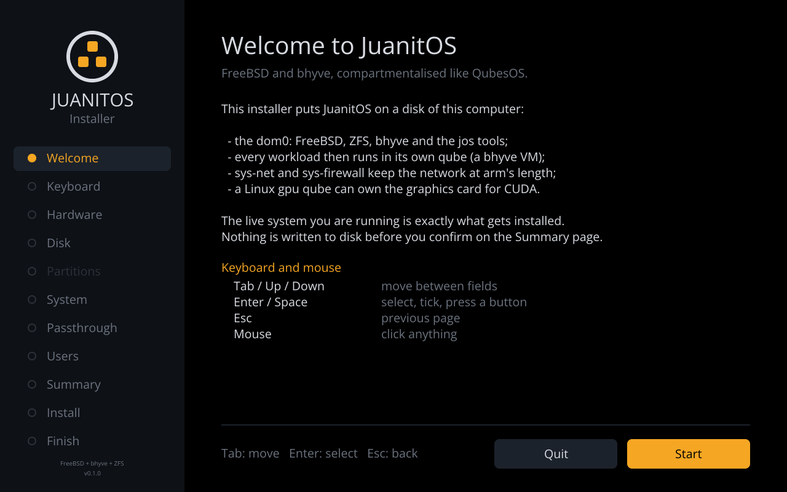 | 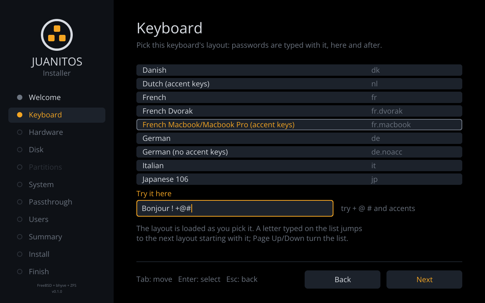 |
| 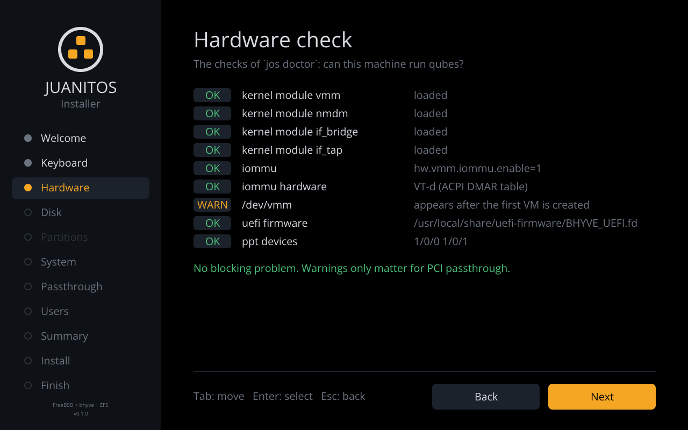 | 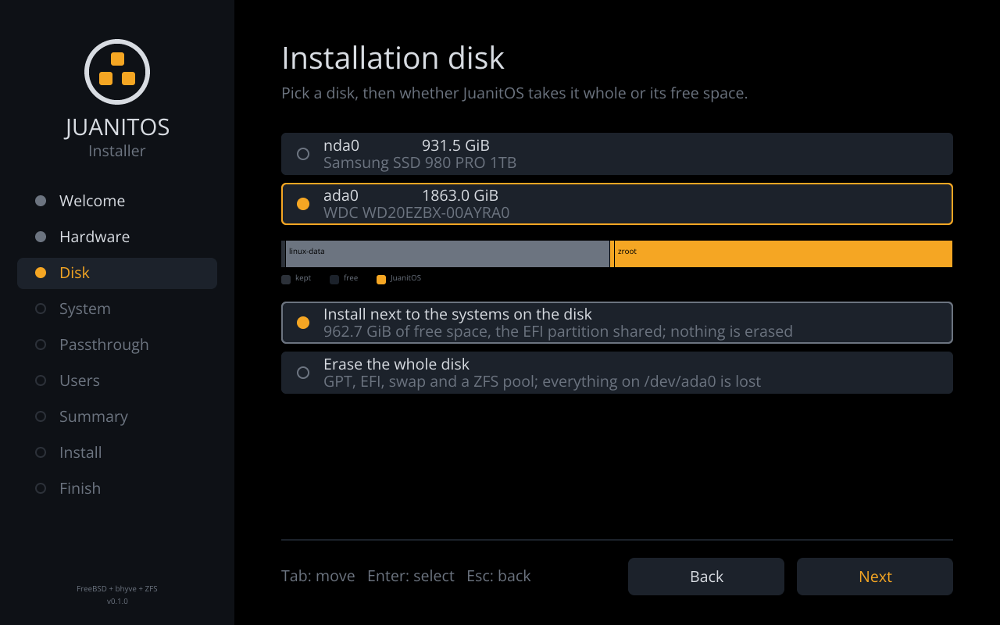 |
| 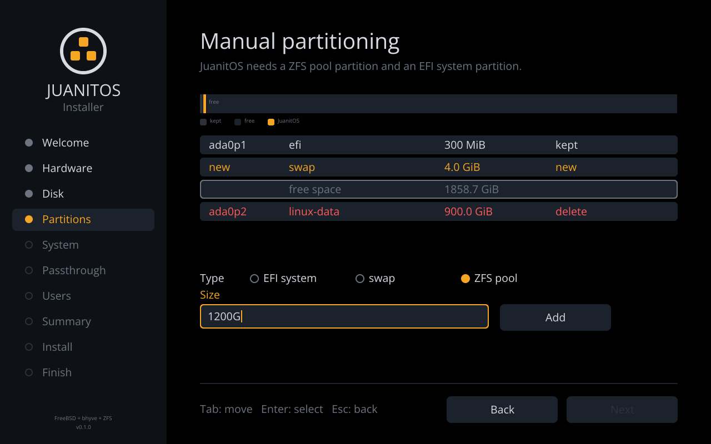 | 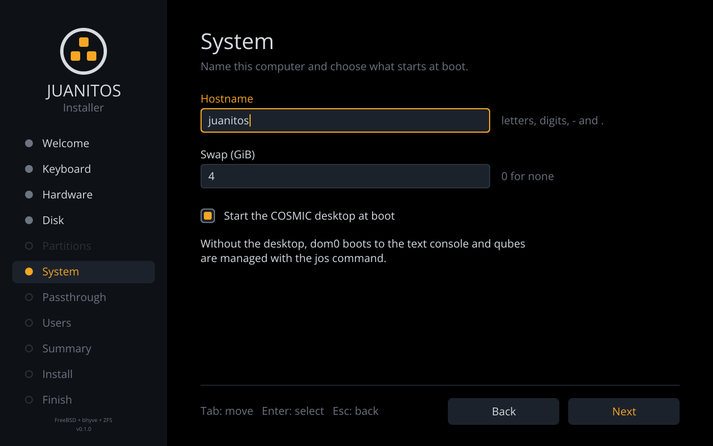 |
| 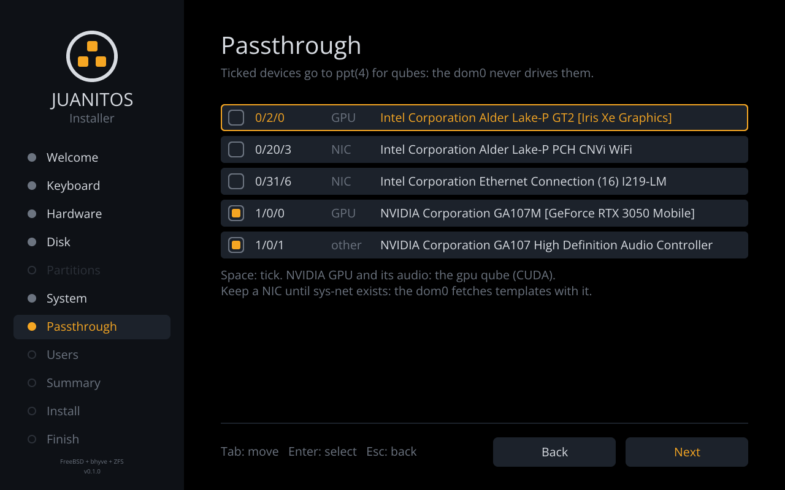 | 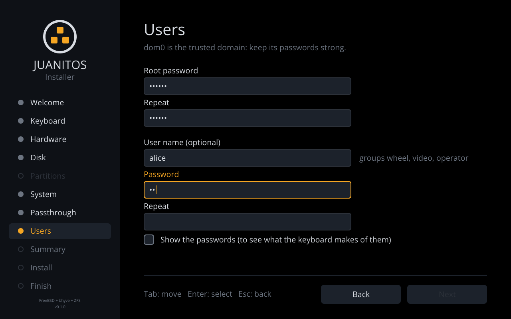 |
| 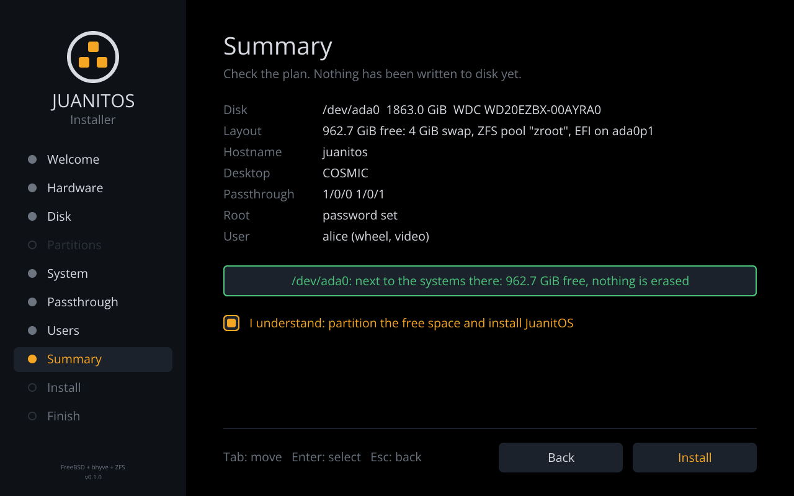 | 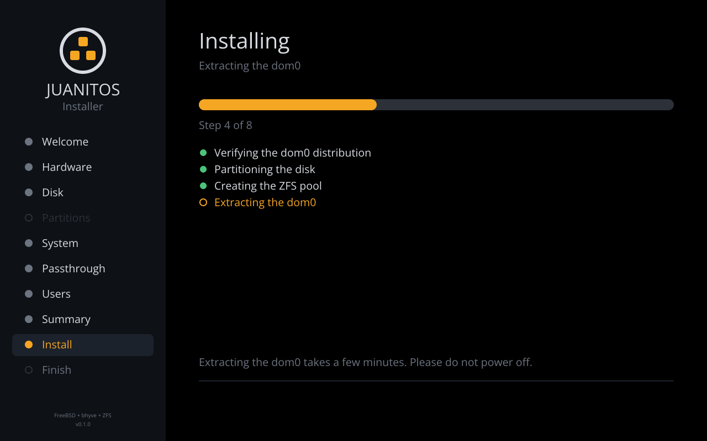 |
| 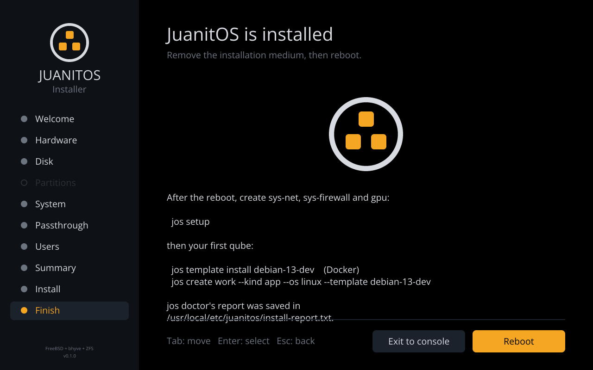 | |

### Keyboard layout

The kernel boots with its built-in `us` keymap, so on any other keyboard
the keys do not say what they type: a password with `+`, `@` or an
accented letter in it, typed into masked fields, is then not the
password the user thinks they set, and the login refuses it. The
**Keyboard** page comes right after Welcome for that reason. It lists
the console keymaps of `/usr/share/vt/keymaps` (from kbdmap(1)'s
`INDEX.keymaps`, English descriptions, sorted) with `us` preselected;
`Up`/`Down` and `Page Up`/`Page Down` move through the list, a letter
jumps to the next layout starting with it, and every change is loaded
at once (`kbdcontrol -l`, on `/dev/ttyv0`: the keymap belongs to the
keyboard, which every terminal shares). The field under the list shows
what the layout makes of the keys, and the **Users** page has a "Show
the passwords" box for the same purpose.

The choice goes into the installed system's `rc.conf` as
`keymap="fr.macbook"`, which `rc.d/syscons` loads at boot before the
login screen starts (`rc.d/jos-login` requires `syscons`), so the login
screen on `ttyv8` reads the password with the same layout the installer
did. The login screen also tells the desktop session: it turns the
keymap into XKB names (`fr` with the `mac` variant, `gb` for `uk`,
`nodeadkeys` for `noacc`, ...) and exports `XKB_DEFAULT_LAYOUT` and
`XKB_DEFAULT_VARIANT`, which libxkbcommon reads when the compositor is
given no layout; a layout set in COSMIC's own settings wins. An install
without a keymap line (a text or unattended install without `--keymap`)
exports nothing: `sysrc -n keymap` then answers `NO`, rc.conf's word for
"none", which is not a layout (taken for one, it made `cosmic-comp`
abort at start). The text
front end takes `--keymap NAME` instead of asking (a serial console has
its own keyboard handling).

The **Disk** page lists the disks (the boot medium excluded), then the
selected disk as a bar: the partitions that stay in grey, free space
dark, and what JuanitOS creates (EFI, swap, the pool) in the accent
colour. Below it, three choices:

- **Install next to the systems on the disk**: the largest free area,
  sharing the EFI system partition (see "Next to another system"). It is
  preselected whenever the disk allows it; otherwise it is greyed out
  with the reason (no GPT table, no ESP, less than 16 GiB free, an earlier
  install's labels).
- **Erase the whole disk**: GPT, EFI, BIOS boot, swap and the pool.
- **Partition the disk by hand**: the **Partitions** page, which the
  walk skips otherwise (see "Manual partitioning"). Greyed out on a disk
  whose partition table is not GPT (MBR): erase it instead.

The Summary page then says what happens to the disk: "next to the
systems there: N GiB free, nothing is erased" or "partitions are added,
nothing is erased" (green), "ALL DATA WILL BE ERASED" or "nda0p2, nda0p3
WILL BE DELETED" (red), and its checkbox names the same thing.

### Manual partitioning

The **Partitions** page lists the selected disk in offset order: its
partitions (device, type, size, "kept"), its free areas, the partitions
to create ("new", in the accent colour) and, last and in red, the
partitions to delete. The bar above it shows the disk as it will be. The
button under the list acts on the selected row:

- a partition: **Delete** it, or **Keep** it again once deleted (refused
  while new partitions use its space: remove those first);
- a new partition: **Remove** it;
- a free area: **Add** a partition at its start, of the type (EFI
  system, swap or ZFS pool, as radio buttons) and size given (`260M`,
  `4G`, or a bare number of GiB; empty for the whole area). The type
  starts as the one most likely missing: EFI when the disk keeps no
  ESP, then swap, then the pool.

Next is enabled once the layout has a ZFS pool partition of at least
16 GiB and an EFI system partition, kept (shared with the other
systems, as in "Next to another system") or new. Nothing is resized, and
the labels are the other methods' (`efiboot0`, `swap0`, `zfs0`), so the
installed system is the same whichever way the disk was laid out. Those
labels must not be in use already: an earlier JuanitOS install on the
same disk is replaced by deleting its partitions (a deleted partition
takes its label with it, so its pool can be deleted and a smaller one
added in its place), a kept one that carries a label the layout needs
must go first ("Delete da0p2 first: it is labelled swap0"), and labels
on another disk block the layout. The **System** page has no swap field
then: the swap partition, if any, is the one added here.

The install deletes (`gpart delete -i N`), then creates the new
partitions at the exact offsets shown (`gpart add -b -s`, the new ESP
with `-i` at the lowest free index so the boot entry can name it), and
formats a new ESP; a disk without a partition table gets a GPT one
first. A new ESP gets the default boot file `EFI/BOOT/BOOTX64.EFI` and
a boot entry put first; a kept one is shared as described below. As
next to another system, there is no `freebsd-boot` partition and no
`gpart bootcode`: the disk boots through UEFI only.

The **Passthrough** page lists the GPUs, the NICs (Wi-Fi included) and
the other functions of each GPU's slot (its HDMI audio), as `pciconf`
reports them. Ticked devices end up in `pptdevs` in the new system's
`/boot/loader.conf`, so `ppt(4)` claims them at boot and the dom0 never
drives them. The default selection is the devices already bound to `ppt`
plus, when another GPU is left for the dom0's display, the NVIDIA GPU
and its slot siblings (for the `gpu` qube, see `docs/gpu-passthrough.md`).
Reserving every GPU is allowed but flagged: the dom0 then has no display
of its own. NICs are never ticked by default: until `sys-net` exists the
dom0 needs one to download templates.

Keyboard: `Tab`/`Shift-Tab` or `Up`/`Down` move between fields,
`Up`/`Down` pick a keyboard layout, a disk, a method, a partition, its
type or a device in a list, `Space` ticks a device,
`Enter`/`Space` press buttons and tick boxes, `Esc` goes back. `Enter`
in a field moves to the next one, and on from the last field of a page
(a checkbox after it keeps its default). Fields
filter what they accept (digits for the swap size, digits and `G`/`M`
for a partition size, host-name and
user-name characters), passwords are masked unless "Show the
passwords" is ticked.

Mouse and touchpad: the installer reads `/dev/sysmouse`, where `moused`
publishes every pointing device, and draws its own pointer once the mouse
moves. `rc.conf` runs a single `moused -p auto` (all evdev pointing
devices, hotplug through devd) rather than devd's per-device instances:
devfs sends no events for devices that attach while the kernel is still
cold, so a PS/2 mouse or touchpad never got its own `moused` (seen under
QEMU). On the live medium `rc.local` starts it before the installer:
`rc.d/local` comes before `rc.d/moused` in the boot order, so the mouse
would otherwise only work once the installer exits. A left click focuses and activates what it lands on: it
presses a button, ticks a box, selects a keyboard layout, a disk, a
method, a partition or its type, ticks a device, or puts
the caret in a field (at the nearest character, counted in average
character widths). Without `moused` the installer says so on the console
and stays keyboard-only.

The installation runs on a background thread and reports each step, so
the progress page stays responsive during the long extraction; keys and
clicks during the install are discarded so a stray Enter cannot reboot the
machine on the Finish page. **Exit to console** leaves for a login prompt
(the full log is on `ttyv0`); **Reboot** restarts into the new system.

The code is split so all of it is tested without a screen:

```text
crates/jos-install/src/wizard.rs   pages, fields, focus, validation (pure state machine)
crates/jos-install/src/ui.rs       rendering into a jos-gfx Image (1280x800 logical, integer-scaled)
crates/jos-install/src/gui.rs      event loop: keys and clicks -> wizard, frames -> display, installer thread
crates/jos-fb                      vt(4) framebuffer, keyboard and sysmouse decoders, shared with jos-splash
```

`jos-install --screenshots DIR` renders every page to PNG on any host
(`cargo xtask screenshots` refreshes the ones above).

## Text and unattended installs

Without a framebuffer (serial console, or `--ui text`) the same steps are
asked as line prompts, except the keyboard layout (`--keymap`, see
above). Exit (Ctrl-C or answer no) for a shell; re-run with
`jos-install`. Every answer can be given as a flag, so an unattended
install is:

```sh
jos-install --non-interactive --disk nda0 --hostname lab --swap-gb 8 \
    --keymap fr.macbook \
    --root-password '...' --user alice --user-password '...' \
    --pci 1/0/0 --pci 1/0/1     # or --no-pci; default: as on the Passthrough page
jos-install --non-interactive --disk nda0 --alongside ...   # next to the Linux on nda0
```

## Next to another system

On a UEFI disk that already holds a system, JuanitOS can go into the
free space instead of taking the disk: the graphical installer
preselects it on the Disk page, the text installer asks (yes by
default) once the disk has what that needs, `--alongside` asks for it.
The installer never resizes anything, so make room first with the other
system's tools (GParted on Linux; the free space must be at least 16 GiB
plus the swap, which covers the dom0 and a first template). What the
disk must have, read from `kern.geom.conftxt`:

- a GPT partition table with an EFI system partition (`efi` type): the
  new system shares it;
- no `swap0` or `zfs0` GPT label on any disk, since the new partitions
  get those names (an earlier JuanitOS install has to be removed first);
- a free area of at least 16 GiB, 1 MiB aligned; the largest one is used.

The install then differs from the whole-disk one in three places:

- `gpart add -b <start> -s <size>` creates `swap0` and `zfs0` in the
  free area and nothing else: no partition table, no ESP, no
  `freebsd-boot` partition, no `gpart bootcode` (which writes into
  partition index 2, another system's here). The disk boots through UEFI
  only.
- The existing ESP is mounted by its device (`/dev/nda0p1`, in `fstab`
  too) and gets `EFI/JUANITOS/BOOTX64.EFI` (jos-boot, or FreeBSD's
  loader) next to `EFI/FREEBSD/LOADER.EFI`; `EFI/BOOT` and the other
  systems' directories are left alone.
- The `efibootmgr` entry points at `EFI/JUANITOS/BOOTX64.EFI` and is
  put *last* in the boot order (`efibootmgr -c` puts a new entry first;
  the installer restores the order and appends), so the machine keeps
  booting what it did. JuanitOS is then one firmware boot-menu choice
  away (the key the firmware shows at power-on, F12 on many machines),
  or a GRUB entry on the Linux side:

  ```sh
  # /etc/grub.d/40_custom on the Linux, then update-grub / grub-mkconfig
  menuentry "JuanitOS" {
      insmod part_gpt
      insmod fat
      search --no-floppy --file --set=root /EFI/JUANITOS/BOOTX64.EFI
      chainloader /EFI/JUANITOS/BOOTX64.EFI
  }
  ```

The summary says "next to the systems there: N GiB free, nothing is
erased" in that mode, and the confirmation asks about partitioning the
free space rather than erasing the disk.

## What it does

1. Host checks (see above). Fails hard unless `--ignore-doctor`.
2. Disk selection from `kern.disks` (optical/memory disks filtered out).
   The disk the live system booted from is never offered: the root
   device from `mount -p` is walked down the GEOM tree
   (`kern.geom.conftxt`) to the disk under it, which also finds the stick
   under Ventoy's `ventoy/IMAGE` provider.
3. `gpart`: GPT with `efiboot0` (260 MiB FAT32, p1), `gptboot0`
   (512 KiB `freebsd-boot`, p2), `swap0`, `zfs0`; next to another
   system, only `swap0` and `zfs0` in the free area (above); laid out by
   hand, the deletions and additions of the Partitions page.
4. `zpool create` with `altroot=/mnt`, `compression=lz4`, `atime=off`;
   datasets as `bsdinstall zfsboot` makes them, `bootfs=zroot/ROOT/default`,
   and `zroot/juanitos/{templates,qubes}` via the same code as `jos init`.
5. `tar -xpf juanitos-dom0.txz -C /mnt --unlink` after verifying the sha256,
   then `dist/images/` into `/var/cache/juanitos/images`, where `jos
   setup` finds the template image without the dom0 downloading it.
6. `rc.conf` (`zfs_enable`, `jos_enable`, `seatd`, `dbus`, `jos_login`;
   `jos_kms_module` names the `drm-kmod` driver for the GPU `pciconf`
   reports, loaded by `rc.d/jos-kms` before the boot splash, and
   `jos_kms_fallback="jos_efifb"` the KMS driver on the UEFI frame buffer
   it loads instead when that gives no `/dev/dri/card0`),
   `loader.conf` (with `pptdevs` for the reserved devices), `fstab` (swap + ESP at `/boot/efi`), `zpool.cache`,
   `jos.toml`. The login screen (`jos-greet` on `ttyv8`, see
   `docs/relibc-cosmic.md`) needs no `/etc/ttys` change: that terminal
   has no getty.
7. ESP: `EFI/FREEBSD/LOADER.EFI` from `/boot/loader.efi`, and
   `EFI/BOOT/BOOTX64.EFI` from `/boot/jos-boot.efi` (graphical boot, see
   `docs/boot-splash.md`) or from `loader.efi` when the release has no
   pre-loader, plus `EFI/BOOT/BOOTIA32.EFI` from `/boot/loader_ia32.efi`;
   `efibootmgr` entry on `BOOTX64.EFI` (best effort). BIOS:
   `gpart bootcode -b /boot/pmbr -p /boot/gptzfsboot -i 2`, so the disk
   also boots on firmware without UEFI. Next to another system: its ESP,
   `EFI/JUANITOS/BOOTX64.EFI`, the boot entry last, no BIOS boot code.
8. Root password and first user through `chroot /mnt pw ... -h 0` (the
   password goes over stdin, never argv).

UEFI only; legacy-BIOS disks are out of scope (bhyve-capable machines are
UEFI machines). Installing next to another system needs that system's
disk to be GPT with an ESP, which every UEFI install is.

## Trying it under QEMU

Install `qemu-system-x86` and the OVMF/edk2 firmware package, then:

```sh
jos-release qemu                 # boots release/out/JuanitOS-*.iso, creates a 40 GiB qcow2
jos-release qemu --no-cdrom      # boot what you installed
jos-release qemu --headless      # serial console only (the ISO enables comconsole)
```

For `jos doctor` to pass *inside* the VM the guest needs VT-x: on Linux
enable nested virtualization (`kvm_intel nested=1` / `kvm_amd nested=1`);
`jos-release qemu` passes `-cpu host` by default. QEMU's default machine
has no IOMMU, so `ppt devices` stays a warning in the VM — exactly what
the installer is for: run it on the real box to find out before committing
a disk. `jos-release qemu --iommu` adds an emulated one plus a NIC to pass
through, for developing the passthrough path (`docs/gpu-passthrough.md`).

VirtualBox and others work with the same ISO; enable EFI and nested VT-x in
the VM settings. Docker cannot run FreeBSD; use it only to host QEMU.

## The VirtualBox install test

`jos-release vbox` is the unattended counterpart for VirtualBox, and the
one that takes the graphical path end to end: VirtualBox's own EFI
firmware starts `jos-boot` on a Graphics Output Protocol (VMSVGA with
128 MB of VRAM, which offers modes up to 7680x4320, so the pre-loader's 4K
cap is exercised), the kernel paints its splash, the graphical installer
and later the login screen draw on the framebuffer, the disk is AHCI
(`ada0`) and the keyboard PS/2. The VM's serial port is a local socket the
harness drives like `selfhost` drives QEMU's: it logs in on the live
medium's serial getty (the installer is on the screen), runs
`jos-install --non-interactive ... --disk ada0 --user alice`, reboots,
logs in on the installed dom0 and checks that the kernel got the
framebuffer (`VT(efifb)`), that `jos_vmsvga` drives the display
(`/dev/dri/card0`), that `jos-greet` is up and that `hw.efi.poweroff`
is 0. It then types alice's password on the login screen and waits up to
five minutes for `cosmic-panel`, which only starts once the compositor
runs (the session log is printed if it does not). Finally it powers off
and waits for VirtualBox to report the VM off, which is where the EFI
runtime power-off used to hang (`docs/boot-splash.md`).

```sh
jos-release vbox                       # <work>/vbox: VM, serial.sock, console.log, screenshots
jos-release vbox --keep --vram-mb 32   # leave the VM registered; a smaller VRAM offers 4K at most
jos-release vbox --dry-run             # the VBoxManage calls and the dialogue
```

The VM (`jos-vbox`, 4 CPUs, 6 GB, a 20 GB VDI) is created under `<work>/vbox`
and unregistered with its disk afterwards unless `--keep`; `installer.png`,
`login-screen.png` and `desktop.png` stay as evidence of the graphical
path, next to the serial `console.log`. No nested virtualization is enabled, so the host
checks inside report no VT-x (`--ignore-doctor`). drm-kmod has no driver
for VirtualBox's (or QEMU's) virtual GPUs; JuanitOS ships its own for
VMSVGA, `freebsd/jos_vmsvga`, which the installer selects
(`jos_kms_module="jos_vmsvga"`) so that `cosmic-comp` finds a KMS device
and renders with Mesa's software rasteriser.

## The container test

`jos-release oci` tests the dom0 userland one level further in: as an
OCI image under podman on FreeBSD, where a container is a jail
(`ocijail`). The dom0 tarball is a complete FreeBSD root, so it is the
whole image: `release/oci/Containerfile` is `FROM scratch` plus
`ADD juanitos-dom0.txz /`. On Linux the chain is Linux → QEMU → FreeBSD →
podman → JuanitOS. The FreeBSD VM is the builder's (`jos-release builder
--auto` leaves its disk in `<work>/builder/builder.raw`, serial console
already on); it runs on a qcow2 overlay, so the builder's disk is only
read and stays usable for the next ISO build. In the VM the harness
mounts the repository and `<work>/oci` over 9p, installs `podman-suite`
with a zstd-compressed ZFS dataset for its storage, builds the image,
then runs each check in a fresh container (`--network none`):

- `freebsd-version -u` is the profile's release;
- the dom0 packages are installed and `pkg check -d` finds no missing
  dependency;
- no program in the base or `/usr/local` misses a shared library;
- `jos doctor` runs its host checks (a jail has no `/dev/vmm`, so it
  fails, as expected);
- `jos --dry-run` creates a template and an app qube and plans the
  `bhyve` command line;
- `jos-install --dry-run --non-interactive` plans an install onto the
  VM's first disk;
- alice is created and logs in through PAM with `jos-greet try-login`;
- `jos-splash` renders the boot card;
- every rc script parses and `rcorder` orders them without a complaint.

```sh
jos-release oci                    # the builder's disk and tarball, results in <work>/oci
jos-release oci --keep             # leave <work>/oci/oci.qcow2 with the image in it
jos-release oci --on-host          # on FreeBSD, as root, with podman installed
jos-release oci --dry-run          # the VM, its steps and the podman commands
```

The build context does not stay on the 9p share: buildah reads it there
at a few hundred kilobytes a second, and it unpacks xz in about an hour
where zstd takes six minutes. The VM recompresses the tarball into its
own disk (`xz -dc | zstd`, about three minutes) and passes it with
`--build-arg TARBALL=juanitos-dom0.tar.zst`; the Containerfile's default
is the `.txz`, which is what a build by hand uses. buildah's scratch
files go to the same compressed dataset (`TMPDIR`), not to `/var/tmp`.
Everything the VM writes grows the overlay, which peaks around 13 GB on
the host and is deleted at the end unless `--keep`.

A jail shares its host's kernel: bhyve, KMS, pool creation and the boot
chain are out of its reach and stay with the QEMU, `selfhost` and
VirtualBox tests. What the container adds is a quick, disposable dom0
userland to poke at (`podman run --rm -it localhost/juanitos-dom0` in
the kept VM).

## Building on a Linux box

The build steps call FreeBSD's `tar`, `pkg` and `makefs`, so they run on
FreeBSD — natively or in the builder VM that `jos-release builder` starts
from FreeBSD's official qcow2 image with this repository shared in. See
`docs/bootstrap.md`.
