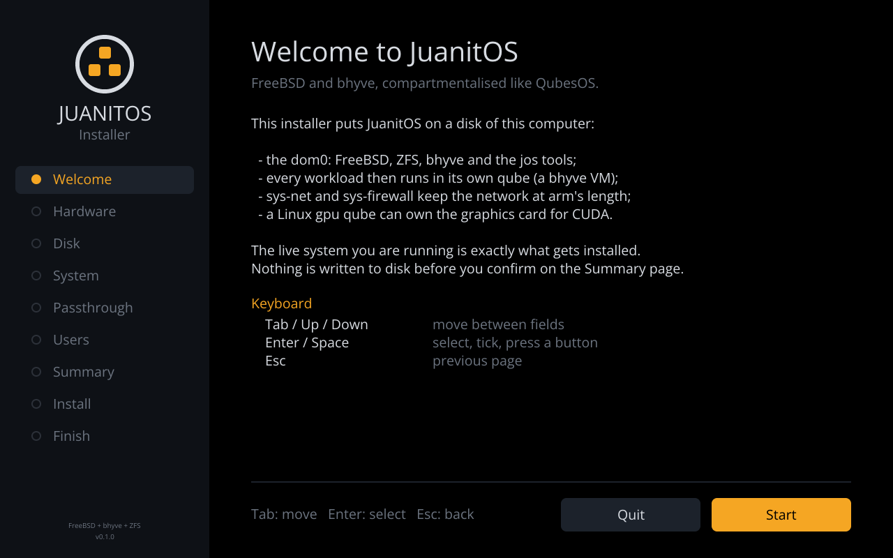
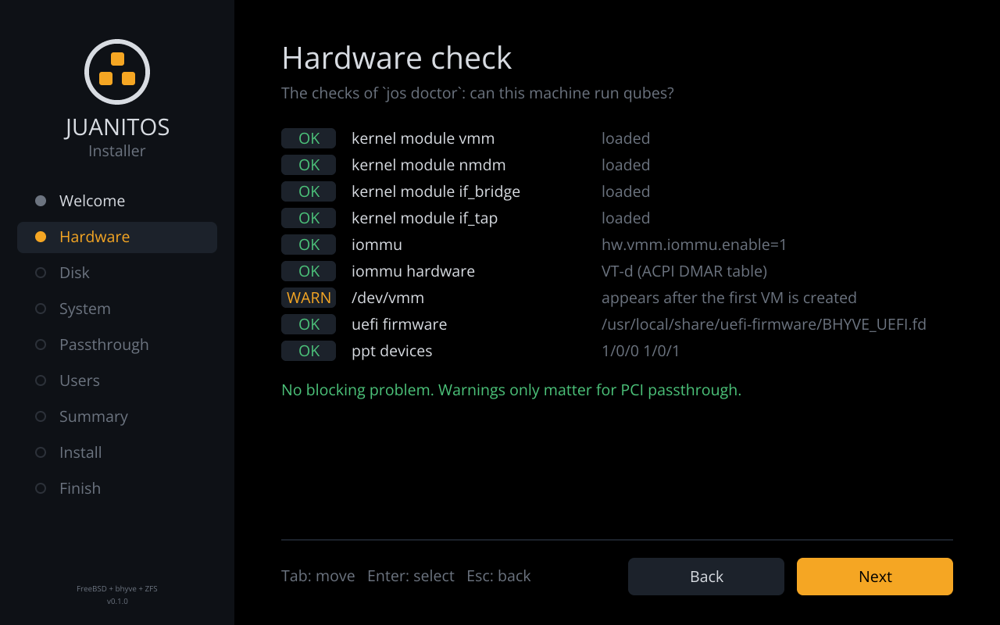
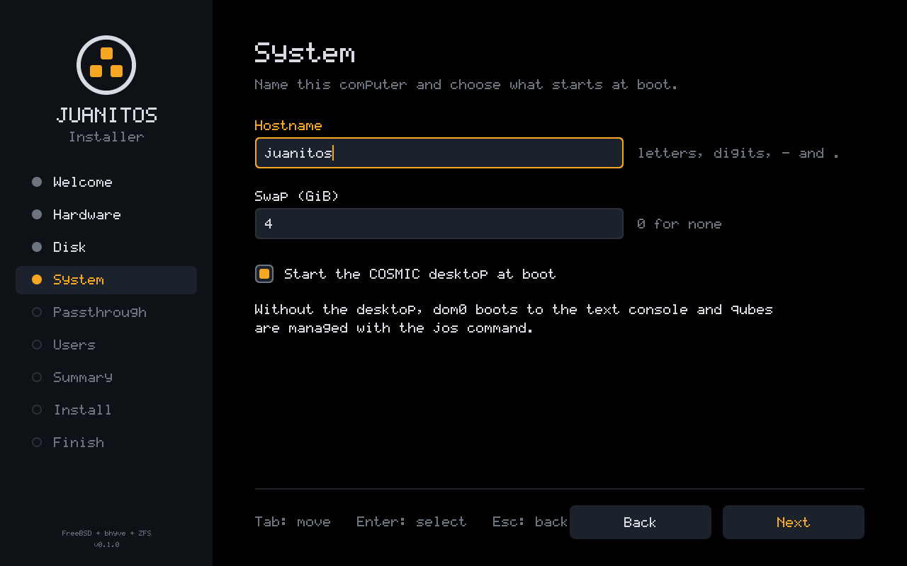
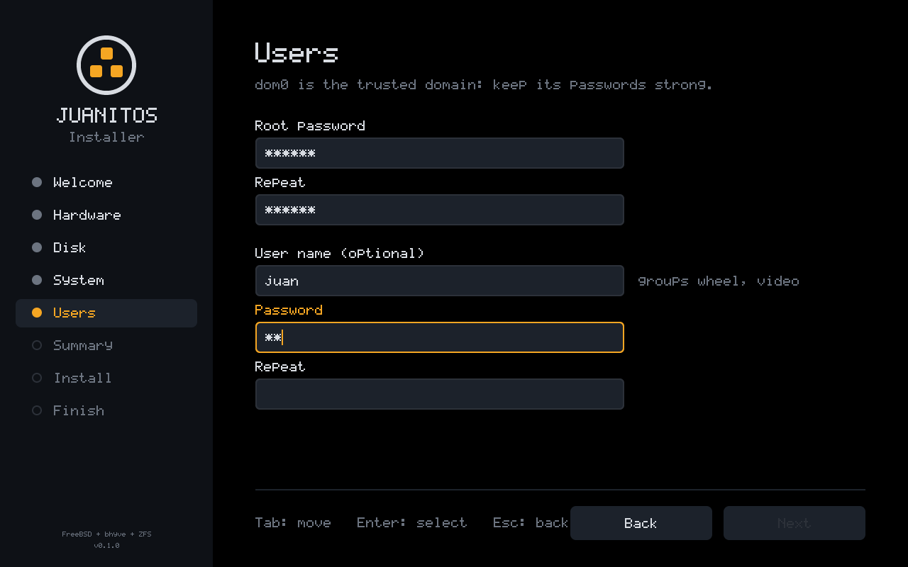
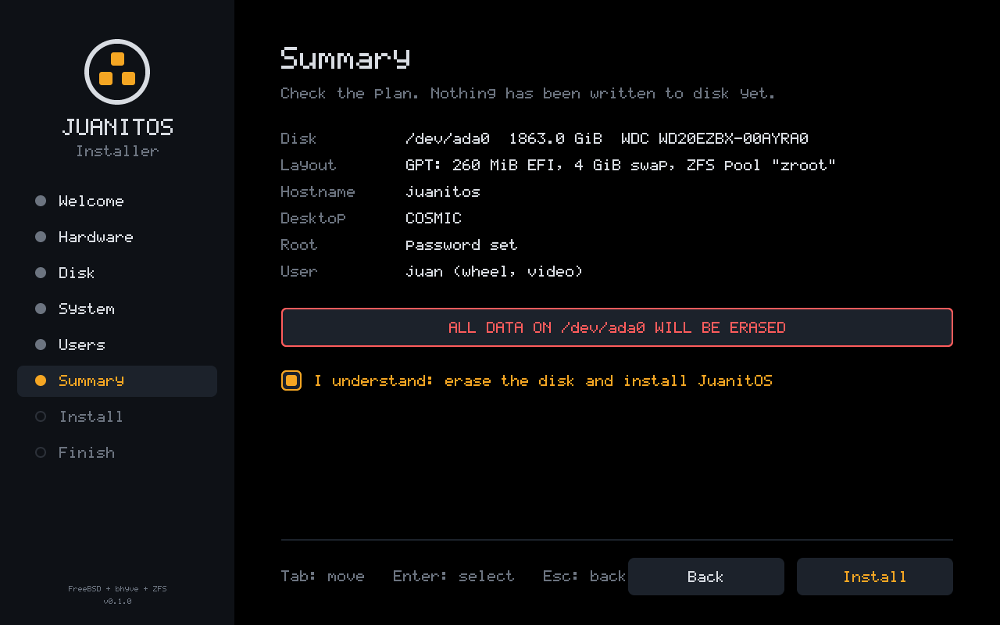
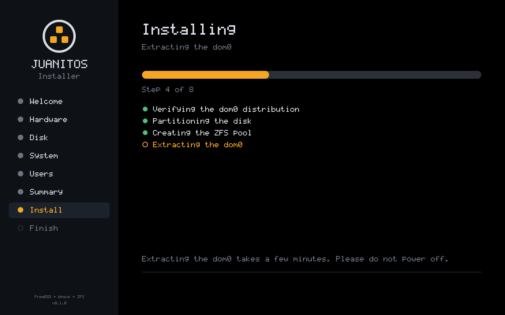
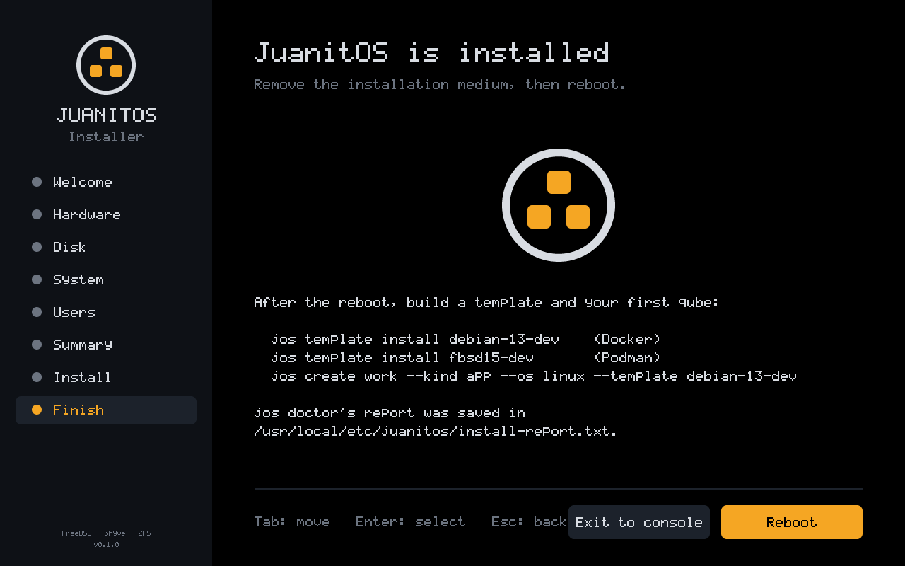

# Install medium and installer

## One dom0, two ways to boot it

`jos-release` builds a single artifact, `juanitos-dom0.txz`: FreeBSD base
and kernel, the dom0 packages and the JuanitOS binaries. The ISO's live
root is that tree extracted, with a small overlay (read-only `fstab`,
`varmfs`/`tmpmfs` in `rc.conf`, an `rc.local` that starts the installer,
a serial+video console). The tarball itself rides along in
`/usr/local/share/juanitos/dist/` with a sha256 `MANIFEST`, and the
installer extracts it onto the new pool.

Because the live system and the installed system come from the same
tarball, what you observe on the live medium — `kldstat` shows `vmm`,
`hw.vmm.iommu.enable=1`, `pciconf` lists `ppt*` devices, COSMIC starts —
is what you get after installing. `jos-install` runs exactly those checks
(`juanitos_core::doctor::run_host_checks`) before touching a disk and
writes the report to `/usr/local/etc/juanitos/install-report.txt` on the
target.

The first check reads the `VT-x:` / `SVM:` line that the kernel prints to
`/var/run/dmesg.boot`. bhyve needs EPT plus unrestricted guest on Intel
(Nehalem, 2008, or later) and nested paging on AMD. A Core 2 therefore
fails this check even though it has VT-x: the medium still boots and
installs, but no qube will start.

## ISO layout

```text
/                         FreeBSD 15.x base + kernel (live root, cd9660)
/boot/loader.conf         vmm/nmdm/if_bridge, hw.vmm.iommu.enable=1, serial console
/etc/rc.conf              root_rw_mount=NO, varmfs, tmpmfs, seatd/dbus
/etc/rc.local             → jos-install --live
/usr/local/bin/           jos, jos-install, jos-release, jos-splash
/usr/local/etc/rc.d/jos   autostart script (disabled on the live medium)
/usr/local/share/juanitos/
    release.toml          version, FreeBSD release, build stage, package list
    loader.conf.sample, sysctl.conf.sample
    dist/juanitos-dom0.txz, dist/MANIFEST
/usr/local/src/juanitos   this repository + vendored crates (stage 2)
El Torito: EFI (efiboot.img: jos-boot.efi as BOOTX64.EFI + EFI/FREEBSD/LOADER.EFI) and, when present, BIOS cdboot
```

## The graphical installer

`rc.local` starts `jos-install --live` once the boot splash has finished.
On a machine with a framebuffer console it opens a full-screen wizard on
`vt(4)` (virtual terminal 10, `--vt` to change it), drawn with the same
font, palette and logo as the boot splash, so the hand-over from boot to
installer is seamless.

The flow borrows from the two installers QubesOS users know:

- **Calamares**: a sidebar of steps walked in order (Welcome, Hardware,
  Disk, System, Users, Summary, Install, Finish), with Back/Next at the
  bottom and Next disabled until the page is valid;
- **Anaconda**: nothing is written to disk before the Summary page, where
  the erase has to be confirmed explicitly; the hardware check comes first,
  so you learn whether the machine can run qubes before choosing a disk.

| | |
|---|---|
|  |  |
|  |  |
|  |  |
|  |  |

Keyboard only (the live medium has no pointer driver in the console):
`Tab`/`Shift-Tab` or `Up`/`Down` move between fields, `Up`/`Down` pick a
disk in the list, `Enter`/`Space` press buttons and tick boxes, `Esc`
goes back. Fields filter what they accept (digits for the swap size,
host-name and user-name characters), passwords are masked.

The installation runs on a background thread and reports each step, so
the progress page stays responsive during the long extraction; keys typed
during the install are discarded so a stray Enter cannot reboot the
machine on the Finish page. **Exit to console** leaves for a login prompt
(the full log is on `ttyv0`); **Reboot** restarts into the new system.

The code is split so all of it is tested without a screen:

```text
crates/jos-install/src/wizard.rs   pages, fields, focus, validation (pure state machine)
crates/jos-install/src/ui.rs       rendering into a jos-gfx Image (1280x800 logical, integer-scaled)
crates/jos-install/src/gui.rs      event loop: keys -> wizard, frames -> display, installer thread
crates/jos-fb                      vt(4) framebuffer + keyboard decoder, shared with jos-splash
```

`jos-install --screenshots DIR` renders every page to PNG on any host
(`cargo xtask screenshots` refreshes the ones above).

## Text and unattended installs

Without a framebuffer (serial console, or `--ui text`) the same steps are
asked as line prompts. Exit (Ctrl-C or answer no) for a shell; re-run with
`jos-install`. Every answer can be given as a flag, so an unattended
install is:

```sh
jos-install --non-interactive --disk nda0 --hostname lab --swap-gb 8 \
    --root-password '...' --user juan --user-password '...'
```

## What it does

1. Host checks (see above). Fails hard unless `--ignore-doctor`.
2. Disk selection from `kern.disks` (optical/memory disks filtered out).
3. `gpart`: GPT with `efiboot0` (260 MiB FAT32), `swap0`, `zfs0`.
4. `zpool create` with `altroot=/mnt`, `compression=lz4`, `atime=off`;
   datasets as `bsdinstall zfsboot` makes them, `bootfs=zroot/ROOT/default`,
   and `zroot/juanitos/{templates,qubes}` via the same code as `jos init`.
5. `tar -xpf juanitos-dom0.txz -C /mnt --unlink` after verifying the sha256.
6. `rc.conf` (`zfs_enable`, `jos_enable`, `seatd`, `dbus`, `jos_login`;
   `kld_list` gains the `drm-kmod` driver for the GPU `pciconf` reports),
   `loader.conf`, `fstab` (swap + ESP at `/boot/efi`), `zpool.cache`,
   `jos.toml`. The login screen (`jos-greet` on `ttyv8`, see
   `docs/relibc-cosmic.md`) needs no `/etc/ttys` change: that terminal
   has no getty.
7. ESP: `EFI/FREEBSD/LOADER.EFI` from `/boot/loader.efi`, and
   `EFI/BOOT/BOOTX64.EFI` from `/boot/jos-boot.efi` (graphical boot, see
   `docs/boot-splash.md`) or from `loader.efi` when the release has no
   pre-loader; `efibootmgr` entry on `BOOTX64.EFI` (best effort).
8. Root password and first user through `chroot /mnt pw ... -h 0` (the
   password goes over stdin, never argv).

UEFI only; legacy-BIOS disks are out of scope (bhyve-capable machines are
UEFI machines).

## Trying it under QEMU

Install `qemu-system-x86` and the OVMF/edk2 firmware package, then:

```sh
jos-release qemu                 # boots release/out/JuanitOS-*.iso, creates a 40 GiB qcow2
jos-release qemu --no-cdrom      # boot what you installed
jos-release qemu --headless      # serial console only (the ISO enables comconsole)
```

For `jos doctor` to pass *inside* the VM the guest needs VT-x: on Linux
enable nested virtualization (`kvm_intel nested=1` / `kvm_amd nested=1`);
`jos-release qemu` passes `-cpu host` by default. QEMU's default machine
has no IOMMU, so `ppt devices` stays a warning in the VM — exactly what
the installer is for: run it on the real box to find out before committing
a disk. `jos-release qemu --iommu` adds an emulated one plus a NIC to pass
through, for developing the passthrough path (`docs/gpu-passthrough.md`).

VirtualBox and others work with the same ISO; enable EFI and nested VT-x in
the VM settings. Docker cannot run FreeBSD; use it only to host QEMU.

## Building on a Linux box

The build steps call FreeBSD's `tar`, `pkg` and `makefs`, so they run on
FreeBSD — natively or in the builder VM that `jos-release builder` starts
from FreeBSD's official qcow2 image with this repository shared in. See
`docs/bootstrap.md`.
