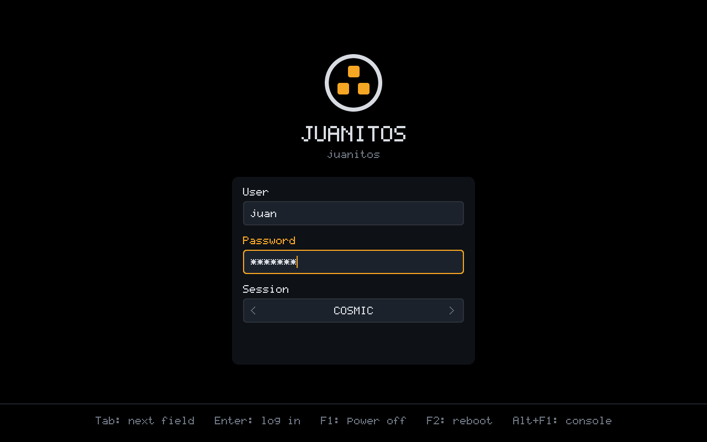
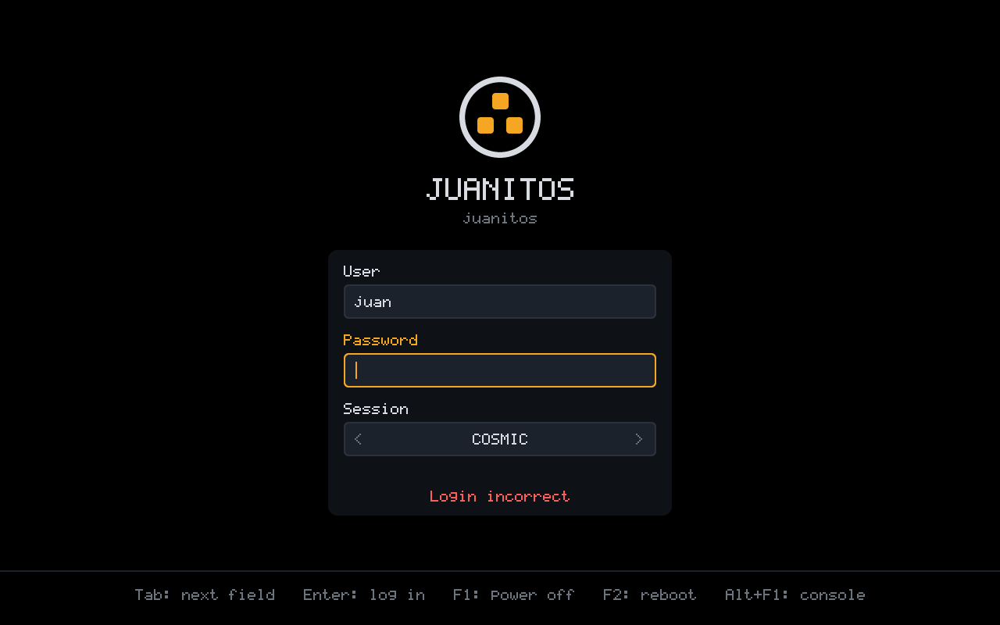

# Relibc, COSMIC and the host/guest libc decision

The README states that JuanitOS uses Relibc instead of glibc or musl and the
COSMIC desktop. This document records how that maps onto the actual stack in
v0.1 and what is deferred.

## Where things run

| Component           | Where          | libc                              |
|---------------------|----------------|-----------------------------------|
| FreeBSD kernel/base | host (dom0)    | FreeBSD libc (unavoidable)        |
| `jos`, `juanitos-core` | host        | Rust `std`; libc-agnostic         |
| COSMIC desktop      | host           | FreeBSD libc via ports (Rust apps)|
| FreeBSD guests      | app/net/fw qubes | FreeBSD libc                    |
| Linux guests        | app/gpu qubes  | glibc (Debian; NVIDIA's CUDA stack is only validated there) |
| Redox guests        | app qubes (`redox` template) | **Relibc** — Redox's own libc, the whole userland is built on it |

## Why Relibc is not on the host (yet)

Relibc is a Rust libc written for Redox; its Linux support exists mainly to
build and test Redox userland. It has **no FreeBSD target**. Replacing
FreeBSD's libc would mean either porting Relibc's platform layer to FreeBSD
syscalls (a significant project) or rebuilding the base system around it,
which conflicts with staying close to stock FreeBSD / HardenedBSD / TrueNAS
Core tooling that the project wants to lean on.

Decision for v0.1:

- The **host stays on FreeBSD libc**. COSMIC is built from source against
  it (`tools/dev/cosmic-build.sh`, below) and packaged with `pkg`.
- Our own tooling is pure Rust on `std` and deliberately avoids libc-specific
  behaviour, so it is ready to be rebuilt against Relibc when a target exists.
- **Relibc-based userland lives inside guests, as Redox OS.** Rather than
  grafting Relibc onto a Linux rootfs, the Relibc template is Redox itself:
  the `redox` recipe (`jos template install redox`, `docs/templates.md`)
  installs the upstream `server` nightly, whose every program — `init`,
  the drivers, `ion`, `coreutils` — is linked against Relibc. The CUDA
  `gpu` qube uses a conventional glibc distribution because NVIDIA's driver
  and toolkit are only validated there.

## Redox as a guest: where it stands

`jos` knows Redox as `--os redox`: such qubes get an NVMe disk and an
e1000 NIC (bhyve's virtio is the legacy transport Redox's drivers do not
speak). The nightly boots on bhyve with the UEFI bootrom to the serial
login, gets a DHCP lease on the e1000 and answers `jos run` (which logs
in as Redox's password-less `user` and speaks `ion`'s dialect). What is
missing is a display: bhyve's `fbuf` framebuffer makes bhyve assert when
Redox's `pcid` programs it, so Redox qubes are console-only for now.
`docs/templates.md` has the details.

## Future goals

1. A Redox `desktop` recipe once bhyve's `fbuf` and Redox's `pcid` get
   along (today bhyve asserts in its BAR registration when Redox programs
   the framebuffer device); Orbital in a qube window is the natural
   COSMIC integration target.
2. Evaluate a Relibc FreeBSD port (platform layer: `src/platform/`), starting
   with what `jos` and COSMIC actually need.
3. Redox's own package manager (`pkg`) inside the qube for a Redox
   development template, mirroring `debian-13-dev` and `fbsd15-dev`.

## COSMIC notes

COSMIC is Rust (iced + smithay); its systemd and logind integration is
behind cargo features, so it runs in dom0 on the FreeBSD host once those
are switched off. FreeBSD has no COSMIC packages: the ports tree only
carries `x11-wm/cosmic-comp` at `epoch-1.0.0` (unmaintained since late
2025, no binary package for 15.x), nothing for the session, panel,
applets or applications, and no `greetd` at all. JuanitOS therefore
builds COSMIC itself.

| Need                 | Linux usual     | FreeBSD host                          |
|----------------------|-----------------|---------------------------------------|
| compositor + shell   | `cosmic-*`      | built from `pop-os/cosmic-epoch` (`epoch-1.10.0`) by `tools/dev/cosmic-build.sh`, shipped as a local `pkg` repository |
| KMS drivers          | kernel          | `graphics/drm-kmod`; the installer adds `amdgpu`/`i915kms` to `kld_list` from `pciconf` |
| seat / VT handling   | `logind`        | `sysutils/seatd` (+ `libseat`)         |
| desktop IPC          | `dbus`          | `devel/dbus`                           |
| login                | `cosmic-greeter`| `jos-greet` (Rust, `crates/jos-greet`) on `ttyv8`; `cosmic-greeter` needs greetd |
| audio (optional)     | PipeWire        | `multimedia/pipewire` or none in dom0  |

### Building the packages

`tools/dev/cosmic-build.sh` runs inside the FreeBSD build VM
(`tools/dev/freebsd-vm.sh`, a stock 15.1 under QEMU/KVM) as root:

```sh
tools/dev/freebsd-vm.sh scp freebsd tools/dev/cosmic-build.sh root@127.0.0.1:/root/
tools/dev/freebsd-vm.sh ssh freebsd ./cosmic-build.sh all   # deps fetch patch build package repo
tools/dev/freebsd-vm.sh scp freebsd -r root@127.0.0.1:/root/cosmic/repo target/work/cosmic/
```

It clones `cosmic-epoch` with its submodules (minus the git-lfs
wallpapers), applies the portability fixes, then builds every component
with `--release` into one shared target directory. Components whose
default features are Linux-only get them switched off: `cosmic-comp` and
`cosmic-session` (`systemd`, `logind`), `cosmic-notifications` and
`xdg-desktop-portal-cosmic` (journald). `cosmic-greeter` (greetd),
`cosmic-store` (flatpak, systemd scopes) and the wallpapers are not
built. Each component is staged with its own `just install` recipe (with
GNU `install`/`sed`/`ln`/`xargs` on the path, which the recipes assume;
`/usr/bin` in session scripts and desktop entries becomes
`/usr/local/bin`) and turned into a package named after it, version
`1.10.0`, origin `juanitos/<name>`; `pkg repo` writes the catalogue.

The fixes (`tools/dev/cosmic-patches/`, applied by `cosmic-build.sh
patch` to the checkout and to cargo's registry/git copies, which cargo
does not verify after download):

| Where | What |
|-------|------|
| `cosmic-comp` | `/sys` is not sysfs (`/compat/linux/sys`, as the old port did) |
| `fontdb` | `fonts.conf` lives under `/usr/local/etc` |
| `libdisplay-info-sys` | accept libdisplay-info 0.4 (FreeBSD ships 0.4.0; the 0.3 API is a subset) |
| libcosmic (iced fork) | drop a stale BSD-only block with an old winit API, give the BSDs the Linux Wayland code paths; older pinned revisions gate everything Wayland on `target_os = "linux"` and are rewritten wholesale |
| `cosmic-panel` | abstract unix sockets for the security context are Linux-only; a socket file under `XDG_RUNTIME_DIR` elsewhere |
| `cosmic-applets` | the bluetooth applet (bluer) is Linux-only |
| `pop-launcher` | pidfd is Linux-only (tokio's `Child::wait` instead); plugins and config under `/usr/local` |
| `pipewire`, `pipewire-sys` | FreeBSD renames `pw_init` to `pipewire_init` (libc has a `pw_init`); the bindgen allowlist missed it |
| `ddc-hi` | its i2c backend is only a dependency on Linux but was enabled on every unix |
| `nix` 0.30/0.31 | libc 0.2.190 dropped FreeBSD's `NOTE_PCTRLMASK` |

All 26 components of the tag build and package this way (2026-10-15,
FreeBSD 15.1-RELEASE, rust 1.98.1, about 3 hours on 10 vCPUs for the
first build; `target/` reaches 45 GB).

`release/juanitos.toml` points `[packages] local_repo` at the copied
repository and `repo = "latest"` at the package branch the VM built
against (the shared libraries must match). `jos-release rootfs` copies
the repository into the root at `/usr/local/share/juanitos/pkg`, enables
it through `/usr/local/etc/pkg/repos/juanitos.conf` and installs the
components best-effort; the installed system keeps the repository, so
`pkg install cosmic-player` works offline later.

### Login

`rc.conf` enables `seatd_enable`, `dbus_enable` and `jos_login_enable`;
`jos` runs independently of all of it. The login screen is `jos-greet`,
a JuanitOS binary built on the same `jos-fb`/`jos-gfx` stack as the boot
splash and the installer, so boot, install and login look like one
product:

|  |  |
|---|---|

- `rc.d/jos-login` runs it under daemon(8) (restarted if it dies) on
  `ttyv8` (VT 9, Alt+F9), the terminal FreeBSD's stock `/etc/ttys`
  leaves `off`, so no getty competes and nothing is edited; `ttyv0`
  (Alt+F1) keeps its text login. `rc.d/jos-splash-finish` runs just
  before it and leaves the boot picture up until the greeter switches.
- The user field is pre-filled with the first account of uid ≥ 1000
  (Left/Right cycles), the session list comes from
  `/usr/local/share/wayland-sessions/*.desktop` (COSMIC's
  `cosmic.desktop`; COSMIC if there is none). F1/F2 pressed twice power
  off/reboot.
- Authentication is OpenPAM, service `jos-greet`
  (`/etc/pam.d/jos-greet`: `login`'s policy without `pam_self`, which
  would let root, the greeter's own uid, in without a password); root
  and `nologin` accounts are refused, and a refused password costs two
  seconds.
- The session: `pam_setcred` + `pam_open_session`, then
  `/var/run/user/<uid>` (mode 700, owned by the user) as
  `XDG_RUNTIME_DIR`, and a child that calls `setsid` and
  `setusercontext(3)` (groups, login class, umask, `setlogin`, uid —
  what login(1) does) and execs `/usr/local/libexec/jos-session
  <Exec=>` with a clean environment (`HOME`, `PATH`, `XDG_SESSION_TYPE=wayland`,
  `XDG_CURRENT_DESKTOP`, `XDG_VTNR`, ... plus PAM's). Before that the
  greeter puts its terminal back in text mode *without* switching away,
  so seatd hands that VT to the compositor. Output goes to
  `/var/run/user/<uid>/jos-session.log`; when the session ends the
  greeter comes back and shows its exit status if it failed.
- Not done: utmpx/wtmp records (`who`, `last` do not see graphical
  logins) and a lock screen (COSMIC's `cosmic-greeter` locker needs
  greetd too).

Verified in the FreeBSD 15.1 build VM (QEMU VGA, efifb 1280×800):
`rc.d/jos-login` brings the greeter up on VT 9; a wrong password shows
"Login incorrect"; the right one runs the session as the user (uid,
`video` group, umask 022, home, the environment above,
`/var/run/user/<uid>` mode 700) on VT 9 with its output in the log; a
missing `start-cosmic` comes back as "COSMIC exited with status 127";
after a session the greeter redraws and says the user logged out; root
and unknown users are refused (`jos-greet try-login --user NAME --
COMMAND` exercises PAM and the session setup without the screen). The
COSMIC session itself still needs real hardware, as above.

`jos-greet screenshots DIR` renders the screen on any host;
`jos-greet run --dry-run` on a FreeBSD console accepts any non-empty
password and starts nothing, to try the UI.

What has been verified: the packages build, `jos-release rootfs` in the
build VM installs the 23 of `dom0::GUI_PACKAGES` (the rest of the 26,
`cosmic-viewer`, `cosmic-monitor`, `cosmic-player`, `cosmic-osk`,
`cosmic-initial-setup`, stay in the shipped repository for `pkg
install`) together with `drm-kmod` and the X/Mesa run-time into
the dom0 root, and `cosmic-comp` starts on FreeBSD up to "Failed to
acquire session". Running the compositor needs a seat and a KMS device,
which neither the QEMU build VM nor bhyve provide to a FreeBSD guest
(`drm-kmod` has no virtio-gpu driver), so the first COSMIC session has
to be on real hardware — a stage-1 ISO on the StarBook is the planned
test.

On the host COSMIC is the *management* UI only: the long-term plan is a
`jos`-backed applet (qube list, start/stop, colour labels) and
window-forwarding from guests, similar to Qubes' GUI daemon. Nothing in
v0.1 depends on COSMIC; `jos` is fully usable from a TTY.
