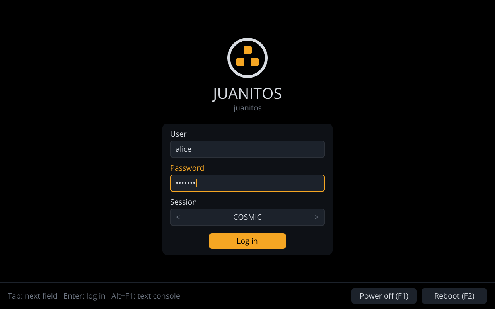
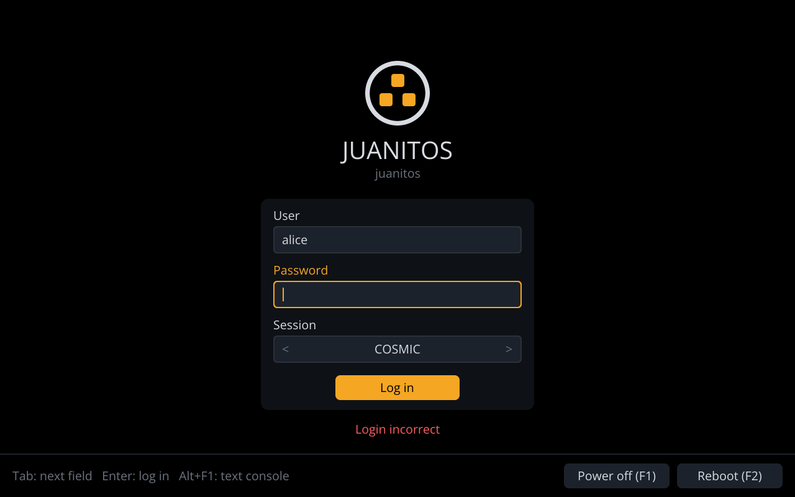
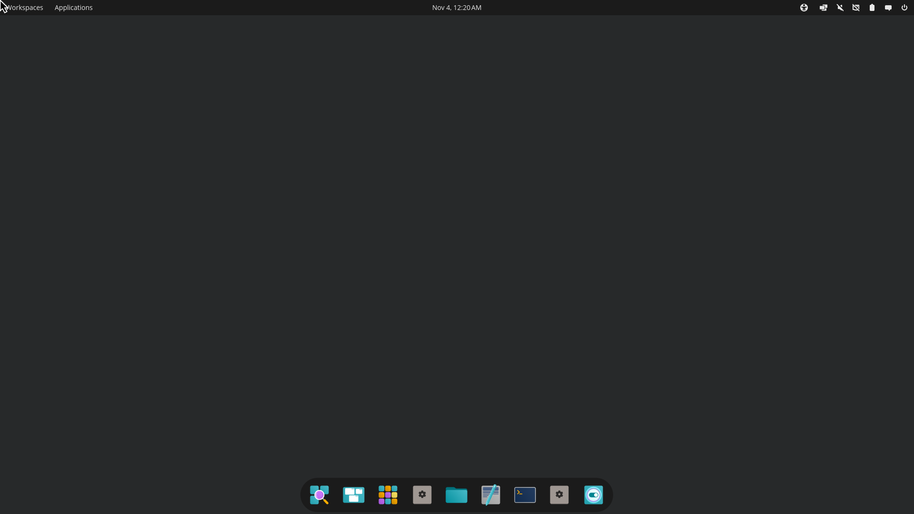
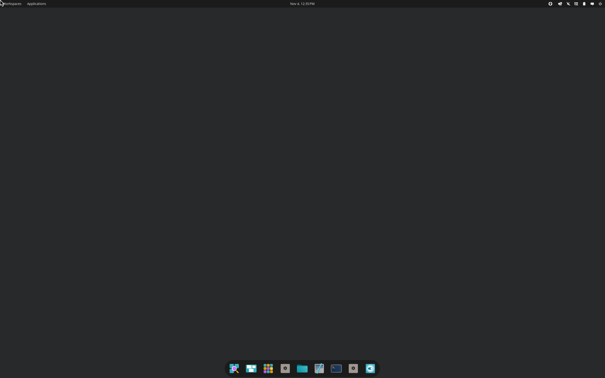

<!-- SPDX-License-Identifier: BSD-3-Clause -->
# Relibc, COSMIC and the host/guest libc decision

The README states that JuanitOS uses Relibc instead of glibc or musl and the
COSMIC desktop. This document records how that maps onto the actual stack in
v0.1 and what is deferred.

## Where things run

| Component           | Where          | libc                              |
|---------------------|----------------|-----------------------------------|
| FreeBSD kernel/base | host (dom0)    | FreeBSD libc (unavoidable)        |
| `jos`, `juanitos-core` | host        | Rust `std`; libc-agnostic         |
| COSMIC desktop      | host           | FreeBSD libc via ports (Rust apps)|
| FreeBSD guests      | app/net/fw qubes | FreeBSD libc                    |
| Linux guests        | app/gpu qubes  | glibc (Debian; NVIDIA's CUDA stack is only validated there) |
| Redox guests        | app qubes (`redox` template) | **Relibc** — Redox's own libc, the whole userland is built on it |

## Why Relibc is not on the host (yet)

Relibc is a Rust libc written for Redox; its Linux support exists mainly to
build and test Redox userland. It has **no FreeBSD target**. Replacing
FreeBSD's libc would mean either porting Relibc's platform layer to FreeBSD
syscalls (a significant project) or rebuilding the base system around it,
which conflicts with staying close to stock FreeBSD / HardenedBSD / TrueNAS
Core tooling that the project wants to lean on.

Decision for v0.1:

- The **host stays on FreeBSD libc**. COSMIC is built from source against
  it (`tools/dev/cosmic-build.sh`, below) and packaged with `pkg`.
- Our own tooling is pure Rust on `std` and deliberately avoids libc-specific
  behaviour, so it is ready to be rebuilt against Relibc when a target exists.
- **Relibc-based userland lives inside guests, as Redox OS.** Rather than
  grafting Relibc onto a Linux rootfs, the Relibc template is Redox itself:
  the `redox` recipe (`jos template install redox`, `docs/templates.md`)
  installs the upstream `server` nightly, whose every program — `init`,
  the drivers, `ion`, `coreutils` — is linked against Relibc. The CUDA
  `gpu` qube uses a conventional glibc distribution because NVIDIA's driver
  and toolkit are only validated there.

## Redox as a guest: where it stands

`jos` knows Redox as `--os redox`: such qubes get an NVMe disk and an
e1000 NIC (bhyve's virtio is the legacy transport Redox's drivers do not
speak). The nightly boots on bhyve with the UEFI bootrom to the serial
login, gets a DHCP lease on the e1000 and answers `jos run` (which logs
in as Redox's password-less `user` and speaks `ion`'s dialect). What is
missing is a display: bhyve's `fbuf` framebuffer makes bhyve assert when
Redox's `pcid` programs it, so Redox qubes are console-only for now.
`docs/templates.md` has the details.

## Future goals

1. A Redox `desktop` recipe once bhyve's `fbuf` and Redox's `pcid` get
   along (today bhyve asserts in its BAR registration when Redox programs
   the framebuffer device); Orbital in a qube window is the natural
   COSMIC integration target.
2. Evaluate a Relibc FreeBSD port (platform layer: `src/platform/`), starting
   with what `jos` and COSMIC actually need.
3. Redox's own package manager (`pkg`) inside the qube for a Redox
   development template, mirroring `debian-13-dev` and `fbsd15-dev`.

## COSMIC notes

COSMIC is Rust (iced + smithay); its systemd and logind integration is
behind cargo features, so it runs in dom0 on the FreeBSD host once those
are switched off. FreeBSD has no COSMIC packages: the ports tree only
carries `x11-wm/cosmic-comp` at `epoch-1.0.0` (unmaintained since late
2025, no binary package for 15.x), nothing for the session, panel,
applets or applications, and no `greetd` at all. JuanitOS therefore
builds COSMIC itself.

| Need                 | Linux usual     | FreeBSD host                          |
|----------------------|-----------------|---------------------------------------|
| compositor + shell   | `cosmic-*`      | built from `pop-os/cosmic-epoch` (`epoch-1.10.0`) by `tools/dev/cosmic-build.sh`, shipped as a local `pkg` repository |
| KMS drivers          | kernel          | `graphics/drm-kmod`; the installer sets `jos_kms_module` to `amdgpu`/`i915kms` from `pciconf` (`rc.d/jos-kms` loads it before the boot splash), with `jos_efifb` on the UEFI frame buffer as the fallback |
| seat / VT handling   | `logind`        | `sysutils/seatd` (+ `libseat`)         |
| desktop IPC          | `dbus`          | `devel/dbus`                           |
| login                | `cosmic-greeter`| `jos-greet` (Rust, `crates/jos-greet`) on `ttyv8`; `cosmic-greeter` needs greetd |
| audio (optional)     | PipeWire        | `multimedia/pipewire` or none in dom0  |

### Building the packages

`tools/dev/cosmic-build.sh` runs inside the FreeBSD build VM
(`tools/dev/freebsd-vm.sh`, a stock 15.1 under QEMU/KVM) as root:

```sh
tools/dev/freebsd-vm.sh scp freebsd tools/dev/cosmic-build.sh root@127.0.0.1:/root/
tools/dev/freebsd-vm.sh ssh freebsd ./cosmic-build.sh all   # deps fetch patch build package repo
tools/dev/freebsd-vm.sh scp freebsd -r root@127.0.0.1:/root/cosmic/repo target/work/cosmic/
```

It clones `cosmic-epoch` with its submodules (minus the git-lfs
wallpapers), applies the portability fixes, then builds every component
with `--release` into one shared target directory. Components whose
default features are Linux-only get them switched off: `cosmic-comp` and
`cosmic-session` (`systemd`, `logind`), `cosmic-notifications` and
`xdg-desktop-portal-cosmic` (journald). `cosmic-greeter` (greetd),
`cosmic-store` (flatpak, systemd scopes) and the wallpapers are not
built. Each component is staged with its own `just install` recipe (with
GNU `install`/`sed`/`ln`/`xargs` on the path, which the recipes assume;
`/usr/bin` in session scripts and desktop entries becomes
`/usr/local/bin`) and turned into a package named after it, version
`1.10.0`, origin `juanitos/<name>`; `pkg repo` writes the catalogue.

The fixes (`tools/dev/cosmic-patches/`, applied by `cosmic-build.sh
patch` to the checkout and to cargo's registry/git copies, which cargo
does not verify after download):

| Where | What |
|-------|------|
| `cosmic-comp` | `/sys` is not sysfs (`/compat/linux/sys`, as the old port did) |
| `fontdb` | `fonts.conf` lives under `/usr/local/etc` |
| `libdisplay-info-sys` | accept libdisplay-info 0.4 (FreeBSD ships 0.4.0; the 0.3 API is a subset) |
| libcosmic (iced fork) | drop a stale BSD-only block with an old winit API, give the BSDs the Linux Wayland code paths; older pinned revisions gate everything Wayland on `target_os = "linux"` and are rewritten wholesale |
| `cosmic-panel` | abstract unix sockets for the security context are Linux-only; a socket file under `XDG_RUNTIME_DIR` elsewhere |
| `cosmic-session` | not FreeBSD-specific: it waits forever for the compositor's environment when `cosmic-comp` exits first (no display or GPU), so the greeter never gets the exit status; it now exits with an error |
| `cosmic-applets` | the bluetooth applet (bluer) is Linux-only; the power applet's own shut down and restart (its fallback when `cosmic-osd` cannot start) run shutdown(8) instead of logind |
| `cosmic-osd` | the shut down and restart confirmed in its dialog went through logind's `PowerOff`/`Reboot`, which FreeBSD has not, so nothing happened; `shutdown -p now` / `shutdown -r now` instead, which root and the `operator` group may run (the installer puts its user there) |
| `pop-launcher` | pidfd is Linux-only (tokio's `Child::wait` instead); plugins and config under `/usr/local` |
| `pipewire`, `pipewire-sys` | FreeBSD renames `pw_init` to `pipewire_init` (libc has a `pw_init`); the bindgen allowlist missed it |
| `ddc-hi` | its i2c backend is only a dependency on Linux but was enabled on every unix |
| `nix` 0.30/0.31 | libc 0.2.190 dropped FreeBSD's `NOTE_PCTRLMASK` |

All 26 components of the tag build and package this way (2026-10-15,
FreeBSD 15.1-RELEASE, rust 1.98.1, about 3 hours on 10 vCPUs for the
first build; `target/` reaches 45 GB). Rebuilding a few components after
a patch does not need the whole set: on a fresh VM, `deps`, `fetch`,
`patch`, then `build` and `package` of `cosmic-applets` and `cosmic-osd`
took half an hour on 8 vCPUs (2026-11-10, 15 GB of disk). The other
packages come from the repository the current dom0 tarball carries
(`tar -xJf juanitos-dom0.txz --strip-components=6
./usr/local/share/juanitos/pkg`), copied into `repo/` before `package`
and `repo` so the catalogue lists all 26 again.

`release/juanitos.toml` points `[packages] local_repo` at the copied
repository and `repo = "latest"` at the package branch the VM built
against (the shared libraries must match). `jos-release rootfs` copies
the repository into the root at `/usr/local/share/juanitos/pkg`, enables
it through `/usr/local/etc/pkg/repos/juanitos.conf` and installs the
components best-effort; the installed system keeps the repository, so
`pkg install cosmic-player` works offline later.

### Login

`rc.conf` enables `seatd_enable`, `dbus_enable` and `jos_login_enable`;
`jos` runs independently of all of it. The login screen is `jos-greet`,
a JuanitOS binary built on the same `jos-fb`/`jos-gfx` stack as the boot
splash and the installer, so boot, install and login look like one
product:

|  |  |
|---|---|

- `rc.d/jos-login` runs it under daemon(8) (restarted if it dies) on
  `ttyv8` (VT 9, Alt+F9), the terminal FreeBSD's stock `/etc/ttys`
  leaves `off`, so no getty competes and nothing is edited; `ttyv0`
  (Alt+F1) keeps its text login. `rc.d/jos-splash-finish` runs just
  before it and leaves the boot picture up until the greeter switches,
  and `rc.d/syscons` before that, so the console keymap the installer
  chose (`keymap=` in `rc.conf`) is loaded before the password is typed.
  The same keymap, as XKB names (`juanitos_core::keyboard::xkb_for`),
  goes to the session as `XKB_DEFAULT_LAYOUT`/`XKB_DEFAULT_VARIANT`,
  which the compositor's libxkbcommon reads unless COSMIC's settings
  name a layout.
- The user field is pre-filled with the first account of uid ≥ 1000
  (Left/Right cycles), the session list comes from
  `/usr/local/share/wayland-sessions/*.desktop` (COSMIC's
  `cosmic.desktop`; COSMIC if there is none). F1/F2 pressed twice power
  off/reboot; the *Power off* and *Reboot* buttons want a second click
  the same way.
- Mouse and touchpad work as in the installer: the greeter reads
  `/dev/sysmouse` (`moused` is up by then) and draws its own pointer
  once the mouse moves; a click focuses a field, turns the session (`<`
  goes back, the rest of the box on), presses *Log in* or a power
  button. Without `moused` it says so on the console and stays
  keyboard-only.
- Alt+F1 shows the text console; Alt+F9 comes back. vt(4) repaints the
  terminal it switches to (blank cells, border) whatever its mode, so
  the greeter presents its frame again for a second once it sees its
  terminal back on screen (`VT_GETACTIVE` polled every tick,
  `Display::needs_redraw` in `crates/jos-fb`), and does the same when it
  opens on a terminal that was on screen already — after a session, when
  the GPU driver restores the console mode and the kernel repaints it
  some time later. While another terminal is on screen it draws nothing.
- Authentication is OpenPAM, service `jos-greet`
  (`/etc/pam.d/jos-greet`: `login`'s policy without `pam_self`, which
  would let root, the greeter's own uid, in without a password); root
  and `nologin` accounts are refused, and a refused password costs two
  seconds.
- The session: `pam_setcred` + `pam_open_session`, then
  `/var/run/user/<uid>` (mode 700, owned by the user) as
  `XDG_RUNTIME_DIR`, and a child that calls `setsid` and
  `setusercontext(3)` (groups, login class, umask, `setlogin`, uid —
  what login(1) does) and execs `/usr/local/libexec/jos-session
  <Exec=>` with a clean environment (`HOME`, `PATH`, `XDG_SESSION_TYPE=wayland`,
  `XDG_CURRENT_DESKTOP`, `XDG_VTNR`, ... plus PAM's). Before that the
  greeter puts its terminal back in text mode *without* switching away,
  so seatd hands that VT to the compositor. Output goes to
  `/var/run/user/<uid>/jos-session.log`; when the session ends the
  greeter comes back and shows its exit status if it failed.
- Not done: utmpx/wtmp records (`who`, `last` do not see graphical
  logins) and a lock screen (COSMIC's `cosmic-greeter` locker needs
  greetd too).

Verified in the FreeBSD 15.1 build VM (QEMU VGA, efifb 1280×800):
`rc.d/jos-login` brings the greeter up on VT 9; a wrong password shows
"Login incorrect"; the right one runs the session as the user (uid,
`video` group, umask 022, home, the environment above,
`/var/run/user/<uid>` mode 700) on VT 9 with its output in the log; a
missing `start-cosmic` comes back as "COSMIC exited with status 127"; a
session whose compositor cannot start (no KMS device) ends with status 1
and `the compositor exited before it was ready` in the log, where it used
to hang: the greeter shows "COSMIC exited with status 1 (log: …)" a few
seconds after the password (checked in QEMU with the stage-1 ISO); after a session the greeter redraws and says the user logged out; root
and unknown users are refused (`jos-greet try-login --user NAME --
COMMAND` exercises PAM and the session setup without the screen). The
The COSMIC session itself needs a KMS device, see below.

`jos-greet screenshots DIR` renders the screen on any host;
`jos-greet run --dry-run` on a FreeBSD console accepts any non-empty
password and starts nothing, to try the UI.

What has been verified: the packages build, `jos-release rootfs` in the
build VM installs the 23 of `dom0::GUI_PACKAGES` (the rest of the 26,
`cosmic-viewer`, `cosmic-monitor`, `cosmic-player`, `cosmic-osk`,
`cosmic-initial-setup`, stay in the shipped repository for `pkg
install`) together with `drm-kmod` and the X/Mesa run-time into
the dom0 root, and `cosmic-comp` starts on FreeBSD up to "Failed to
acquire session". Running the compositor needs a seat and a KMS device.
`drm-kmod` has no driver for any virtual GPU (virtio-gpu included), so
JuanitOS has its own for the VMware SVGA II device that VirtualBox
(VMSVGA) and QEMU (`-vga vmware`) emulate, `freebsd/jos_vmsvga`: a plain
frame buffer KMS driver without a render node, so `jos-session` sets
`GBM_ALWAYS_SOFTWARE=1` and Mesa renders in software. In VirtualBox
(VMSVGA, `jos-release vbox`) logging in on `jos-greet` brings up the whole
COSMIC session: `cosmic-comp`, the panel and dock, the launcher, the app
library, the workspaces view, notifications and the settings daemon
(`desktop.png` of that run):



`drm-kmod` has no simpledrm or efidrm either, so a GPU it does not drive
(too new for it, firmware missing, an attach that fails) would leave the
compositor without a KMS device. On top of the same KMS code
(`freebsd/jos_kmsfb`), `freebsd/jos_efifb` drives the frame buffer the
UEFI firmware left on screen: the installer writes
`jos_kms_fallback="jos_efifb"` next to `jos_kms_module`, and
`rc.d/jos-kms` loads it when the driver gives no `/dev/dri/card0` within a
few seconds (or when there is no driver to load). `jos-session` sets
`GBM_ALWAYS_SOFTWARE=1` whenever there is no render node, so COSMIC runs
as on VMSVGA, with the limits of a fallback: the firmware's resolution on
the monitor it lit, rendering on the CPU, UEFI boots only, and a reboot
before a driver installed later can take the display over. `jos doctor`
reports it as a warning. In QEMU with `-vga std` and OVMF (no drm-kmod
driver for that device), the installed dom0 falls back on it and runs
the same session at the firmware's 2560x1600:



PipeWire is not running (the settings daemon retries it). On real
hardware (a laptop with an Intel GPU, `i915kms`, installed to an
external disk) the session comes up and the desktop works; what does
not yet:

- **Power menu.** Shut down and restart did nothing (logind calls, see
  the `cosmic-osd` and `cosmic-applets` patches above). The two packages
  were rebuilt with the patches and the repository the ISO ships carries
  them since 2026-11-10 (in QEMU, the panel's power button, its "Shut
  down now?" dialog and Confirm power the machine off); the user has to
  be in `operator`
  (`pw groupmod operator -m <user>` on an existing install; the installer
  does it now). An install made from an earlier ISO keeps the old
  binaries: the version did not change, so `pkg upgrade` sees nothing;
  replace `/usr/local/share/juanitos/pkg` with the newer medium's copy
  and `pkg install -f cosmic-applets cosmic-osd`, or reinstall. Until
  then, log out and use the login screen's Power off (F1) and Reboot
  (F2).
- **Tiling.** On the laptop the tiling applet's "Tile current
  workspace" and the Tiled/Floating choice for new workspaces left the
  windows floating. Not reproduced: in QEMU (the `jos_efifb` session
  above, a fresh account, the same packages) `Super+Y` tiles two
  terminals and floats them again, the applet's toggle tiles them and
  writes `autotile` (`true`), and with "Tiled" chosen the two terminals
  opened on a second workspace are tiled from the start. So the
  compositor, the applet's privileged socket and the config watcher work
  on FreeBSD; what differs on the laptop is open. Candidates are state
  an older session left in `~/.config/cosmic/com.system76.CosmicComp/v1/`
  and the applet's connection failing there; the log lines below tell
  which, and `rm -r ~/.config/cosmic/com.system76.CosmicComp` followed by
  a new login tests the first. How the applet reaches the compositor:
  it does not talk to it over the panel's display
  but over a second, privileged socket: the panel creates a
  `wp_security_context_v1` listener (the socket file under
  `XDG_RUNTIME_DIR` from the `cosmic-panel` patch), connects to it and
  passes that connection as `X_PRIVILEGED_WAYLAND_SOCKET`. Only a client
  on that socket sees the `ext_workspace_manager_v1` /
  `zcosmic_workspace_manager_v2` globals the toggle needs. When the
  listener cannot be made, the applet falls back to `WAYLAND_SOCKET`,
  the panel's own embedded display, which has no workspace globals: the
  toggle then flips in the menu and nothing happens, without a message.
  So look in `/var/run/user/<uid>/jos-session.log` for "Failed to
  initialize security context manager" or "Failed to create a listener"
  (panel side), and for "Workspaces subscription failed" (applet side:
  its workspace thread died, for example because the compositor never
  accepted the connection). The new-workspace choice goes the other way
  round, written to `~/.config/cosmic/com.system76.CosmicComp/v1/autotile`
  and picked up by `cosmic-comp` through the `notify` crate (kqueue on
  FreeBSD): if that file changes but only a new login tiles the
  windows, the watcher is the problem. Two things that look suspicious
  in the sources are not it: the compositor polls the listener's close
  pipe for reading on its write end, which does fire on FreeBSD because
  its pipes are bidirectional (EOF when the panel drops the other end,
  the same signal Linux gives as an error event); and a
  `cosmic-panel-sc-*` socket file is left behind per applet start
  because the panel takes the stream and listener out of the context
  right after `commit`, so the patched `Drop` has no path to remove. The
  leak is harmless.

On the host COSMIC is the *management* UI only: the long-term plan is a
`jos`-backed applet (qube list, start/stop, colour labels) and
window-forwarding from guests, similar to Qubes' GUI daemon. Nothing in
v0.1 depends on COSMIC; `jos` is fully usable from a TTY.
