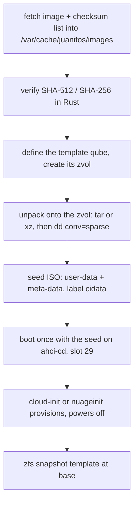

# Guest templates

QubesOS ships TemplateVMs; app qubes run on top of them and are thrown
away or kept, while software is installed once, in the template. JuanitOS
does the same with ZFS: a template is a zvol under
`zroot/juanitos/templates/`, snapshotted as `@base`, and every app qube
is a `zfs clone` of that snapshot (instant, and sharing blocks until it
diverges).

Templates are built **on the host, from the distributions' own cloud
images**, so the only things downloaded are Debian's, FreeBSD's and
Redox's official artifacts, checked against their published checksums.

## The development templates

| recipe          | base                                         | containers                                  | user                             |
|-----------------|----------------------------------------------|---------------------------------------------|----------------------------------|
| `debian-13-dev` | Debian 13 "trixie" `generic` image           | Docker Engine 26, Compose v2, Buildx (Debian's packages) | `user`, sudo without password, in group `docker` |
| `fbsd15-dev`    | FreeBSD 15.1 `BASIC-CLOUDINIT` ZFS image     | Podman 5 + Buildah (`podman-suite`, `ocijail` runtime, ZFS storage, pf NAT, Linux emulation) | `user` in `wheel`, `doas` without password |
| `fbsd15-net`    | FreeBSD 15.1 `BASIC-CLOUDINIT` ZFS image     | none: this is `sys-net` (DHCP client upstream, dnsmasq DHCP/DNS + pf NAT downstream), see [below](#the-network-template) | `user` in `wheel`, `doas` without password |
| `redox`         | Redox OS `server` nightly (Relibc userland)  | none; experimental, see [below](#the-redox-template) | Redox's `user` / `root:password` |

The two development templates also get git, curl, jq, tmux, vim, htop and a toolchain (Debian:
`build-essential`, Python; FreeBSD: Rust, Python), and land in a shell on
the serial console, so `jos console <qube>` just works. The console is
only reachable from dom0, which is why no password is set — the same
trade-off as QubesOS's passwordless `user`.

```sh
jos template recipes                       # what can be built
jos template install debian-13-dev         # ~5 min: fetch, verify, write, provision, @base
jos template install fbsd15-dev            # ~8 min

jos create web  --kind app --os linux   --template debian-13-dev
jos create jail --kind app --os freebsd --template fbsd15-dev
jos start web && jos console web
user@web:~$ docker run --rm hello-world

user@jail:~ $ doas podman run --rm --os=linux docker.io/library/alpine cat /etc/alpine-release
```

Each clone boots under its own name: the templates ship the **guest
agent** (`templates/agent/`, embedded in every `user-data` as
`/usr/local/etc/rc.d/jos_agent` on FreeBSD and `jos-agent.service` on
Debian), which mounts the qube's dom0 share on `/mnt/jos` early in the
boot and sets the hostname from the name dom0 wrote there. That share is
also where `jos copy` delivers files (`docs/inter-qube.md`). The Redox
template has no agent (no 9p client), so Redox clones keep the
template's hostname.

`--name` installs a recipe under another name (several variants side by
side), `--disk-gb` sizes the zvol (default 40 GiB, sparse; the guest
grows its file system on first boot), `--no-boot` stops before
provisioning. A dom0 without network installs from a USB stick with
`--image FILE --checksums FILE`, and `--uplink IFACE` provisions through
a host NIC before any `sys-net` exists (the dom0 bridges the interface
into `bru-IFACE`, shared by every qube using that uplink).

## How `jos template install` works



- The recipes live in `templates/<recipe>/user-data` (plain
  `#cloud-config`, readable and editable) and are compiled into `jos`;
  the catalogue (image URLs, checksum lists, sizes) is
  `crates/juanitos-core/src/template.rs`.
- A corrupt or tampered download fails verification and is deleted from
  the cache; a verified one is reused by later installs.
- The provisioning boot is a *maintenance boot* (`Vm::maintain`): it
  follows guest reboots (up to 5) and returns when the guest powers off.
  Follow it live with `jos console <template>`.
- Templates are network clients of the default NetVM (they get an address
  from `sys-firewall` like any qube) because provisioning and updates need
  the network; they are never started otherwise.
- App qubes never re-run provisioning: Debian's template disables
  cloud-init at the end, and FreeBSD's nuageinit only runs on `firstboot`.
  Debian's clones still need a network: cloud-init's own netplan file
  matches the NIC by the MAC address of the provisioning boot, so the
  recipe replaces it with `10-jos.yaml` (DHCP on `en*`), and writes the
  hostname to `/etc/hosts` (`manage_etc_hosts: localhost`), without
  which every `sudo` waits on a DNS lookup of the qube's name.
- Debian's `generic` image, not `genericcloud`: the cloud kernel has no
  9p support, and the share would be unreachable.
- A recipe without `user-data` (Redox has no cloud-init) skips the seed
  and the boot: the verified image *is* the template. A recipe whose
  file name changes with every build (Redox nightlies carry a date)
  holds a `*` in its URL, resolved against the checksum list, which is
  fetched first anyway.

## The network template

`sys-net` is the qube that owns the physical NIC (or, without IOMMU, the
host interface bridged in with `--uplink`) and gives `sys-firewall` its
upstream. The `fbsd15-net` recipe builds it from the same FreeBSD image
as `fbsd15-dev`: `gateway_enable`, `pf` for NAT, `dnsmasq` as DHCP server
and DNS forwarder (Quad9 / Cloudflare upstream) on the downstream side,
`10.138.0.0/24` with the qube at `.1`.

Which interface is which depends on how the qube was created, so a small
rc script (`josnet`, written by the recipe, runs before `netif`) decides
it at every boot: with two or more interfaces the highest-numbered
`vtnet` is the downstream tap and everything else is an upstream on DHCP
(`em0` from passthrough, or `vtnet0` from `--uplink`); a lone interface
is an upstream, which is what a template maintenance boot gets. It
writes `/etc/rc.conf.d/network`, `/etc/pf.conf` and `dnsmasq.conf`
accordingly.

```sh
jos template install fbsd15-net
jos create sys-net --kind net --os freebsd --template fbsd15-net --pci 5/0/0 --autostart
jos create sys-firewall --kind firewall --os unikernel --netvm sys-net --autostart \
    --kernel /usr/local/share/juanitos/jos-firewall.img
```

Verified on bhyve (dom0 under nested KVM, `--uplink vtnet0` instead of
`--pci`): `sys-net` boots with `vtnet0` on DHCP and `vtnet1` at
`10.138.0.1`, pf's NAT rule loaded and dnsmasq listening; the Rust
`sys-firewall` unikernel takes a lease from it (`upstream bound:
10.138.0.35 via 10.138.0.1`); an app qube `work` cloned from
`fbsd15-dev` gets `10.137.0.8` from the unikernel, pings the firewall,
the world (`ttl=253`: two hops) and fetches `https://www.freebsd.org/`
through DNS forwarded along the chain; with `jos firewall policy work
deny` plus `allow udp any 53` and `allow tcp any 443`, ping and HTTP
are dropped and HTTPS still works.

## The Redox template

Redox OS is the operating system Relibc was written for, so a Redox qube
is the natural "Relibc-based guest" (`docs/relibc-cosmic.md`). The
`redox` recipe installs the `server` nightly from
`static.redox-os.org` (SHA-256 verified; the 0.9.0 release hangs in its
NVMe driver on bhyve, the nightly does not). Redox qubes are the one case
where `jos` does not use virtio: Redox's virtio drivers need the modern
(1.0) transport, bhyve only emulates the legacy one, so `--os redox`
qubes get an **NVMe** disk and an **e1000** NIC, in the same PCI slots.

What works today (nightly 2026-10-13, bhyve on FreeBSD 15.1 with the
`BHYVE_UEFI` bootrom): the Redox UEFI bootloader finds RedoxFS on the
NVMe disk, the kernel and its drivers start (`nvmed`, `e1000d`, `pcid`,
`acpid`), `init` switches root, the login prompt appears on the serial
console and accepts input, and the e1000 gets a DHCP lease and pings its
gateway. `jos run` works too, with two Redox particularities handled in
`console.rs`: the stock image has no autologin, so `jos run` logs in as
the password-less `user` when it meets the `login:` prompt (`--login
root:password` for root); and `ion` on a serial console has no job
control, so commands are started as background jobs and ion's own
`exited with N` report is the end marker. The first `jos run` on a
freshly booted Redox qube takes a few seconds longer (login).

```sh
jos create rx --kind app --os redox --template redox --uplink vtnet0
jos start rx
jos run rx uname -a          # Redox redox 0.5.12 ... x86_64 Redox
jos run rx ping -c 1 10.0.2.2
```

What does not work: a display. bhyve's `fbuf` device trips an assertion
in bhyve's PCI BAR registration (`pci_emul.c`, `modify_bar_registration`)
when Redox's `pcid` programs it, which kills the VM; so Redox qubes are
console-only until that is fixed on one side or the other, and the
`desktop` image is not offered as a recipe. Redox's 0.9.0 release hangs
in its NVMe driver on bhyve, hence the nightly.

## Updating a template

```sh
jos template run debian-13-dev     # boots it; update from `jos console debian-13-dev`, then power off
jos template snapshot debian-13-dev 2026-10    # new clones start from this snapshot
```

Existing app qubes keep their own clone; recreate them (or keep data in a
separate disk) to pick up the new snapshot, as with QubesOS StandaloneVMs
vs AppVMs.

## Verified

Both development recipes were provisioned from the real images under
QEMU/KVM with the same unpacking, the same seed ISO and the same
virtio/AHCI devices as the bhyve command `jos` builds:

- `debian-13-dev`: cloud-init 25.1 applied the seed and powered off after
  about 2.5 minutes; on the next boot `user` is in `docker`, Docker 26.1,
  Compose 2.26 and Buildx 0.13 are installed, `docker` and `containerd`
  are active, `docker run hello-world` pulls, cloud-init is disabled.
- `fbsd15-dev`: nuageinit ran the script once (about 5 minutes) and
  powered off; on the next boot (15.1-RELEASE-p4 after `pkg upgrade`)
  Podman 5.8 and Buildah 1.43 report `ocijail` and the `zfs` driver, pf
  and fdescfs are up, and `podman run --os=linux alpine` works with
  Linux emulation.

Two FreeBSD details that the boot test caught, now handled in the recipe:
the image uses pkgbase, so `pkg upgrade` can install a newer kernel and
kernel modules must not be loaded in that same boot; and nuageinit's
script runs as long as `/firstboot` exists, which `/etc/rc` only removes
at the very end of a boot, so the recipe removes it before powering off.

On bhyve itself (the JuanitOS dom0 running nested under KVM, the image
handed over on a USB stick):

```sh
jos template install fbsd15-dev --uplink vtnet0 \
    --image /media/usb/FreeBSD-15.1-RELEASE-amd64-BASIC-CLOUDINIT-zfs.raw.xz \
    --checksums /media/usb/CHECKSUM.SHA256
jos create jail --kind app --os freebsd --template fbsd15-dev --uplink vtnet0
jos start jail && jos run jail podman version
```

provisioned the FreeBSD template over the dom0's NIC (nuageinit, `pkg`,
power-off, `@base`) and the clone boots to the autologin shell on
`nmdm`; `jos run` types commands there and returns their exit status
(`jos run jail "sh -c 'exit 7'"` exits 7). The guest agent was added to
the same template afterwards with `jos template run fbsd15-dev` (the
script delivered by `jos copy`, enabled, powered off, `jos template
snapshot fbsd15-dev agent`): a fresh clone `test` came up as
`test`, with `/mnt/jos` mounted, and `syslog` shows the agent's work
(`virtio_p9fs0: Mount tag: jos`). One p9fs oddity: the mount does not
appear in `mount` or `df` output on 15.1, although it is there.
The Debian template was installed on the same dom0 from the `generic`
image (the first attempt with `genericcloud` booted fine but had no 9p
in its kernel, hence the switch) and a clone `web` booted as `web`
with the share mounted by `jos-agent.service`, an address from
`sys-firewall` over netplan, HTTPS reaching `deb.debian.org`, Docker
pulling `hello-world`, and `jos-copy` exchanging files with the FreeBSD
qubes under the policy (`docs/inter-qube.md`). The Redox recipe was
installed the same way (`jos template install redox --image ...
--checksums ...`, SHA-256 verified, no provisioning boot), `rx` cloned
from it boots on bhyve, logs in, pings its gateway and answers `jos run`
as described above.

One detail of `jos run` that the bhyve test caught: the host side of an
`nmdm` pair is a tty, and in its default cooked mode its line discipline
*echoes the guest's output back to the guest as input* (the guest shell
then tries to run its own prompt). `jos run` puts the device in raw mode
first, as `cu` does; the pseudo-terminal test in `crates/jos/tests`
reproduces the echo and checks it.
